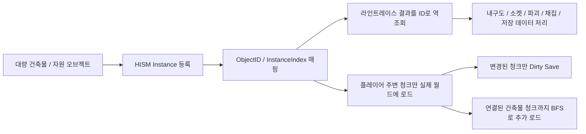
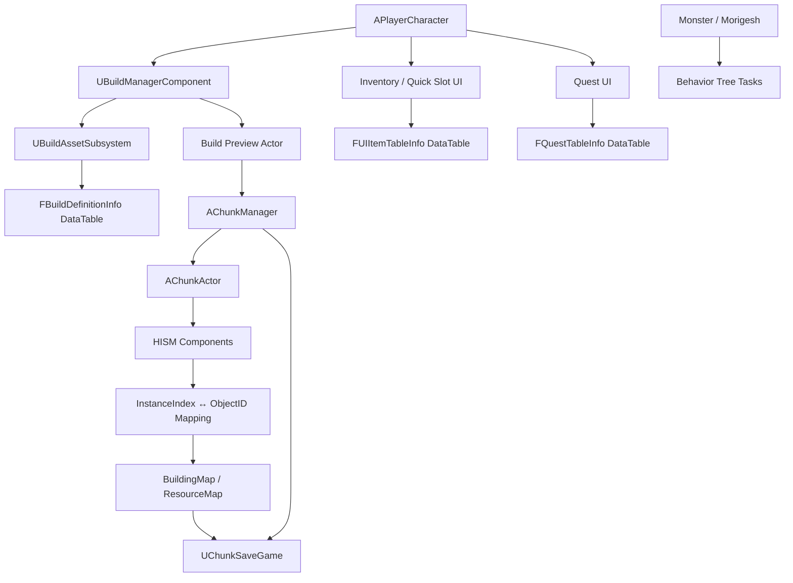

[README_final_edited.md](https://github.com/user-attachments/files/27805011/README_final_edited.md)
# Survival Game - Unreal Engine C++ 클라이언트 포트폴리오

> Unreal Engine C++ 기반의 3D 생존/액션 게임 클라이언트 프로젝트입니다.  
> 월드에 대량으로 존재하는 건축물과 자원 오브젝트를 **HISM 기반 청크 시스템**으로 관리하고, **ID / InstanceIndex 매핑**, **플레이어 위치 기반 청크 스트리밍**, **Dirty Chunk 저장/로드**, **DataTable 기반 건축·아이템·퀘스트 시스템**, **AI 전투 시스템**을 구현했습니다.

---

<a id="table-of-contents"></a>
## 목차

- [1. 프로젝트 개요](#overview)
- [2. 핵심 기술 요약](#tech-summary)
- [3. 주요 기능 요약](#feature-summary)
- [4. 시스템 구조](#system-architecture)
- [5. 핵심 기술 상세](#core-tech)
  - [5.1 HISM 기반 청크 월드 관리](#hism-chunk-world)
  - [5.2 플레이어 위치 기반 청크 스트리밍](#chunk-streaming)
  - [5.3 Dirty Chunk 기반 저장/로드](#dirty-chunk-save-load)
  - [5.4 소켓 기반 건축 연결과 HISM ↔ Actor Hybrid](#socket-building-state)
  - [5.5 데이터 기반 건축 시스템과 에셋 로드](#data-driven-building)
  - [5.6 인벤토리 / 제작 / 퀘스트 UI](#inventory-crafting-quest)
  - [5.7 AI 전투 시스템](#ai-combat)
- [6. 코드 구조](#code-structure)
- [7. 측정 방법 / 재현 조건](#measurement-method)
- [8. 설계상 트레이드오프](#tradeoffs)
- [9. 한 줄 요약](#one-line-summary)

---

<a id="overview"></a>
## 1. 프로젝트 개요

| 항목 | 내용 |
|---|---|
| 프로젝트명 | Survival Game |
| 장르 | 3D 생존 / 액션 / 제작 / 건축 |
| 엔진 | Unreal Engine C++ `[엔진 버전 직접 입력]` |
| 담당 영역 | 클라이언트 시스템 설계 및 구현 |
| 주요 구현 | 청크 스트리밍, HISM 인스턴싱, 건축 시스템, 저장/로드, 인벤토리, 제작, 퀘스트, AI 전투 |
| 개발 인원 | 1명 |
| 개발 기간 | 3~4개월 |

### 핵심 목표

- 대량으로 배치될 수 있는 건축물과 자원을 개별 Actor가 아닌 **HISM 기반 인스턴스**로 관리합니다.
- HISM 인스턴스가 Actor처럼 자체 상태를 가질 수 없는 문제를 **BuildingID / ResourceID 기반 상태 관리 구조**로 보완합니다.
- 플레이어 위치 기준으로 필요한 청크만 실제 월드에 로드하고, 멀어진 청크는 SaveData 캐시에 반영한 뒤 언로드합니다.
- 건축물 배치, 소켓 연결, 내구도, 업그레이드, 파괴, 저장/복원을 하나의 흐름으로 관리합니다.
- 건축물, 아이템, 퀘스트 정보를 DataTable 기반으로 관리하여 콘텐츠 확장성을 확보합니다.

---

<a id="tech-summary"></a>
## 2. 핵심 기술 요약

| 핵심 기술 | 설명 |
|---|---|
| HISM 기반 대량 오브젝트 관리 | 건축물과 자원을 개별 Actor가 아닌 HISM 인스턴스로 등록하여 대량 오브젝트의 Actor / Component 수 증가를 줄였습니다. |
| ID ↔ InstanceIndex 상태 관리 | HISM 인스턴스를 개별 게임 오브젝트처럼 다루기 위해 `BuildingID` / `ResourceID`와 HISM `InstanceIndex`를 매핑했습니다. |
| 라인트레이스 기반 ID 역조회 | Hit 결과의 HISM Component와 InstanceIndex를 이용해 실제 상호작용 대상의 `BuildingID` / `ResourceID`를 역조회했습니다. |
| Chunk Streaming | 플레이어 위치 기준으로 필요한 청크만 로드하고, 범위 밖 청크는 SaveData 캐시에 반영한 뒤 월드에서 언로드했습니다. |
| Connected Chunk Loading | 청크 경계 밖에 연결된 건축물이 누락되지 않도록 `SocketMap` 기반 연결 정보를 BFS로 순회하여 필요한 청크를 추가 로드했습니다. |
| Dirty Chunk Save | 전체 월드를 매번 저장하지 않고, 변경된 청크와 연결 정보가 바뀐 청크만 SaveData에 반영했습니다. |
| DataTable + Soft Reference | 건축물, 아이템, 퀘스트 정보를 DataTable로 분리하고, 건축 프리뷰 에셋은 Soft Reference 기반 비동기 로드와 캐싱으로 관리했습니다. |
| HISM ↔ Actor Hybrid | 벽, 바닥, 천장, 창문 등 정적 건축물은 HISM으로 관리하고, 문처럼 상호작용 상태가 필요한 오브젝트는 Actor로 유지했습니다. |
| Behavior Tree 기반 AI | Task / Service / Decorator로 몬스터의 순찰, 추적, 공격, 도주와 보스 Phase 패턴을 분리했습니다. |

### 핵심 설계 흐름



이 프로젝트의 핵심은 단순히 HISM을 사용한 것이 아니라, **Actor가 아닌 HISM 인스턴스에 고유 ID와 상태 데이터를 부여하여 개별 건축물/자원처럼 조작할 수 있는 구조를 설계한 점**입니다.

또한 청크 스트리밍은 렌더링 컬링과 다르게, 멀어진 청크의 HISM 인스턴스와 충돌 데이터를 실제 월드에서 제거하고 SaveData 캐시만 유지하는 방식으로 동작합니다.

---

<a id="feature-summary"></a>
## 3. 주요 기능 요약

| 구분 | 주요 구현 내용 |
|---|---|
| 월드 / 청크 시스템 | 플레이어 주변 청크를 기준으로 건축물과 자원을 로드/언로드하고, HISM Hit 결과를 `BuildingID` / `ResourceID`로 역조회하여 채집, 파괴, 업그레이드, 저장/로드에 사용했습니다. |
| 건축 시스템 | 건축 모드, 프리뷰, 충돌 검사, 소켓 스냅, 배치, 내구도, 파괴, 업그레이드, 문 상호작용을 하나의 건축 흐름으로 구현했습니다. |
| 저장 / 로드 | 청크별 건축물, 자원, 문과 같은 부착형 Actor, 소켓 연결 정보를 저장하고 로드 시 다시 복원하도록 구성했습니다. |
| 인벤토리 / 제작 / 퀘스트 | UMG 기반 인벤토리와 퀵슬롯, 아이템 스택, 제작 UI, 사냥/제작 등 퀘스트 진행도와 보상 지급을 구현했습니다. |
| 전투 / AI | 장비 타입별 공격, 활 조준과 화살 발사, 스태미나 소모, Behavior Tree 기반 몬스터 AI, Phase 기반 보스 패턴을 구현했습니다. |

---

<a id="system-architecture"></a>
## 4. 시스템 구조



---

<a id="core-tech"></a>
## 5. 핵심 기술 상세

<a id="hism-chunk-world"></a>
### 5.1 HISM 기반 청크 월드 관리

#### 문제

건축물, 나무, 돌 같은 월드 오브젝트가 늘어나면서 개별 Actor 방식의 비용이 커질 수 있습니다. 특히 생존/건축 게임은 플레이어가 배치한 건축물이 계속 누적되고, 자원 오브젝트도 월드에 대량으로 존재하기 때문에 모든 오브젝트를 개별 Actor로 유지하면 Actor 수와 Component 수가 함께 증가합니다.

단순히 멀리 있는 오브젝트를 숨기거나 Tick을 끄는 방식만으로는 한계가 있었습니다. 건축물과 자원은 단순 배경 Mesh가 아니라 내구도, 파괴, 업그레이드, 소켓 연결, 저장/로드, 라인트레이스 상호작용이 필요했기 때문에, 렌더링 최적화와 게임 로직용 상태 관리를 함께 해결해야 했습니다.

#### 문제 해결 과정: 왜 HISM을 선택했는가?

| 방법 | 장점 | 한계 | 판단 |
|---|---|---|---|
| 개별 Actor 유지 + Tick 비활성화 | 기존 로직을 그대로 사용하기 쉽고 구현이 단순함 | Tick 비용은 줄일 수 있지만 Actor / Component / Transform / Collision 관리 비용은 계속 남음 | 대량 오브젝트 구조에는 부족 |
| 거리 기반 숨김 / Collision 비활성화 | 멀리 있는 오브젝트 비용 일부 감소 | 월드에 Actor가 계속 존재하고, 저장/로드 및 상호작용 구조는 그대로 복잡함 | 보조 최적화로는 가능하지만 핵심 해결책은 아님 |
| Object Pooling | Spawn / Destroy 비용 감소 | 이미 월드에 배치된 수많은 건축물과 자원을 계속 Actor로 유지해야 함 | 생성 비용 완화에는 좋지만 대량 배치 문제 해결에는 부족 |
| Merge Actor / HLOD | 고정된 배경 오브젝트 최적화에 유리 | 플레이어가 자유롭게 배치, 파괴, 업그레이드하는 동적 건축물에는 부적합 | 동적 건축 시스템과 맞지 않음 |
| ISM | 같은 Mesh를 하나의 Component에서 인스턴스로 관리 가능 | 넓은 월드에 흩어진 오브젝트의 공간 단위 관리와 컬링 측면에서 HISM보다 불리하고, 개별 상태 관리는 별도 구현 필요 | 후보였지만 최종 구조로는 HISM이 더 적합 |
| HISM | 반복 Mesh를 인스턴스 단위로 관리하고, 계층 구조 기반 컬링에 유리 | Actor가 아니므로 내구도, ID, 소켓, 저장 데이터는 직접 가질 수 없음 | ID 기반 상태 구조를 추가하여 채택 |

최종적으로 **HISM을 기반으로 하되, HISM 인스턴스를 개별 게임 오브젝트처럼 다루기 위한 ID 기반 관리 구조**를 직접 구현했습니다. 즉, HISM 선택의 핵심은 렌더링 최적화뿐 아니라 “대량 오브젝트를 줄이면서도 개별 상호작용을 유지할 수 있는 구조를 만들 수 있는가”였습니다.

#### 해결

`AChunkManager`와 `AChunkActor`를 분리하여 월드 오브젝트를 청크 단위로 관리했습니다. 청크 내부의 건축물과 자원은 HISM 인스턴스로 등록하고, 게임 로직에 필요한 상태는 별도 맵에서 ID 기반으로 관리했습니다.

- `AChunkManager`
  - 전체 청크 로드/언로드 관리
  - 건축물/자원 ID 발급
  - `BuildingMap`, `ResourceMap`을 통한 런타임 상태 관리
  - 저장/로드 및 Dirty Chunk 관리

- `AChunkActor`
  - 청크 내부의 실제 HISM 인스턴스 관리
  - `UHierarchicalInstancedStaticMeshComponent`를 메시별로 생성/재사용
  - HISM `InstanceIndex`와 게임 오브젝트 ID를 매핑

```cpp
TMap<FChunkCoords, AChunkActor*> LoadChunks;
TMap<int32, FBuildingNode> BuildingMap;
TMap<int32, FResourceNode> ResourceMap;
```

#### ID 기반 상태 관리 구조

HISM 인스턴스는 Actor가 아니기 때문에 다음 정보를 직접 가질 수 없습니다.

- 고유 ID
- 내구도 / 최대 내구도
- 소켓 점유 상태
- 연결된 건축물 목록
- 파괴 / 업그레이드 상태
- 저장/로드 데이터

이를 해결하기 위해 건축물과 자원에 각각 고유 ID를 부여하고, 런타임에서는 `BuildingMap`, `ResourceMap`으로 상태를 관리했습니다.

```text
BuildingID
 ├─ OwnerChunk
 ├─ InstanceIndex
 ├─ StaticMesh
 ├─ Durability
 ├─ MaxDurability
 ├─ BuildDefinitionName
 ├─ MaterialType / BuildType
 ├─ SocketMap
 ├─ ConnectedBuildingIDs
 └─ IsAnchor

ResourceID
 ├─ OwnerChunk
 ├─ InstanceIndex
 ├─ StaticMesh
 ├─ Hp
 ├─ ResourceType
 └─ ResourceDefinitionName
```

건축물은 소켓 연결, 업그레이드, 파괴, 지지 구조 판정이 필요하므로 `SocketMap`, `ConnectedBuildingIDs`, `IsAnchor` 같은 정보를 추가로 관리했습니다. 반면 자원은 채집/파괴와 드롭 처리에 필요한 체력, 자원 타입, 정의 이름을 중심으로 관리했습니다.

```text
LineTrace Hit
    ↓
HISM Component + InstanceIndex
    ↓
ChunkActor에서 ObjectID 역조회
    ↓
BuildingMap / ResourceMap 접근
    ↓
Damage / Upgrade / Destroy / Harvest / Save 처리
```


#### 벤치마크 조건

| 항목 | 값 |
|---|---|
| 배치 수 | `GridSizeX 30 * GridSizeY 30 * GridSizeZ 5 = 4,500개` |
| Mesh | `[측정에 사용한 Mesh 이름]` |
| 간격 | `Spacing 300.f` |
| 측정 방식 | 동일 위치에서 벤치마크 실행 후 3~5회 평균 |
| 측정 환경 | `[CPU / GPU / RAM / 해상도 / 빌드 타입]` |

#### 측정 결과

| 방식 | 생성 시간(ms) | 평균 FPS | Game Thread(ms) | Render Thread(ms) | GPU(ms) | Draw Calls | Actor 수 | Component 수 | 비고 |
|---|---:|---:|---:|---:|---:|---:|---:|---:|---|
| Actor | [ ] | [ ] | [ ] | [ ] | [ ] | [ ] | 4,500 | [ ] | 개별 Actor Spawn |
| ISM | [ ] | [ ] | [ ] | [ ] | [ ] | [ ] | 1 | [ ] | 단일 ISM Component |
| HISM | [ ] | [ ] | [ ] | [ ] | [ ] | [ ] | 1 | [ ] | 단일 HISM Component |
| Chunk-HISM | [ ] | [ ] | [ ] | [ ] | [ ] | [ ] | `[청크 수]` | `[HISM 수]` | 청크 + ID/Socket 관리 포함 |

#### README에 넣을 수 있는 해석 문장

```text
동일한 4,500개 오브젝트 배치 조건에서 Actor, ISM, HISM, Chunk-HISM 방식을 비교했습니다.
Actor 방식은 개별 오브젝트 관리에는 유리하지만, 오브젝트 수가 증가할수록 Actor 수와 Component 수가 직접 증가합니다.
반면 HISM/Chunk-HISM 방식은 반복 Mesh를 인스턴스 단위로 관리하여 더 적은 Component로 대량 오브젝트를 표현할 수 있었습니다.
```

#### 추천 이미지/GIF 위치

| 위치 | 추천 자료 |
|---|---|
| `문제 해결 과정` 아래 | Actor / ISM / HISM 구조 차이를 보여주는 비교 다이어그램 |
| `ID 기반 상태 관리 구조` 아래 | LineTrace → InstanceIndex → BuildingID/ResourceID 역조회 흐름 이미지 |
| `InstanceIndex 재매핑` 아래 | RemoveInstance 이후 이동된 인스턴스 ID를 갱신하는 흐름도 |
| `측정 결과` 아래 | Actor / ISM / HISM / Chunk-HISM 측정 결과 그래프 |

#### 관련 코드

```text
PP/Chunk/ChunkManager.h
PP/Chunk/ChunkManager.cpp
PP/Chunk/ChunkActor.h
PP/Chunk/ChunkActor.cpp
PP/Tools/AInstancingBenchmark.h
PP/Tools/AInstancingBenchmark.cpp
```

---

<a id="chunk-streaming"></a>
### 5.2 플레이어 위치 기반 청크 스트리밍

#### 문제

청크 시스템은 처음부터 스트리밍을 목적으로 만든 것은 아니었습니다. 초기 의도는 월드 좌표를 `FChunkCoords`로 변환하고, 해당 좌표를 키로 사용하여 건축물이나 자원을 빠르게 찾는 구조였습니다.

```text
World Location
    ↓
FChunkCoords
    ↓
Chunk Map 조회
    ↓
해당 청크의 오브젝트 접근
```

하지만 건축 시스템이 정해진 격자 좌표에만 배치되는 방식이 아니라, 플레이어가 원하는 위치와 방향으로 자유롭게 배치하는 방식이었기 때문에 청크 좌표만으로 특정 건축물을 바로 식별하기 어려웠습니다. 건축물은 회전, 크기, 소켓 연결, 청크 경계 걸침 등의 변수가 있었고, 같은 청크 안에도 여러 건축물이 존재할 수 있었습니다.

결국 상호작용 대상 식별은 청크 좌표보다 **라인트레이스 결과의 HISM Component + InstanceIndex를 ID로 역조회하는 방식**이 더 정확했습니다. 그래서 청크 시스템은 개별 오브젝트 조회보다 **월드 데이터를 공간 단위로 로드/언로드하고 저장하는 단위**로 활용하는 방향으로 전환했습니다.

#### 설계 전환 과정: 청크를 어디에 활용할 수 있는가?

처음 설계했던 “청크 좌표 기반 오브젝트 조회”는 자유 배치 건축 시스템과 맞지 않았습니다. 그래서 청크를 버리는 대신, 청크가 더 잘 맞는 역할을 다시 정리했습니다.

```text
초기 목적: 월드 좌표 → 청크 좌표 → 오브젝트 빠른 조회
    ↓
한계 발견: 자유 배치 / 회전 / 소켓 / 경계 걸침 때문에 좌표만으로 개별 건축물 식별 어려움
    ↓
역할 전환: 청크를 오브젝트 조회 단위가 아니라 월드 데이터의 생명주기 단위로 사용
    ↓
적용 기능: 청크 스트리밍, Dirty Save
```

#### 해결

플레이어 위치를 기준으로 중심 청크를 계산하고, 반경 내 청크만 활성화하는 스트리밍 구조를 구현했습니다. 멀어진 청크는 저장 캐시에 반영한 뒤 월드에서 제거하고, 다시 가까워지면 SaveData를 기준으로 HISM 인스턴스를 재생성합니다.

```cpp
FChunkCoords CenterCoords = GetChunkCoordsLocation(Location);
TSet<FChunkCoords> WantChunks = BuildWantChunkSet(CenterCoords);
TSet<FChunkCoords> FinalWantChunks = BuildConnectedWantedChunkSet(WantChunks);
```

#### 구현 포인트

- `StreamingRadius` 기준으로 로드해야 할 청크 집합을 계산합니다.
- 현재 로드된 청크와 비교하여 `Load`, `Unload` 목록을 분리합니다.
- 언로드 전 변경된 청크는 SaveData 캐시에 반영합니다.
- 스트리밍은 단순 렌더링 컬링이 아니라, 범위 밖 청크의 HISM 인스턴스와 Collision 데이터를 실제 월드에서 제거하는 방식입니다.
- 건축물이 청크 경계를 넘어 연결되어 있을 수 있으므로, 연결된 건축물의 청크까지 추가 로드하는 `BuildConnectedWantedChunkSet`을 구현했습니다.

#### 경계 연결 처리: BFS 기반 연결 청크 로드

플레이어 위치 기준 반경 밖 청크를 언로드하면, 현재 청크의 건축물이 외부 청크의 건축물과 연결되어 있는 경우 연결 정보가 일부만 로드될 수 있습니다. 예를 들어 벽이나 천장이 인접 청크의 Foundation에 연결되어 있다면, 기본 반경만 로드했을 때 지지 구조나 소켓 연결 판정이 불안정해질 수 있습니다.

이를 줄이기 위해 먼저 플레이어 위치 기준 반경 안의 청크를 기본 로드 대상으로 구했습니다. 그 다음 Runtime SaveData에 저장된 `SocketMap`을 기준으로 연결된 건축물 ID를 BFS로 순회하고, 순회 중 발견한 건축물이 다른 청크에 있으면 해당 청크를 최종 로드 대상에 추가했습니다.

```text
Player Location → CenterCoords 계산
    ↓
BuildWantChunkSet으로 기본 반경 청크 수집
    ↓
기본 청크들을 Queue에 추가
    ↓
Runtime SaveData에서 CurrentChunk의 Building SaveData 조회
    ↓
Building.SocketMap의 연결 BuildingID 확인
    ↓
ChunkBuildingDataIndexCoords에서 연결 BuildingID의 청크 좌표 조회
    ↓
아직 로드 대상이 아니라면 FinalWantedChunks에 추가 후 Queue에 Enqueue
    ↓
FinalWantedChunks 기준으로 Load / Unload 수행
```

이 방식은 연결된 건축물이 여러 청크에 걸쳐 있더라도 연결 그래프를 따라 필요한 청크를 함께 로드할 수 있다는 장점이 있습니다. 대신 하나의 대형 구조물이 많은 청크를 가로지르면 활성 청크 수가 증가할 수 있으므로, 연결 안정성과 메모리 사용량 사이의 트레이드오프가 있습니다.

#### 정량 측정 항목

이 섹션에는 **전체 로드 방식과 청크 스트리밍 방식의 차이**를 넣는 것이 좋습니다.

| 방식 | TotalKnownChunks | ActiveChunks | UnloadedChunks | ActiveTotalInstances | ActiveHISMComponents | AvgLoad(ms) | AvgUnload(ms) | AvgSave(ms) | 비고 |
|---|---:|---:|---:|---:|---:|---:|---:|---:|---|
| 전체 로드 | [ ] | [ ] | [ ] | [ ] | [ ] | - | - | - | `bEnableChunkStreaming = false` |
| StreamingRadius = 1 | [ ] | [ ] | [ ] | [ ] | [ ] | [ ] | [ ] | [ ] | 중심 청크 주변만 로드 |
| StreamingRadius = 2 | [ ] | [ ] | [ ] | [ ] | [ ] | [ ] | [ ] | [ ] | 반경 확장 비교 |
| StreamingRadius = 1 + 연결 청크 로드 | [ ] | [ ] | [ ] | [ ] | [ ] | [ ] | [ ] | [ ] | 경계 연결 안정성 비교 |

#### 추천 이미지/GIF 위치

| 위치 | 추천 자료 |
|---|---|
| `설계 전환 과정` 아래 | 자유 배치 건축물과 청크 격자가 어긋나는 예시 이미지 |
| `해결` 아래 | 플레이어 중심 청크 반경이 이동하는 GIF |
| `BFS 기반 연결 청크 로드` 아래 | 기본 로드 청크와 BFS 순회로 추가된 연결 청크를 색으로 구분한 다이어그램 |
| `정량 측정 항목` 아래 | 전체 로드와 청크 스트리밍의 ActiveChunks 비교 그래프 |

#### 관련 코드

```text
AChunkManager::UpdateChunkStreamingAroundLocation
AChunkManager::LoadChunkRuntime
AChunkManager::UnloadChunkRuntime
AChunkManager::BuildWantChunkSet
AChunkManager::BuildConnectedWantedChunkSet
```

---

<a id="dirty-chunk-save-load"></a>
### 5.3 Dirty Chunk 기반 저장/로드

#### 문제

청크 좌표는 자유 배치된 건축물을 직접 찾는 용도로는 한계가 있었지만, 저장/로드 단위로는 적합했습니다. 월드 전체를 하나의 SaveData로 매번 저장하면 건축물과 자원이 많아질수록 저장 대상이 계속 커지고, 플레이어가 일부 지역만 수정했더라도 전체 데이터를 다시 구성해야 합니다.

청크 시스템의 역할을 다시 정리하는 과정에서, 청크는 “개별 오브젝트를 찾는 단위”보다 **변경된 월드 데이터를 묶어서 저장하고 복원하는 단위**로 활용하는 것이 더 적합하다고 판단했습니다.

#### 해결

건축물 배치, 파괴, 업그레이드, 자원 채집 등 월드 변경이 발생한 위치의 청크만 Dirty로 표시하고, 저장 시 Dirty Chunk만 SaveGame 데이터에 반영하도록 구성했습니다.

```cpp
TSet<FChunkCoords> DirtyChunks;
TSet<FChunkCoords> GraphDirtyChunks;
```

`DirtyChunks`는 일반적인 건축물/자원 변경에 사용하고, `GraphDirtyChunks`는 건축물 연결 관계처럼 주변 구조와 함께 저장되어야 하는 변경에 사용했습니다. 스트리밍 중에는 Runtime SaveData 캐시를 유지하고, 청크 언로드 또는 수동 저장 시 변경된 청크만 캐시에 반영합니다.

#### 저장 데이터 구조

```cpp
USTRUCT(BlueprintType)
struct FBuildingSaveData
{
    GENERATED_BODY()

    UPROPERTY(SaveGame)
    int32 ID = INDEX_NONE;

    UPROPERTY(SaveGame)
    FString BuildDefinitionName;

    UPROPERTY(SaveGame)
    FTransform Transform;

    UPROPERTY(SaveGame)
    int32 Durability = 0;

    UPROPERTY(SaveGame)
    TMap<FName, int32> SocketMap;
};

USTRUCT(BlueprintType)
struct FResourceSaveData
{
    GENERATED_BODY()

    UPROPERTY(SaveGame)
    int32 ID = INDEX_NONE;

    UPROPERTY(SaveGame)
    FTransform Transform;

    UPROPERTY(SaveGame)
    int32 Hp = 0;

    UPROPERTY(SaveGame)
    EnvironmentsType ResourceType = EnvironmentsType::Wood;

    UPROPERTY(SaveGame)
    FString ResourceDefinitionName;
};
```

#### 구현 포인트

- 건축물/자원 변경 시 위치 기반으로 Dirty Chunk 등록
- 건축물 연결 관계 변경 시 Graph Dirty Chunk 등록
- `SaveWorldFull`과 `SaveWorldDirty`를 분리
- 청크 언로드 전 Dirty 상태를 SaveData 캐시에 반영
- 저장 데이터에는 건축물 ID, 건축물 정의 이름, Transform, 내구도, 소켓 연결 정보 포함
- 자원 저장 데이터에는 자원 ID, Transform, Hp, ResourceType, ResourceDefinitionName 포함
- 문처럼 HISM에 직접 포함되지 않는 부착형 Actor는 별도 AttachBuildable SaveData로 저장

#### 구현 중 보완한 부분: 스트리밍과 저장 캐시 동기화

청크를 언로드하기 전에 변경 내용을 SaveData 캐시에 반영하지 않으면, 다시 로드했을 때 파괴되거나 업그레이드된 건축물이 이전 상태로 복원될 수 있습니다. 이를 방지하기 위해 언로드 전 Dirty Chunk를 캐시에 반영하고, 수동 저장 시에도 Dirty Chunk만 SaveGame 데이터에 갱신하도록 분리했습니다.

또한 연결 구조가 바뀐 경우에는 단일 건축물만 저장하는 것이 아니라 연결 정보가 포함된 청크도 함께 Dirty 처리하여, 로드 후 `SocketMap`과 연결 관계가 어긋나지 않도록 했습니다.

#### 정량 측정 항목

| 방식 | 전체 청크 수 | Dirty 청크 수 | 저장 대상 청크 수 | Save Time(ms) | Save Slot Size(KB/MB) | 비고 |
|---|---:|---:|---:|---:|---:|---|
| Full Save | [ ] | - | [ ] | [ ] | [ ] | 전체 청크 저장 |
| Dirty Save - 1개 청크 수정 | [ ] | 1 | 1 | [ ] | [ ] | 일부 청크만 갱신 |
| Dirty Save - 5개 청크 수정 | [ ] | 5 | 5 | [ ] | [ ] | 다중 청크 갱신 |

#### 추천 이미지/GIF 위치

| 위치 | 추천 자료 |
|---|---|
| `해결` 아래 | 월드 전체 저장과 Dirty Chunk 저장의 차이 다이어그램 |
| `저장 데이터 구조` 아래 | BuildingSaveData / ResourceSaveData / AttachBuildableSaveData 관계도 |
| `스트리밍과 저장 캐시 동기화` 아래 | Unload 전 SaveData 캐시에 반영되는 흐름도 |
| `정량 측정 항목` 아래 | Full Save / Dirty Save 저장 시간 비교 그래프 |

#### 관련 코드

```text
PP/Chunk/ChunkSaveGame.h
AChunkManager::SaveWorld
AChunkManager::SaveWorldFull
AChunkManager::SaveWorldDirty
AChunkManager::LoadWorld
AChunkManager::BuildChunkSaveData
AChunkManager::FlushDirtyChunksSaveCache
```
---

<a id="socket-building-state"></a>
### 5.4 소켓 기반 건축 연결과 HISM ↔ Actor Hybrid

#### 문제

벽, 바닥, 천장, 창문, 계단처럼 정적인 건축물은 HISM 인스턴스로 관리하는 것이 효율적입니다. 하지만 문처럼 열림/닫힘, 애니메이션, 충돌 상태 변경, 플레이어 입력 처리가 필요한 오브젝트는 단순 HISM 인스턴스만으로 처리하기 어렵습니다.

또한 건축물은 서로 소켓으로 연결되어야 하고, 배치 후에도 내구도 감소, 파괴, 업그레이드, 저장/로드의 대상이 됩니다. 따라서 성능을 위해 모든 건축물을 HISM으로만 관리할지, 상호작용 편의성을 위해 일부 오브젝트를 Actor로 유지할지에 대한 구조 선택이 필요했습니다.

#### 검토한 방식

| 방식 | 장점 | 한계 | 판단 |
|---|---|---|---|
| 모든 건축물을 Actor로 유지 | 문 상호작용, 애니메이션, 충돌 변경 구현이 쉬움 | 벽, 바닥, 천장처럼 대량 배치되는 정적 건축물까지 Actor 수가 증가 | 성능 측면에서 불리 |
| 모든 건축물을 HISM으로 관리 | 대량 건축물 관리에 가장 유리 | 문처럼 상태 변화와 상호작용이 필요한 오브젝트 구현이 복잡 | 기능 구현 비용이 큼 |
| HISM으로 두고 상호작용 시에만 임시 Actor 생성 | 평상시 Actor 수를 최소화할 수 있고, 상호작용 오브젝트가 많아질수록 장기적으로 유리할 수 있음 | HISM ↔ Actor 전환 시 Transform, Collision, Animation, 저장 데이터, 소켓 연결 상태를 모두 동기화해야 함 | 장기 개선 후보 |
| 정적 건축물은 HISM, 상호작용 Actor만 유지 | 구현 안정성이 높고, 현재처럼 문 개수가 적은 구조에서는 성능 부담이 작음 | 상호작용 Actor가 많아지면 Actor 수와 별도 저장 데이터가 증가 | 현재 프로젝트 범위에서 최종 채택 |

현재 프로젝트에서는 상호작용 오브젝트가 문 중심이고, 전체 정적 건축물 수에 비해 개수가 적다고 판단했습니다. 그래서 HISM ↔ Actor 실시간 전환 구조를 처음부터 크게 설계하기보다, **정적 건축물은 HISM으로 줄이고 문처럼 상호작용이 필요한 오브젝트만 Actor로 유지하는 방식**을 선택했습니다.

다만 보관함, 제작대, 화로, 방어 장치처럼 상태를 가진 상호작용 오브젝트가 많아진다면 현재 방식은 Actor 수와 저장 데이터 관리 비용이 늘어날 수 있습니다. 이 경우에는 평상시 HISM으로 유지하고 상호작용 시점에만 임시 Actor로 전환하는 구조가 더 적합할 수 있습니다.

#### 해결

대부분의 정적 건축물은 HISM 인스턴스로 전환하고, 문처럼 상호작용이 필요한 일부 오브젝트는 별도 Actor로 유지했습니다. 이렇게 하면 벽, 바닥, 천장, 창문, 계단처럼 많이 배치되는 오브젝트는 HISM으로 관리하고, 문은 Actor의 충돌, 함수 호출, Timeline/애니메이션, 상태 저장 구조를 활용할 수 있습니다.

Static Mesh Socket을 이용하여 건축물 간 연결 가능한 위치를 정의하고, 배치 시 가장 가까운 유효 소켓을 찾아 프리뷰 위치와 회전을 보정했습니다. 배치 완료 후에는 `SocketMap`과 `ConnectedBuildingIDs`를 갱신하여 연결 관계를 저장하고, 건축물 상태는 `FBuildingNode`에서 ID 기반으로 관리했습니다.

```cpp
bool AChunkManager::AddSocket(
    int32 ID,
    int32 ConnectID,
    FName SocketName,
    FName ConnectSocketName
);

TMap<FName, int32> SocketMap;
TArray<int32> ConnectedBuildingIDs;
```

#### 구현 포인트

- `AllowedTargetTypes`, `AllowedTargetSockets`로 배치 가능한 대상 타입과 소켓을 제한합니다.
- 가장 가까운 유효 소켓을 기준으로 프리뷰 Transform을 보정합니다.
- 이미 사용 중인 소켓은 `SocketMap`으로 막아 중복 배치를 방지합니다.
- 배치 완료 시 양쪽 건축물의 연결 정보를 서로 등록합니다.
- `FBuildingNode`에 내구도, 최대 내구도, 재질 타입, 건축물 타입, 연결 정보 저장
- `DamageBuilding`에서 내구도 감소 후 0 이하가 되면 파괴 처리
- `UpgradeBuildingDefinitionName`에서 DataTable의 상위 건축물 정의를 찾아 메시와 내구도 교체
- 파괴 시 Destructible Mesh 기반 파괴 Actor 연출 가능
- 문 Actor는 부모 건축물 ID와 소켓 이름을 기준으로 부착 관리하고, 별도 AttachBuildable SaveData에 저장합니다.

#### 구현 중 보완한 부분: 충돌 검사 기반 판정에서 연결 그래프 기반 지지 판정으로 변경

초기에는 건축물이 파괴될 때 주변에 충돌 검사를 수행하여 인접한 건축물을 찾고, 다시 그 주변을 검사하는 방식으로 연결 구조를 판정했습니다. 단순한 구조물에서는 동작했지만, 여러 건축물이 한 번에 무너지는 상황에서는 각 건축물마다 주변 충돌 검사가 반복되어 비용이 커졌습니다.

또한 충돌 검사만으로는 “가까이 있는 건축물”과 “실제로 소켓으로 연결되어 지지 관계를 가지는 건축물”을 구분하기 어려웠습니다. 서로 연결되지 않았지만 위치가 가까운 건축물이 연결된 것으로 잘못 판정될 수 있었고, 어떤 건축물이 구조물을 지지하는 Anchor인지 판단하는 로직도 점점 복잡해졌습니다.

이를 해결하기 위해 배치 시점에 저장해 둔 `ConnectedBuildingIDs`를 연결 그래프의 Edge로 사용했습니다. 건축물을 파괴할 때는 파괴 대상과 연결되어 있던 건축물들을 시작점으로 BFS를 수행하고, 탐색된 연결 컴포넌트 안에 `IsAnchor`가 남아 있는지 확인했습니다. Anchor가 없는 컴포넌트는 더 이상 지지되지 않는 구조물로 판단하여 함께 제거했습니다.

```text
DestroyBuilding(ID)
    ↓
파괴 대상의 ConnectedBuildingIDs를 StartNodes로 저장
    ↓
파괴 대상을 SocketMap / ConnectedBuildingIDs에서 Disconnect
    ↓
파괴 대상 HISM Instance 제거
    ↓
각 StartNode에서 ConnectedBuildingIDs 기반 BFS 탐색
    ↓
연결 컴포넌트 내부에 IsAnchor가 있는지 확인
    ↓
Anchor가 없으면 해당 연결 컴포넌트의 건축물들을 함께 제거
```

이 방식은 매번 주변 충돌 검사를 반복하지 않고, 실제 배치 과정에서 확정된 연결 정보만을 기준으로 지지 구조를 판단합니다. 따라서 가까이 있지만 연결되지 않은 건축물이 잘못 포함되는 문제를 줄이고, 대량 파괴 상황에서도 “연결된 구조물 단위”로 공중에 떠 있는 건축물을 처리할 수 있습니다.

#### 선택적으로 넣을 수 있는 정량 지표

이 섹션은 성능 수치보다 기능 안정성 지표와 GIF가 더 효과적입니다. 수치를 넣는다면 아래 항목이 적합합니다.

| 항목 | 값 | 설명 |
|---|---:|---|
| 지원 건축물 타입 수 | [ ] | Foundation, Wall, Ceiling, DoorFrame, Door, Window, Stairs 등 |
| Socket 기반 연결 테스트 수 | [ ] | 수동 테스트 또는 자동 테스트 기준 |
| 중복 배치 방지 케이스 수 | [ ] | 이미 사용 중인 SocketMap 검증 케이스 |
| 업그레이드 단계 수 | [ ] | Wood → Stone → Metal 등 |
| 내구도 단계 | [ ] | 재질별 Durability 값 |
| 연결 파괴 테스트 수 | [ ] | Anchor 유무에 따른 연결 구조 파괴 검증 |

#### 추천 이미지/GIF 위치

| 위치 | 추천 자료 |
|---|---|
| `검토한 방식` 아래 | All Actor / All HISM / 임시 Actor 전환 / 현재 Hybrid 구조 비교 다이어그램 |
| `해결` 아래 | 소켓 스냅으로 벽/천장/계단이 연결되는 GIF |
| `구현 포인트` 아래 | SocketMap으로 중복 배치를 막는 다이어그램 |
| `연결 그래프 기반 지지 판정` 아래 | Anchor 기준 BFS 탐색 후 공중 구조물이 제거되는 GIF |
| `트레이드오프` 아래 | HISM 건축물과 문 Actor가 함께 저장/로드되는 흐름도 |

#### 관련 코드

```text
AChunkManager::AddSocket
AChunkManager::CheckSocket
AChunkManager::AddHISMAttachBuildActor
AChunkManager::RemoveHISMAttachBuildActor
AChunkManager::DamageBuilding
AChunkManager::DestroyBuilding
AChunkManager::DisconnectBuilding
AChunkManager::RemoveOnlyBuilding
AChunkManager::UpgradeBuilding
AChunkManager::UpgradeBuildingDefinitionName
UBuildManagerComponent::FindClosestSocket
ABuildable::Build
ABuildable::BuildDestroy
PP/Buildable/DoorBuildable.cpp
PP/Buildable/OpenDoorBuildable.cpp
PP/Buildable/DestructibleBuildable.cpp
```
---

<a id="data-driven-building"></a>
### 5.5 데이터 기반 건축 시스템과 에셋 로드

#### 문제

건축물 종류가 늘어날수록 클래스, 메시, 내구도, 재질, 배치 조건, 업그레이드 정보를 코드에 직접 연결하면 유지보수가 어려워집니다. 또한 건축물 선택 시 필요한 에셋을 동기 로드하면 순간적인 프레임 드랍이 발생할 수 있습니다.

#### 해결

`FBuildDefinitionInfo`를 DataTable Row로 정의하여 건축물 정보를 데이터화했습니다. 건축물 클래스와 메시, Destructible Mesh는 Soft Reference로 관리하고, `UBuildAssetSubsystem`에서 필요한 에셋을 비동기 로드 및 캐싱하도록 구성했습니다.

```cpp
USTRUCT(BlueprintType)
struct FBuildDefinitionInfo : public FTableRowBase
{
    GENERATED_BODY()

    UPROPERTY(EditAnywhere, BlueprintReadWrite)
    EBuildType BuildType = EBuildType::None;

    UPROPERTY(EditAnywhere, BlueprintReadWrite)
    EnvironmentsType MaterialType = EnvironmentsType::Wood;

    UPROPERTY(EditAnywhere, BlueprintReadWrite)
    TSoftClassPtr<ABuildable> BuildableClass;

    UPROPERTY(EditAnywhere, BlueprintReadWrite)
    TSoftObjectPtr<UStaticMesh> StaticMesh;

    UPROPERTY(EditAnywhere, BlueprintReadWrite)
    TSoftObjectPtr<UDestructibleMesh> DestructibleMesh;

    UPROPERTY(EditAnywhere, BlueprintReadWrite)
    FString UpgradeName;
};
```

#### 구현 포인트

- 건축물 클래스와 메시를 Soft Reference로 관리합니다.
- `UBuildAssetSubsystem`에서 필요한 에셋을 비동기 로드하고 캐싱합니다.
- `UBuildManagerComponent`는 현재 선택된 건축물의 DataTable 정보를 기준으로 프리뷰 Actor를 생성합니다.
- 배치 가능 여부에 따라 성공/실패 머티리얼을 적용합니다.
- 배치 확정 시 정적 건축물은 Actor를 유지하지 않고 Chunk HISM 인스턴스로 전환합니다.

#### 선택적으로 넣을 수 있는 정량 지표

| 항목 | 측정/기록 값 | 설명 |
|---|---:|---|
| Build DataTable Row 수 | [ ] | 등록된 건축물 정의 개수 |
| Soft Reference 최초 로드 시간(ms) | [ ] | 건축물 첫 선택 시 비동기 로드 시간 |
| 캐시 재사용 로드 시간(ms) | [ ] | 같은 건축물을 다시 선택했을 때 걸린 시간 |
| 코드 수정 없이 추가 가능한 건축물 수 | [ ] | DataTable Row 추가만으로 확장 가능한 항목 |

#### 추천 이미지/GIF 위치

| 위치 | 추천 자료 |
|---|---|
| `해결` 아래 | DataTable Row → Build Preview → HISM 등록 흐름도 |
| `구현 포인트` 아래 | 건축 프리뷰 생성 및 머티리얼 변경 GIF |
| `선택적으로 넣을 수 있는 정량 지표` 아래 | 최초 로드 / 캐시 재사용 시간 비교 표 또는 그래프 |

#### 관련 코드

```text
PP/GameInfo.h
PP/AssetManager/BuildAssetSubsystem.h
PP/AssetManager/BuildAssetSubsystem.cpp
PP/Buildable/BuildManagerComponent.h
PP/Buildable/BuildManagerComponent.cpp
PP/Buildable/Buildable.h
PP/Buildable/Buildable.cpp
```

---

<a id="inventory-crafting-quest"></a>
### 5.6 인벤토리 / 제작 / 퀘스트 UI

#### 구현 내용

- 인벤토리는 20칸, 퀵슬롯은 6칸 구조로 구현했습니다.
- 아이템은 `FUIItemTableInfo` DataTable에서 이름, 아이콘, 메시, 타입, 옵션, 제작 재료를 읽어옵니다.
- 동일 아이템은 최대 수량까지 스택하고, 초과 수량은 빈 슬롯에 분배합니다.
- 제작 UI는 아이템 타입별로 무기, 장비, 건축 아이템, 음식 카테고리를 필터링합니다.
- 퀘스트 UI는 사냥/제작 등 진행도를 갱신하고 완료 시 보상을 인벤토리에 지급합니다.

#### 정량 측정 항목

| 항목 | 값 | 설명 |
|---|---:|---|
| 인벤토리 슬롯 수 | 20 | 기본 인벤토리 슬롯 |
| 퀵슬롯 수 | 6 | 단축 슬롯 |
| 아이템 DataTable Row 수 | [ ] | 등록된 아이템 수 |
| 제작 가능 아이템 수 | [ ] | Crafting UI에 노출되는 제작 항목 수 |
| 퀘스트 타입 수 | [ ] | 등록된 퀘스트 타입 수 |

#### 추천 이미지/GIF 위치

| 위치 | 추천 자료 |
|---|---|
| `구현 내용` 아래 | 인벤토리, 퀵슬롯, 제작 UI 캡처 |
| `정량 측정 항목` 아래 | 아이템 획득 → 스택 → 제작 → 퀘스트 보상 흐름 GIF |

#### 관련 코드

```text
PP/Widget/InventoryTile.cpp
PP/Widget/UseInventoryTile.cpp
PP/Widget/Crafting.cpp
PP/Widget/QuestWidget.cpp
PP/GameInfo.h
PP/PPGameInstance.cpp
```

---

<a id="ai-combat"></a>
### 5.7 AI 전투 시스템

#### 구현 내용

- 몬스터의 순찰, 추적, 공격, 도주를 Behavior Tree Task로 분리했습니다.
- Player Detect Service에서 탐지 거리와 각도를 기준으로 타겟을 감지합니다.
- Decorator로 거리 조건과 보스 Phase 조건을 판단합니다.
- 보스 Morigesh는 Phase에 따라 보호막, 좀비 소환, 폭발, 메테오, 단검 공격 패턴을 수행합니다.

#### 정량 측정 항목

AI 섹션은 영상/GIF가 더 효과적입니다. 그래도 수치를 넣는다면 아래 정도가 적당합니다.

| 항목 | 값 | 설명 |
|---|---:|---|
| Behavior Tree Task 수 | [ ] | Patrol, Trace, Attack, Getaway, Boss Phase 등 |
| Service / Decorator 수 | [ ] | 감지, 거리 체크, Phase 체크 등 |
| 보스 Phase 수 | [ ] | Morigesh Phase 패턴 수 |
| 보스 스킬 수 | [ ] | 보호막, 소환, 폭발, 메테오 등 |

#### 추천 이미지/GIF 위치

| 위치 | 추천 자료 |
|---|---|
| `구현 내용` 아래 | 일반 몬스터 탐지 → 추적 → 공격 GIF |
| `정량 측정 항목` 아래 | Morigesh Phase 전환 및 보스 스킬 사용 GIF |

#### 관련 코드

```text
PP/AI/BTService_PlayerDetect.cpp
PP/AI/BTDecorator_CheckDistance.cpp
PP/AI/BTDecorator_CheckPhase.cpp
PP/AI/BTTask_Patrol.cpp
PP/AI/BTTask_TargetTrace.cpp
PP/AI/BTTask_NormalAttack.cpp
PP/AI/BTTask_Getaway.cpp
PP/AI/BTTask_MorigeshPhase0.cpp
PP/AI/UBTTask_MorigeshPhase1.cpp
PP/AI/UBTTask_MorigeshPhase2.cpp
PP/Character/Monster/Morigesh.cpp
```

---

<a id="code-structure"></a>
## 6. 코드 구조

```text
PP/
├── AI/                  # Behavior Tree Task, Service, Decorator
├── AssetManager/        # 건축 에셋 비동기 로드 및 캐싱
├── Buildable/           # 건축물 Actor, 건축 매니저, 문/벽/창문/천장/계단 등
├── Character/
│   ├── Player/          # 플레이어 이동, 전투, 건축, 인벤토리 연동
│   └── Monster/         # 몬스터, 보스, AI Controller, Anim
├── Chunk/               # 청크, HISM 인스턴싱, 저장/로드, 스트리밍
├── Equipment/           # 무기, 장비, 소비 아이템, 화살 등
├── Environments/        # 나무/돌 등 채집 자원
├── Effect/              # 투사체, 보스 스킬, 실드, 이펙트
├── Tools/               # 벤치마크, 포털, 아이템 박스
└── Widget/              # 인벤토리, 제작, 퀘스트, HUD
```

---

<a id="measurement-method"></a>
## 7. 측정 방법 / 재현 조건

성능 수치를 README에 넣을 때는 수치만 적기보다 **측정 조건**을 함께 적는 것이 중요합니다. 같은 코드라도 PC 사양, 해상도, 빌드 타입, 맵 상태에 따라 결과가 달라질 수 있기 때문입니다.

### 공통 측정 환경

| 항목 | 값 |
|---|---|
| CPU | [ ] |
| GPU | [ ] |
| RAM | [ ] |
| OS | [ ] |
| Unreal Engine Version | [엔진 버전 직접 입력] |
| Build Type | Development 패키징 권장, Editor 측정 시 별도 표기 |
| Resolution | [예: 1920x1080] |
| 측정 횟수 | [예: 3~5회 평균] |

### Build Type 선택 기준

README에 최종 성능 수치를 넣을 때는 **하나의 빌드 타입을 기준으로 고정해서 여러 번 측정**하는 것이 좋습니다. 포트폴리오용 최종 표라면 Editor보다 패키징된 Development 또는 Shipping 빌드를 권장합니다.

Editor 환경은 에디터 자체 비용이 포함될 수 있어 실제 게임 실행 성능과 차이가 날 수 있습니다. 따라서 Editor 결과를 사용할 경우에는 “Editor 기준 측정”이라고 명확히 적고, Development/Shipping 결과와 같은 표에서 섞지 않는 것이 좋습니다.

정리하면 다음 방식이 가장 무난합니다.

```text
1순위: 패키징 Development 또는 Shipping 중 하나를 선택해 3~5회 평균 측정
2순위: Editor 측정값은 디버깅 참고용으로만 사용
둘 다 측정할 경우: Editor / Development 표를 분리해서 작성
```

### 추천 측정 항목

| 구분 | 추천 지표 | README 반영 위치 |
|---|---|---|
| Actor / ISM / HISM 비교 | 생성 시간, FPS, Game/Render/GPU ms, Draw Calls, Actor 수 | `5.1 HISM 기반 청크 월드 관리` |
| 청크 스트리밍 | ActiveChunks, ActiveInstances, ActiveHISMComponents, AvgLoad/Unload/Save ms | `5.2 플레이어 위치 기반 청크 스트리밍` |
| Dirty Save | Save Time, DirtyChunkCount, Save Slot Size | `5.3 Dirty Chunk 기반 저장/로드` |
| 에셋 비동기 로드 | 최초 로드 시간, 캐시 재사용 시간 | `5.4 데이터 기반 건축 시스템과 에셋 로드` |
| 소켓 연결 안정성 | 경계 연결 테스트 수, 연결 유지 성공률, Anchor 기준 파괴 테스트 수 | `5.5 소켓 기반 건축 연결과 HISM ↔ Actor Hybrid` |

### 간단한 측정 로그 코드 예시

`SaveWorldFull()` 또는 `SaveWorldDirty()` 전체 호출 시간을 비교하고 싶다면 아래처럼 함수 시작/끝에 시간을 찍으면 됩니다.

```cpp
double StartSeconds = FPlatformTime::Seconds();

RunTargetLogic();

float ElapsedMs = static_cast<float>((FPlatformTime::Seconds() - StartSeconds) * 1000.0);
UE_LOG(LogTemp, Log, TEXT("[Benchmark] SaveWorldDirty elapsed: %.3f ms"), ElapsedMs);
```

벤치마크 Actor의 생성 루프도 동일한 방식으로 전체 생성 시간을 측정할 수 있습니다.

```cpp
double StartSeconds = FPlatformTime::Seconds();

RunSpawnBenchmark();

float ElapsedMs = static_cast<float>((FPlatformTime::Seconds() - StartSeconds) * 1000.0);
UE_LOG(LogTemp, Log, TEXT("[Benchmark] Mode:%d Count:%d Elapsed:%.3f ms"),
    static_cast<int32>(CurrentMode),
    GridSizeX * GridSizeY * GridSizeZ,
    ElapsedMs);
```

### 측정 시 주의사항

- README에는 직접 측정하지 않은 수치를 넣지 않습니다.
- Editor 환경 측정값과 패키징 빌드 측정값은 구분해서 작성합니다.
- 평균값을 사용할 경우 `3회 평균`, `5회 평균`처럼 기준을 함께 적습니다.
- 한 번에 너무 많은 지표를 넣기보다, 핵심 비교표 2~3개만 넣는 것이 포트폴리오 가독성에 좋습니다.
- 정량 수치가 의미 없는 기능은 억지로 성능표를 넣기보다 GIF나 기능 범위 수치로 보여주는 것이 좋습니다.

---

<a id="tradeoffs"></a>
## 8. 설계상 트레이드오프

### HISM 선택으로 인한 ID 기반 상태 관리 필요

HISM은 대량 오브젝트를 표현하는 데 유리하지만, Actor처럼 각 인스턴스가 자체적으로 내구도, 소켓 상태, 연결 정보, 저장 데이터를 가질 수 없습니다.

이를 보완하기 위해 `BuildingID`, `ResourceID`, `InstanceIndex`, `BuildingMap`, `ResourceMap`을 별도로 관리했습니다. 이 방식은 대량 오브젝트 성능에는 유리하지만, 인스턴스 삭제 후 재매핑과 저장/로드 동기화를 반드시 처리해야 합니다.

### 청크 좌표 기반 조회의 한계

초기에는 청크 좌표를 이용해 건축물을 빠르게 찾는 구조를 고려했지만, 자유 배치 건축 시스템에서는 좌표만으로 특정 건축물을 안정적으로 식별하기 어려웠습니다.

결과적으로 상호작용은 `HISM Component + InstanceIndex` 기반 ID 역조회로 처리하고, 청크는 스트리밍과 저장/로드 단위로 활용했습니다. 이 구조는 역할이 명확하지만, 청크와 ID 매핑을 함께 유지해야 하는 관리 비용이 생깁니다.

### 연결 청크 로드로 인한 활성 청크 증가

연결 구조의 일관성을 유지하기 위해, 기본 스트리밍 반경 밖에 있더라도 연결된 건축물이 있는 청크는 추가 로드 대상으로 포함했습니다.

이 방식은 연결 구조 일부만 로드되는 문제를 줄일 수 있지만, 하나의 대형 구조물이 여러 청크에 걸쳐 연결되어 있을 경우 활성 청크 수가 증가할 수 있습니다.

### SaveData 기준 연결 탐색

연결 청크 로드는 Runtime SaveData 캐시를 기준으로 수행합니다. 따라서 연결 구조가 변경된 청크는 스트리밍 계산 전에 SaveData 캐시에 반영되도록 처리했습니다.

이 방식은 언로드된 청크의 연결 정보를 탐색할 수 있다는 장점이 있지만, SaveData 캐시와 런타임 상태가 어긋나지 않도록 Dirty Chunk 반영 타이밍을 신경 써야 합니다.

### HISM ↔ Actor Hybrid 구조

현재 구조는 정적 건축물은 HISM으로 관리하고, 문처럼 상호작용이 필요한 일부 오브젝트는 Actor로 유지합니다. 이 방식은 구현 안정성이 높고 현재 프로젝트 범위에서는 Actor 수 증가가 크지 않다는 장점이 있습니다.

다만 상호작용 Actor가 많아지면 Actor 수와 별도 저장 데이터 관리 비용이 증가할 수 있습니다. 장기적으로 보관함, 제작대, 함정처럼 상태를 가진 상호작용 오브젝트가 많이 추가된다면, 평상시에는 HISM으로 유지하고 상호작용 시에만 Actor로 전환하는 구조를 검토할 수 있습니다. 이 경우 Transform, Collision, Animation, 저장 데이터, 소켓 연결 상태 동기화가 추가로 필요합니다.

### 동기 로드/언로드

현재 청크 로드/언로드는 동기 방식으로 처리됩니다. 구현 복잡도는 낮지만, 청크 크기와 오브젝트 수가 커질 경우 순간적인 비용이 발생할 수 있습니다. 추후 비동기 에셋 로딩과 청크 로딩으로 확장할 수 있습니다.

---

<a id="one-line-summary"></a>
## 9. 한 줄 요약

> 대규모 건축/자원 오브젝트를 HISM과 청크 스트리밍으로 관리하고, ID 기반 상태 관리와 DataTable 기반 건축·아이템·퀘스트 시스템을 결합한 Unreal Engine C++ 클라이언트 포트폴리오입니다.
