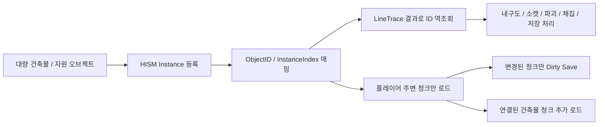
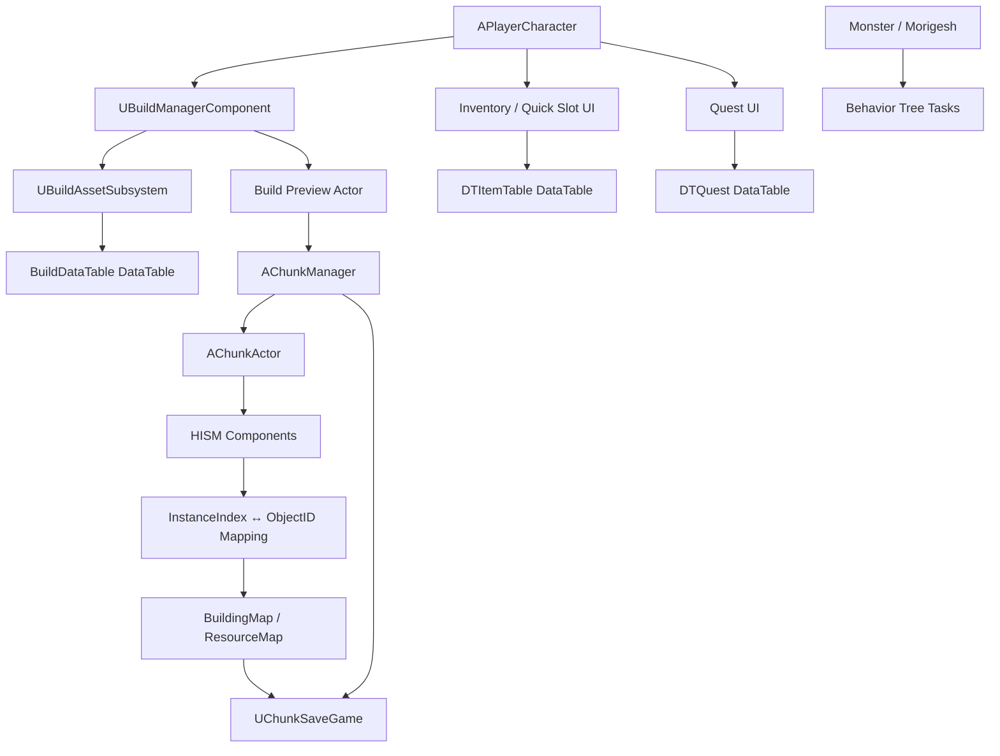

# Survival Game - Unreal Engine C++ 클라이언트 포트폴리오

> Unreal Engine C++ 기반 3D 생존/액션 게임 클라이언트 프로젝트입니다.  
> 대량으로 배치되는 건축물과 자원을 **HISM 기반 청크 시스템**으로 관리하고,  
> **ID / InstanceIndex 매핑**, **청크 스트리밍**, **Dirty Chunk 저장/로드**, **DataTable 기반 콘텐츠 관리**, **AI 전투 시스템**을 구현했습니다.

파일코드 업뎃안함!!!!!!!!주의!!!!!

## 영상


- [영상 링크](https://youtu.be/0txWLSwWrPc?si=d2CH1-GF88vsjKtm)
  
건축 시스템, HISM 기반 오브젝트 관리, 청크 스트리밍, Dirty Save, 인벤토리/퀘스트 UI, AI 전투와 보스 Phase 패턴을 보여주는 시연 영상입니다.

---

<a id="table-of-contents"></a>
## 목차

- [1. 프로젝트 개요](#overview)
- [2. 핵심 기술 요약](#tech-summary)
- [3. 시스템 구조](#system-architecture)
- [4. 핵심 기술 상세](#core-tech)
  - [4.1 HISM 기반 청크 월드 관리](#hism-chunk-world)
  - [공통 배경: Chunk System를 사용한 이유](#chunk-systems)
  - [4.2 Dirty Chunk 기반 저장/로드](#dirty-chunk-save-load)
  - [4.3 플레이어 위치 기반 청크 스트리밍](#chunk-streaming)
  - [4.4 소켓 기반 건축 연결과 HISM ↔ Actor Hybrid](#socket-building-state)
  - [4.5 데이터 기반 건축 시스템과 에셋 로드](#data-driven-building)
  - [4.6 인벤토리 / 제작 / 퀘스트 UI](#inventory-crafting-quest)
  - [4.7 AI 전투 시스템](#ai-combat)
- [5. 코드 구조](#code-structure)
- [6. 공통 측정 환경](#measurement-method)
- [7. 설계상 트레이드오프](#tradeoffs)
- [8. 한 줄 요약](#one-line-summary)

---

<a id="overview"></a>
## 1. 프로젝트 개요

| 항목 | 내용 |
|---|---|
| 프로젝트명 | Survival Game |
| 장르 | 3D 생존 / 액션 / 제작 / 건축 |
| 엔진 | Unreal Engine C++ 4.26 |
| 담당 영역 | 클라이언트 시스템 설계 및 구현 |
| 주요 구현 | 청크 스트리밍, HISM 인스턴싱, 건축 시스템, 저장/로드, 인벤토리, 제작, 퀘스트, AI 전투 |
| 개발 인원 | 1명 |
| 개발 기간 | 3~4개월 |

### 프로젝트 방향

이 프로젝트는 생존/건축 게임에서 오브젝트가 계속 늘어나는 상황을 기준으로 만들었습니다. 정적 건축물과 자원은 HISM 인스턴스로 묶고, HISM이 직접 들고 있지 못하는 상태는 ID 기반 데이터로 따로 관리했습니다. 여기에 청크 스트리밍, Dirty Save, DataTable 기반 콘텐츠 관리를 붙여서 배치부터 저장/로드까지 이어지는 구조로 만들었습니다.

---

<a id="tech-summary"></a>
## 2. 핵심 기술 요약

| 핵심 기술 | 설명 |
|---|---|
| HISM 기반 오브젝트 관리 | 건축물과 자원을 HISM 인스턴스로 등록해 Actor / Component 수 증가를 줄였습니다. |
| ID ↔ InstanceIndex 매핑 | HISM 인스턴스를 개별 오브젝트처럼 다루기 위해 `BuildingID` / `ResourceID`와 `InstanceIndex`를 매핑했습니다. |
| Chunk Streaming | 플레이어 주변 청크만 로드하고, 범위 밖 청크는 Runtime SaveData 캐시에 반영한 뒤 언로드했습니다. |
| Connected Chunk Loading | 청크 밖에 연결된 건축물이 누락되지 않도록 `SocketMap`을 따라 필요한 청크를 추가 로드했습니다. |
| Dirty Chunk Save | 전체 월드를 매번 다시 구성하지 않고, 변경된 청크만 SaveData에 반영했습니다. |
| DataTable + Soft Reference | 건축물, 아이템, 퀘스트 정보를 DataTable로 분리하고, 건축 프리뷰 에셋은 비동기로 로드해 캐싱했습니다. |
| HISM ↔ Actor Hybrid | 정적 건축물은 HISM으로 관리하고, 문 같은 상호작용이 필요한 오브젝트는 Actor로 유지했습니다. |
| Behavior Tree 기반 AI | Task / Service / Decorator로 몬스터 행동과 보스 Phase 패턴을 분리했습니다. |

### 핵심 설계 흐름



HISM은 렌더링 최적화로만 쓰지 않고, ID 기반 상태 데이터와 연결해 개별 건축물/자원처럼 다룰 수 있게 만들었습니다. 

청크 스트리밍은 멀어진 HISM 인스턴스와 충돌 데이터를 월드에서 제거하고, Runtime SaveData 캐시만 남기는 방식으로 구현했습니다.

---

<a id="system-architecture"></a>
## 3. 시스템 구조



---

<a id="core-tech"></a>
## 4. 핵심 기술 상세

<a id="hism-chunk-world"></a>
### 4.1 HISM 기반 청크 월드 관리

#### 문제

생존/건축 게임에서는 플레이어가 만든 건축물과 자원 오브젝트가 계속 늘어납니다. 

개별 Actor 방식으로 유지하면 Actor / Component / Collision 비용이 계속 쌓이기 때문에, 대량 오브젝트 관리에 맞는 HISM 기반 구조로 바꿨습니다.

#### 왜 HISM을 선택했나?

| 방법 | 장점 | 한계 | 판단 |
|---|---|---|---|
| 개별 Actor 유지 + Tick 비활성화 | 기존 로직을 그대로 쓰기 쉬움 | Actor / Component / Collision 비용은 계속 남음 | 대량 오브젝트에는 부족 |
| 거리 기반 숨김 / Collision 비활성화 | 멀리 있는 오브젝트 비용 일부 감소 | Actor는 계속 월드에 남음 | 보조 최적화로만 적합 |
| Object Pooling | Spawn / Destroy 비용 감소 | 이미 배치된 오브젝트는 계속 Actor로 유지해야 함 | 생성 비용 완화용 |
| Merge Actor / HLOD | 고정 배경 오브젝트에 유리 | 자유 배치, 파괴, 업그레이드가 필요한 건축물에는 맞지 않음 | 부적합 |
| ISM | 같은 Mesh를 인스턴스로 관리 가능 | 공간 단위 관리와 컬링 측면에서 HISM보다 아쉬움 | 후보였지만 HISM이 더 적합 |
| HISM | 반복 Mesh를 인스턴스로 관리하고 계층 컬링에 유리 | Actor가 아니므로 상태 관리를 직접 해야 함 | ID 기반 상태 구조를 추가해 채택 |

결국 HISM을 쓰되, HISM 인스턴스를 개별 게임 오브젝트처럼 다루기 위한 **ID 기반 관리 구조**로 만들었습니다.

#### 구현

`AChunkManager`는 전체 청크와 런타임 상태를 관리하고, `AChunkActor`는 청크 내부 HISM 인스턴스를 관리합니다.

- `AChunkManager`: 청크 로드/언로드, 건축물/자원 ID 발급, `BuildingMap`, `ResourceMap` 관리, 저장/로드 및 Dirty Chunk 처리
- `AChunkActor`: 청크 내부 HISM Component 관리, `InstanceIndex ↔ ObjectID` 매핑, Hit 결과 역조회

#### ID 기반 상태 관리

HISM 인스턴스 자체에는 상태를 저장할 수 없기 때문에, 건축물과 자원에 고유 ID를 발급하고 실제 상태는 `BuildingMap`, `ResourceMap`에서 관리했습니다.

- `BuildingMap`: 내구도, 최대 내구도, 건축물 정의 이름, 소켓 연결, 연결된 건축물 ID, Anchor 여부를 관리합니다.
- `ResourceMap`: 체력, 자원 타입, 자원 정의 이름을 관리합니다.

건축물은 소켓 연결, 업그레이드, 파괴, 지지 구조 판정이 필요해서 `SocketMap`, `ConnectedBuildingIDs`, `IsAnchor`를 추가로 관리했습니다.  
자원은 채집/파괴에 필요한 체력과 자원 타입 위주로 관리했습니다.

```text
LineTrace Hit
    ↓
HISM Component + InstanceIndex
    ↓
ChunkActor에서 ObjectID 역조회
    ↓
BuildingMap / ResourceMap 접근
    ↓
Damage / Destroy / Upgrade / Harvest / Save 처리
```


| Damage & Destroy | Upgrade |
|---|---|
|  |  |

 Harvest | Save & load |
|---|---|
|  |  |


#### 측정 결과

| 방식 | 생성 시간(ms) | 평균 FPS | Game Thread(ms) | GPU(ms) | Draw Calls | 비고 |
|---|---:|---:|---:|---:|---:|---|
| Actor | 2,155.8 | 68.0 | 14.7 | 14.7 | 4,676 | 개별 Actor 4,500개 Spawn |
| ISM | 15.3 | 81.5 | 8.8 | 12.8 | 1,096 | 단일 ISM Component |
| HISM | 15.6 | 129.0 | 7.0 | 8.2 | 1,254 | 단일 HISM Component |
| Chunk-HISM | 28.8 | 131.0 | 7.1 | 8.2 | 1,614 | 청크/ID/소켓 관리 포함 |

같은 조건에서 4,500개 오브젝트를 배치해 Actor / ISM / HISM / Chunk-HISM을 비교했습니다. 
Actor 방식은 Spawn 비용과 Draw Calls가 가장 높았고, ISM/HISM은 인스턴스로 등록하면서 생성 시간이 크게 줄었습니다.

Chunk-HISM은 단일 HISM보다 생성 시간과 Draw Calls는 늘었지만, FPS/GPU 시간은 거의 같은 수준을 유지했습니다. 
이 프로젝트에서는 순수 렌더링보다 청크 로드/언로드, ID 매핑, 소켓 연결 상태 관리가 더 중요했기 때문에 Chunk-HISM 구조를 선택했습니다.


#### 관련 코드
<details>
<summary>코드 파일 / 함수 목록 보기</summary>
  
```text
PP/Chunk/ChunkManager.h
PP/Chunk/ChunkManager.cpp
PP/Chunk/ChunkActor.h
PP/Chunk/ChunkActor.cpp
PP/Tools/AInstancingBenchmark.h
PP/Tools/AInstancingBenchmark.cpp
```
</details>

---

<a id="chunk-systems"></a>
### 공통 배경: Chunk System를 사용한 이유

#### 문제

청크 시스템은 처음에는 스트리밍용으로 만든 것이 아니었습니다.  

월드 좌표를 `FChunkCoords`로 바꾸고, 그 좌표를 키로 건축물이나 자원을 빠르게 찾기 위한 구조였습니다.

하지만 이 방식은 포트나이트처럼 정해진 격자에 맞춰 배치하는 시스템에 더 어울렸습니다.

이 프로젝트는 러스트나 더 포레스트처럼 플레이어가 원하는 위치와 방향으로 자유롭게 배치하는 방식을 목표로 했기 때문에, 청크 좌표만으로 특정 건축물을 식별하기 어려웠습니다.

그래서 상호작용 대상은 `HISM Component + InstanceIndex`로 찾고, 청크 시스템은 **청크 스트리밍**과 **Dirty Chunk 기반 저장/로드**에 활용하는 방향으로 전환했습니다.

#### 설계 전환

```text
초기 목적: 월드 좌표 → 청크 좌표 → 오브젝트 빠른 조회
    ↓
한계 발견: 자유 배치 / 회전 / 소켓 / 경계 걸침 때문에 좌표만으로 식별 어려움
    ↓
역할 전환: 청크를 오브젝트 조회 단위가 아니라 월드 데이터 관리 단위로 사용
    ↓
적용 기능: 청크 스트리밍, Dirty Save
```

<a id="dirty-chunk-save-load"></a>
### 4.2 Dirty Chunk 기반 저장/로드

#### 문제

청크 좌표는 자유 배치된 건축물을 직접 찾는 용도로는 한계가 있었지만 저장/로드 단위로는 잘 맞았습니다.

월드 전체를 매번 저장하면 건축물과 자원이 많아질수록 저장 대상이 계속 커지고, 플레이어가 일부 지역만 수정했더라도 전체 데이터를 다시 구성해야 합니다.

그래서 청크를 **변경된 월드 데이터를 묶어서 저장하고 복원하는 단위**로 사용했습니다.

#### 구현

건축물 배치, 파괴, 업그레이드, 자원 채집처럼 월드 상태가 바뀌면 해당 위치의 청크만 Dirty로 표시했습니다.  
저장 시에는 Dirty Chunk만 SaveGame 데이터에 반영합니다.

Dirty Chunk는 일반 변경과 연결 그래프 변경을 나눠 처리했습니다.

- `DirtyChunks`: 건축물 배치, 파괴, 업그레이드, 자원 채집처럼 일반적인 월드 상태 변경
- `GraphDirtyChunks`: 소켓 연결 변경처럼, 다음 스트리밍 계산 전에 Runtime SaveData 캐시를 먼저 최신화해야 하는 변경

스트리밍 중에는 Runtime SaveData 캐시를 유지하고, 청크 언로드 또는 수동 저장 시 변경된 청크만 캐시에 반영했습니다.

#### 저장 데이터 구조

| 데이터 | 주요 필드 | 용도 |
|---|---|---|
| `FBuildingSaveData` | `ID`, `BuildDefinitionName`, `Transform`, `Durability`, `SocketMap` | 건축물 위치, 내구도, 소켓 연결 복원 |
| `FResourceSaveData` | `ID`, `Transform`, `Hp`, `ResourceType`, `ResourceDefinitionName` | 자원 위치, 체력, 타입 복원 |
| `FAttachBuildableSaveData` | `ParentBuildingID`, `BuildDefinitionName`, `ParentSocketName`, `Transform`, `Durability` | 문 같은 부착형 Actor 복원 |

#### 구현 포인트

- 건축물/자원 변경은 해당 위치의 청크만 Dirty로 표시했습니다.
- 일반 변경과 소켓 연결 변경을 나눠, 연결 그래프 변경은 스트리밍 계산 전에 캐시에 먼저 반영했습니다.
- Full Save와 Dirty Save 경로를 분리하고, Dirty Save는 변경된 청크만 기존 SaveData에 병합했습니다.
- 문 같은 부착형 Actor는 부모 건축물과 소켓 정보를 담은 별도 SaveData로 저장했습니다.

#### 보완한 부분: 스트리밍과 저장 캐시 동기화

청크를 언로드하기 전에 변경 내용을 캐시에 반영하지 않으면, 다시 로드했을 때 이전 상태로 돌아갈 수 있습니다.  
예를 들어 파괴한 건축물이 다시 생기거나, 업그레이드 전 상태로 복원될 수 있습니다.

그래서 언로드 전 Dirty Chunk를 캐시에 반영하고, 수동 저장 시에도 Dirty Chunk만 SaveGame 데이터에 갱신하도록 분리했습니다.  
또한 연결 구조가 바뀐 경우에는 연결 정보가 포함된 청크도 함께 Dirty 처리했습니다.


| 청크 저장 캐시 동기화 | 
|---|
|  |

건축물의 내구도를 감소시키고 업그레이드한 뒤 청크를 언로드/재로드해도, 이전 상태로 되돌아가지 않고 변경된 상태가 그대로 복원되는 것을 확인할 수 있습니다

#### 측정 결과

Dirty Save 측정은 625개 청크가 로드된 테스트 월드에서 진행했습니다.  
Full Save는 전체 청크를 다시 저장 데이터로 만들고, Dirty Save는 변경된 청크만 다시 저장 데이터로 구성하도록 측정했습니다.

| 방식 | 전체 청크 | 변경 청크 | 재구성 청크 | 재구성(ms) | 전체 저장(ms) |
|---|---:|---:|---:|---:|---:|
| Full Save | 625 | - | 625 | 287.965 | 329.165 |
| Dirty Save - 1개 청크 | 625 | 1 | 1 | 0.975 | 93.710 |
| Dirty Save - 5개 청크 | 625 | 5 | 5 | 3.142 | 96.147 |

Dirty Save는 기존 SaveData를 로드한 뒤 변경된 청크만 다시 구성해 병합하는 방식으로 측정했습니다.

Full Save는 625개 청크 전체를 다시 구성해야 해서 재구성 시간이 크게 증가했습니다. 반면 Dirty Save는 변경된 1개 또는 5개 청크만 다시 구성해, 재구성 시간이 287.965ms에서 0.975ms / 3.142ms로 줄었습니다.

전체 저장 처리 시간도 329.165ms에서 93.710ms / 96.147ms로 줄어, 월드 규모가 커지고 일부 청크만 바뀌는 상황에서 Dirty Chunk 방식이 효과적이라고 봤습니다.


#### 관련 코드
<details>
<summary>코드 파일 / 함수 목록 보기</summary>
  
```text
PP/Chunk/ChunkSaveGame.h

AChunkManager::SaveWorld
AChunkManager::SaveWorldFull
AChunkManager::SaveWorldDirty
AChunkManager::LoadWorld
AChunkManager::BuildChunkSaveData
AChunkManager::FlushDirtyChunksSaveCache
```
</details>

---

<a id="chunk-streaming"></a>
### 4.3 플레이어 위치 기반 청크 스트리밍

#### 문제

Dirty Chunk 저장으로 저장 비용은 줄일 수 있었지만, 모든 청크를 계속 로드해두면 런타임 월드 비용은 그대로 남습니다.

플레이어가 이동할수록 탐색 범위가 넓어지고, 건축물과 자원도 계속 누적되기 때문에 화면에 보이지 않는 지역의 HISM 인스턴스, Component, Collision 데이터까지 월드에 남게 됩니다.

그래서 청크를 저장 단위뿐 아니라 로드/언로드 단위로도 사용했습니다. 플레이어 주변 청크만 유지하고, 멀어진 청크는 Runtime SaveData 캐시에 반영한 뒤 월드에서 제거하도록 구현했습니다.

다만 건축물이 청크 경계를 넘어 연결될 수 있어서, 단순 거리 기준이 아니라 `SocketMap` 기준의 연결 청크도 함께 로드하도록 처리했습니다.

#### 구현

플레이어 위치를 기준으로 중심 청크를 계산하고, 반경 안의 청크만 로드했습니다.  
멀어진 청크는 Runtime SaveData 캐시에 반영한 뒤 월드에서 제거하고, 다시 가까워지면 SaveData를 기준으로 HISM 인스턴스를 재생성합니다.


| 청크 스트리밍 | 
|---|
|  |


#### 구현 포인트

- 플레이어 위치와 `StreamingRadius`를 기준으로 로드 대상 청크를 계산하고, 현재 로드된 청크와 비교해 Load / Unload 대상을 나눴습니다.
- 언로드 대상 청크는 변경 내용을 Runtime SaveData 캐시에 반영한 뒤, HISM 인스턴스와 Collision 데이터를 월드에서 제거했습니다.
- 다시 가까워진 청크는 SaveData를 기준으로 HISM 인스턴스를 재생성했습니다.
- 청크 경계에 걸친 건축물은 `SocketMap` 기반 BFS로 연결 청크를 찾아 추가 로드했습니다.

#### 보완한 부분: 경계 연결 처리

기본 반경만 로드하면 문제가 생길 수 있습니다.  
예를 들어 현재 청크의 천장이 바깥 청크의 Foundation에 연결되어 있다면, 바깥 청크가 언로드되면서 지지 구조나 소켓 연결 판정이 어긋날 수 있습니다.

이를 줄이기 위해 먼저 플레이어 주변 청크를 기본 로드 대상으로 잡은 뒤 Runtime SaveData의 `SocketMap`을 기준으로 연결된 건축물 ID를 BFS로 순회하고, 연결된 건축물이 다른 청크에 있으면 그 청크도 최종 로드 대상에 추가했습니다.

```text
플레이어 위치 기준 기본 청크 계산
    ↓
기본 로드 청크 수집
    ↓
기본 청크를 BFS 시작점으로 추가
    ↓
Runtime SaveData 캐시의 소켓 연결 정보 확인
    ↓
연결된 건축물이 다른 청크에 있으면 추가 로드 대상에 포함
    ↓
새로 추가된 청크도 BFS 탐색 대상에 추가
    ↓
BFS 완료 후 최종 로드 대상 기준으로 Load / Unload 수행
```

이렇게 해서 연결된 건축물이 여러 청크에 걸쳐 있어도 필요한 청크를 함께 로드할 수 있었습니다. 대신 하나의 대형 구조물이 여러 청크를 가로지르면 활성 청크 수가 늘어날 수 있습니다.


| 청크 연결 스트리밍 | 
|---|
|  | 


#### 측정 결과

Clean은 변경 없이 이동하며 순수 청크 로드 / 언로드 비용을 측정한 경우이고, Dirty는 활성 청크마다 건축물 1개를 추가한 뒤 언로드 비용을 측정한 경우입니다.

##### 측정 조건

| 케이스 | 조건 |
|---|---|
| 전체 로드 | 7x7 청크 전체를 상시 로드 |
| Radius 1, Clean | 중심 청크 포함 3x3 유지, 변경 없이 이동 |
| Radius 1, Dirty | 9개 청크에 건축물 1개씩 추가 후 언로드 |
| Radius 2, Clean | 중심 청크 포함 5x5 유지, 변경 없이 이동 |
| Radius 2, Dirty | 25개 청크에 건축물 1개씩 추가 후 언로드 |
| Radius 1, Connected Clean | 기본 3x3 + 연결 청크 1개 추가 로드 |
| Radius 1, Connected Dirty | 연결 포함 10개 청크에 건축물 1개씩 추가 후 언로드 |

##### 활성 오브젝트 수

| 케이스 | ActiveChunks | ActiveInstances | ActiveHISMComponents |
|---|---:|---:|---:|
| 전체 로드 | 49 | 2729 | 980 |
| Radius 1, Clean | 9 | 507 | 180 |
| Radius 1, Dirty | 9 | 516 | 180 | 
| Radius 2, Clean | 25 | 1385 | 500 | 
| Radius 2, Dirty | 25 | 1410 | 500 |
| Radius 1, Connected Clean | 10 | 562 | 200 |
| Radius 1, Connected Dirty | 10 | 572 | 200 |

##### 로드 / 언로드 비용

`AvgCacheFlush`는 디스크 저장 시간이 아니라, 언로드 전 Dirty Chunk를 Runtime SaveData 캐시에 반영하는 평균 시간(ms)입니다.

| 케이스 | AvgLoad(ms) | AvgUnload(ms) | DirtyFlushCount | AvgCacheFlush(ms) |
|---|---:|---:|---:|---:|
| 전체 로드 | - | - | - | - |
| Radius 1, Clean | 1.185 | 0.436 | 0 | - |
| Radius 1, Dirty | 1.203 | 0.474 | 9 | 0.117 |
| Radius 2, Clean | 1.205 | 0.436 | 0 | - |
| Radius 2, Dirty | 1.224 | 0.528 | 25 | 0.178 |
| Radius 1, Connected Clean | 1.219 | 0.440 | 0 | - |
| Radius 1, Connected Dirty | 1.254 | 0.494 | 10 | 0.107 |

측정 결과, 전체 월드를 유지하지 않고 플레이어 주변 청크만 남기는 방식으로 ActiveChunks, ActiveInstances, ActiveHISMComponents를 크게 줄일 수 있었습니다. 
Dirty Unload 상황에서도 Runtime SaveData 캐시 반영 비용은 0.1ms대로 유지되어, 언로드 전 캐시 갱신 비용은 크지 않다고 봤습니다.

연결 청크 로드는 기본 반경 밖의 청크를 일부 더 로드하지만, 소켓 연결과 지지 구조를 유지하기 위해 감수할 만한 비용이라고 봤습니다.

#### 관련 코드
<details>
<summary>코드 파일 / 함수 목록 보기</summary>
  
```text
AChunkManager::UpdateChunkStreamingAroundLocation
AChunkManager::LoadChunkRuntime
AChunkManager::UnloadChunkRuntime
AChunkManager::BuildWantChunkSet
AChunkManager::BuildConnectedWantedChunkSet
```
</details>

---

<a id="socket-building-state"></a>
### 4.4 소켓 기반 건축 연결과 HISM ↔ Actor Hybrid

#### 문제

건축 시스템은 완전 자유 배치만으로는 부족했습니다.  
벽, 바닥, 천장, 계단, 문틀처럼 서로 맞물려야 하는 건축물은 위치와 회전이 정확해야 하고, 어떤 건축물의 어느 지점에 붙었는지도 계속 관리해야 했습니다.

단순히 충돌 검사만으로 가까운 건축물을 찾는 방식도 애매했는데 연결이 불가능한 건축물이거나, 이미 사용 중인 연결 지점에 다른 건축물이 또 붙는 문제도 생길 수 있기 때문입니다.

그래서 건축물 연결은 **Static Mesh Socket**을 기준으로 처리했습니다.  
소켓은 각 건축물 Mesh에 미리 정의된 연결 지점이기 때문에, 벽은 벽에 맞는 위치로, 천장은 천장에 맞는 위치로, 계단은 계단에 맞는 위치로 자연스럽게 붙일 수 있었습니다.

#### HISM ↔ Actor Hybrid를 같이 사용한 이유

벽, 바닥, 천장, 창문, 계단처럼 배치 후 거의 움직이지 않는 건축물은 HISM으로 관리했습니다. 
반면 문처럼 열림/닫힘, 애니메이션, 충돌 변경이 필요한 오브젝트는 HISM만으로 처리하기 어려워 Actor로 유지했습니다.

정적 HISM 건축물은 `BuildingID` 기준으로 관리하고, 문 같은 부착형 Actor는 부모 `BuildingID`와 부모 소켓 이름을 기준으로 관리했습니다.
정적 건축물의 소켓 연결, 내구도, 파괴, 업그레이드는 `BuildingMap` 기반으로 처리하고, 부착형 Actor는 부모 건축물과 소켓 정보를 담은 별도 SaveData로 복원했습니다.

#### 검토한 방식

| 방식 | 장점 | 한계 | 판단 |
|---|---|---|---|
| 모든 건축물을 Actor로 유지 | 문 상호작용, 애니메이션, 충돌 변경 구현이 쉬움 | 벽, 바닥, 천장처럼 대량 배치되는 정적 건축물까지 Actor 수가 증가 | 성능 측면에서 불리 |
| 모든 건축물을 HISM으로 관리 | 대량 건축물 관리에 가장 유리 | 문처럼 상태 변화와 상호작용이 필요한 오브젝트 구현이 복잡 | 기능 구현 비용이 큼 |
| HISM으로 두고 상호작용 시에만 임시 Actor 생성 | 평상시 Actor 수를 최소화할 수 있고, 상호작용 오브젝트가 많아질수록 장기적으로 유리 | HISM ↔ Actor 전환 시 Transform, Collision, Animation, 저장 데이터, 소켓 연결 상태를 모두 동기화해야 함 | 장기 개선 후보 |
| 정적 건축물은 HISM, 상호작용 Actor만 유지 | 현재 프로젝트처럼 상호작용 Actor 개수가 적은 구조에서는 구현이 단순하고 안정적 | 상호작용 Actor가 많아지면 Actor 수와 별도 저장 데이터가 증가 | 현재 프로젝트 범위에서 최종 채택 |

#### 구현

건축물 연결은 Static Mesh Socket을 사용했습니다.
배치 시 가장 가까운 유효 소켓을 찾아 프리뷰 위치와 회전을 보정하고, 배치 완료 후 양쪽 건축물의 연결 정보를 갱신했습니다.

```text
Build Preview
    ↓
라인트레이스로 연결 대상 건축물 탐색
    ↓
배치 가능한 타입 / 소켓인지 확인
    ↓
가장 가까운 유효 소켓 찾기
    ↓
Preview Transform을 소켓 기준으로 보정
    ↓
충돌 검사 및 배치 가능 여부 확인
    ↓
배치 확정
    ↓
정적 건축물은 HISM Instance로 등록
문 같은 부착형 오브젝트는 Actor로 유지
    ↓
소켓 점유 정보와 연결된 건축물 목록 갱신
```

정적 건축물끼리는 `SocketMap`으로 소켓 점유 상태를 관리했습니다. 이미 사용 중인 소켓에는 다시 배치할 수 없도록 막아 중복 배치를 방지했습니다.

`ConnectedBuildingIDs`는 소켓으로 연결된 건축물 목록입니다. 배치뿐 아니라 저장/로드, 청크 경계 로드, 파괴 후 지지 구조 판정에도 사용했습니다.

문 같은 부착형 Actor는 별도의 `BuildingID`를 새로 발급하지 않고, 부모 건축물 ID와 부모 소켓 이름을 기준으로 관리했습니다.  
저장 시에는 부모 정보, Transform, 내구도를 별도 SaveData로 기록해 다시 복원할 수 있게 했습니다.


| 소켓 기반 건축 | 
|---|
|  |


#### 구현 포인트

- 배치 가능한 대상 타입과 소켓을 제한하고, 가장 가까운 유효 소켓을 기준으로 프리뷰 위치와 회전을 보정했습니다.
- 이미 사용 중인 소켓에는 다시 배치할 수 없도록 막고, 배치 완료 시 양쪽 건축물의 연결 정보를 갱신했습니다.
- 정적 건축물은 HISM 인스턴스로 등록하고, 문 같은 부착형 오브젝트는 부모 건축물 ID와 소켓 이름을 기준으로 Actor로 유지했습니다.
- 소켓 연결 정보는 저장/로드, 청크 경계 로드, 파괴 후 지지 구조 판정에 재사용했습니다.

#### 보완한 부분: 충돌 검사에서 연결 그래프 기반 지지 판정으로 변경

처음에는 건축물이 파괴될 때 주변 충돌 검사로 인접 건축물을 찾았습니다.
하지만 여러 건축물이 한 번에 무너질 때 충돌 검사가 반복되고, 가까이 있지만 실제로 연결되지 않은 건축물까지 포함될 수 있었습니다.

그래서 배치 시점에 저장한 `ConnectedBuildingIDs`를 연결 그래프처럼 사용했습니다.  
건축물이 파괴되면 먼저 파괴 대상과 연결되어 있던 건축물들을 시작점으로 저장하고, 파괴 대상을 연결 정보에서 제거한 뒤 각 시작점에서 BFS를 돌렸습니다.

BFS로 탐색된 연결 그룹 안에 `IsAnchor`가 있으면 아직 지지 구조와 이어져 있다고 보고 유지했습니다.  
반대로 `IsAnchor`가 없다면 지지 구조와 끊어진 그룹으로 보고, 해당 그룹의 건축물들을 함께 제거했습니다.

```text
건축물 파괴
    ↓
파괴 대상과 연결되어 있던 건축물들을 시작점으로 저장
    ↓
파괴 대상을 소켓 연결 정보에서 제거
    ↓
각 시작점에서 연결된 건축물을 BFS로 탐색
    ↓
탐색된 연결 그룹에 Anchor가 있는지 확인
    ↓
Anchor가 있으면 유지
Anchor가 없으면 해당 연결 그룹을 함께 제거
```

이 방식은 주변 충돌 검사를 반복하지 않고, 배치 과정에서 확정된 연결 정보만 사용합니다.  
그래서 가까이 있지만 실제로 연결되지 않은 건축물이 잘못 포함되는 문제를 줄이고, 대량 파괴 상황도 연결 그래프 단위로 처리할 수 있습니다.

| 기반 파괴 | 
|---|
|  |


#### 관련 코드
<details>
<summary>코드 파일 / 함수 목록 보기</summary>
  
```text
AChunkManager::AddSocket
AChunkManager::CheckSocket
AChunkManager::AddHISMAttachBuildActor
AChunkManager::RemoveHISMAttachBuildActor
AChunkManager::DamageBuilding
AChunkManager::DestroyBuilding
AChunkManager::DisconnectBuilding
AChunkManager::RemoveOnlyBuilding
AChunkManager::UpgradeBuilding
AChunkManager::UpgradeBuildingDefinitionName
UBuildManagerComponent::FindClosestSocket
ABuildable::Build
ABuildable::BuildDestroy
PP/Buildable/DoorBuildable.cpp
PP/Buildable/OpenDoorBuildable.cpp
PP/Buildable/DestructibleBuildable.cpp
```
</details>

---

<a id="data-driven-building"></a>
### 4.5 데이터 기반 건축 시스템과 에셋 로드

#### 문제

건축물 종류가 늘어날수록 클래스, 메시, 내구도, 재질, 배치 조건, 업그레이드 정보를 코드에 직접 연결하기 어렵습니다.  
또 건축물 선택 시 필요한 에셋을 동기 로드하면 순간적인 끊김이 생길 수 있습니다.

#### 구현

`FBuildDefinitionInfo`를 `BuildDataTable` Row로 정의해 건축물 정보를 데이터화했습니다.  
Row에는 건축물 타입, 재질 타입, Buildable Class, Static Mesh, Destructible Mesh, 내구도, 배치 조건, Anchor 여부, 업그레이드 Row 이름을 넣었습니다.

건축물 클래스와 메시/파괴 메시는 Soft Reference로 관리했습니다.  
프리뷰 선택 경로는 `RequestAsync`로 비동기 로드하고, 저장/로드 복원이나 청크 재생성처럼 즉시 필요한 경로는 `ResolveSync`로 처리했습니다.

#### 구현 포인트

- 건축물 클래스와 메시를 Soft Reference로 관리했습니다.
- 프리뷰 선택 경로는 `RequestAsync`, 저장/로드 복원 경로는 `ResolveSync`를 사용했습니다.
- 배치 확정 시 정적 건축물은 Actor를 유지하지 않고 Chunk HISM 인스턴스로 전환했습니다.

#### 적용 방식

| 항목 | 적용 방식 |
|---|---|
| 건축물 정의 | `BuildDataTable` DataTable / `FBuildDefinitionInfo` Row 기반  |
| 에셋 참조 | `TSoftClassPtr`, `TSoftObjectPtr` |
| 로드 방식 | 프리뷰 선택 시 `RequestAsync`, 저장/로드 복원 시 `ResolveSync` |
| 재사용 방식 | `UBuildAssetSubsystem` 캐시 |
| 확장 방식 | DataTable Row 추가로 건축물 정의 확장 |

#### 건축물 선택 및 배치 흐름

```text
Build UI에서 건축물 선택
    ↓
DataTable Row 조회
    ↓
Soft Reference 에셋 비동기 로드(RequestAsync)
    ↓
로드 완료 후 캐시에 저장
    ↓
Preview Actor 생성
    ↓
배치 가능 여부 검사
    ↓
배치 확정
    ↓
정적 건축물은 Chunk HISM Instance로 등록
```

#### 관련 코드
<details>
<summary>코드 파일 / 함수 목록 보기</summary>
  
```text
PP/GameInfo.h
PP/AssetManager/BuildAssetSubsystem.h
PP/AssetManager/BuildAssetSubsystem.cpp
PP/Buildable/BuildManagerComponent.h
PP/Buildable/BuildManagerComponent.cpp
PP/Buildable/Buildable.h
PP/Buildable/Buildable.cpp
```
</details>

---

<a id="inventory-crafting-quest"></a>
### 4.6 인벤토리 / 제작 / 퀘스트 UI

#### 구현 내용

- 인벤토리는 20칸, 퀵슬롯은 6칸 구조로 구현했습니다.
- 아이템 정보는 `DTItemTable` DataTable에서 읽고, Row에 설정된 아이템 타입, 아이콘, 장비 정보, 제작 재료 정보등을 기준으로 인벤토리와 제작 UI를 구성했습니다.
- 제작 UI는 무기, 장비, 건축 아이템, 음식 카테고리로 필터링합니다.
- 퀘스트 정보는 `DTQuest` DataTable에서 읽고, Row에 설정된 타입, 목표 수, 보상 정보를 기준으로 진행도와 완료 보상을 처리했습니다.
DTItemTable

#### 구현 규모

| 항목 | 내용 |
|---|---|
| 인벤토리 슬롯 수 | 20칸 |
| 퀵슬롯 수 | 6칸 |
| 아이템 데이터 | `DTItemTable` DataTable / `FUIItemTableInfo` Row 기반 |
| 퀘스트 데이터 | `DTQuest` DataTable / `FQuestTableInfo` Row 기반 |
| 제작 카테고리 | 무기 / 장비 / 건축 아이템 / 음식 |
| 퀘스트 타입 | `Collection` / `Hunt` / `Craft` |


| 인벤토리 UI | 퀘스트 UI |
|---|---|
|  |  | 


#### 관련 코드
<details>
<summary>코드 파일 / 함수 목록 보기</summary>
  
```text
PP/Widget/InventoryTile.cpp
PP/Widget/UseInventoryTile.cpp
PP/Widget/Crafting.cpp
PP/Widget/QuestWidget.cpp
PP/GameInfo.h
PP/PPGameInstance.cpp
```
</details>

---

<a id="ai-combat"></a>
### 4.7 AI 전투 시스템

#### 구현 내용

- 몬스터의 순찰, 추적, 공격, 도주를 Behavior Tree Task로 분리했습니다.
- Player Detect Service와 Decorator로 타겟 감지, 거리 조건, 보스 Phase 조건을 나눠 처리했습니다.
- 보스 Morigesh는 Phase에 따라 보호막, 좀비 소환, 폭발, 메테오, 단검 공격 패턴을 사용합니다.


| 몬스터 탐지 및 추척, 공격 | 
|---|
|  |


#### 관련 코드
<details>
<summary>코드 파일 / 함수 목록 보기</summary>
  
```text
PP/AI/BTService_PlayerDetect.cpp
PP/AI/BTDecorator_CheckDistance.cpp
PP/AI/BTDecorator_CheckPhase.cpp
PP/AI/BTTask_Patrol.cpp
PP/AI/BTTask_TargetTrace.cpp
PP/AI/BTTask_NormalAttack.cpp
PP/AI/BTTask_Getaway.cpp
PP/AI/BTTask_MorigeshPhase0.cpp
PP/AI/UBTTask_MorigeshPhase1.cpp
PP/AI/UBTTask_MorigeshPhase2.cpp
PP/Character/Monster/Morigesh.cpp
```
</details>

---

<a id="code-structure"></a>
## 5. 코드 구조

```text
PP/
├── AI/                  # Behavior Tree Task, Service, Decorator
├── AssetManager/        # 건축 에셋 비동기 로드 및 캐싱
├── Buildable/           # 건축물 Actor, 건축 매니저, 문/벽/창문/천장/계단 등
├── Character/
│   ├── Player/          # 플레이어 이동, 전투, 건축, 인벤토리 연동
│   └── Monster/         # 몬스터, 보스, AI Controller, Anim
├── Chunk/               # 청크, HISM 인스턴싱, 저장/로드, 스트리밍
├── Customizer/          # 캐릭터 커스터마이징
├── Equipment/           # 무기, 장비, 소비 아이템, 화살 등
├── Environments/        # 나무/돌 등 채집 자원
├── Effect/              # 투사체, 보스 스킬, 실드, 이펙트
├── Tools/               # 벤치마크, 포털, 아이템 박스
└── Widget/              # 인벤토리, 제작, 퀘스트, HUD
```

---

<a id="measurement-method"></a>
## 6. 공통 측정 환경

| 항목 | 값 |
|---|---|
| CPU | Intel i9 12900kf |
| GPU | GeForce RTX 3050 |
| RAM | DDR4 32GB |
| OS | 윈도우 11 |
| Unreal Engine Version | 4.26 |
| Build Type | Editor PIE - New Editor Window |
| Resolution | 1280 x 720 |
| 측정 횟수 | 평균 3~5회 |


<a id="tradeoffs"></a>
## 7. 설계상 트레이드오프

### HISM 선택으로 인한 상태 관리 비용

HISM으로 건축물과 자원을 관리하면서 Actor / Component 수는 줄일 수 있었습니다.  
대신 HISM 인스턴스는 Actor처럼 자체 상태를 가질 수 없기 때문에, `BuildingID`, `ResourceID`를 기준으로 `BuildingMap`, `ResourceMap`에서 상태를 따로 관리했습니다.

즉, 렌더링과 Actor 관리 비용은 줄인 대신, 내구도, 소켓 연결, 파괴 상태 같은 개별 오브젝트 데이터를 직접 관리해야 하는 비용이 생겼습니다.

### 연결 청크 로드와 SaveData 캐시

청크 밖에 연결된 건축물이 누락되지 않도록 `SocketMap`을 따라 기본 반경 밖의 청크도 추가 로드했습니다.  
이 방식은 소켓 연결과 지지 구조를 안정적으로 유지할 수 있지만, 큰 건축물이 여러 청크에 걸쳐 있으면 활성 청크 수가 늘어날 수 있습니다.

또 연결 청크 계산은 Runtime SaveData 캐시를 기준으로 하기 때문에, 연결 구조가 바뀐 청크는 스트리밍 계산 전에 캐시에 먼저 반영되도록 처리했습니다.  
덕분에 언로드된 청크의 연결 정보도 탐색할 수 있었지만, 런타임 상태와 SaveData 캐시가 어긋나지 않게 Dirty Chunk 반영 타이밍을 신경 써야 했습니다.

### HISM ↔ Actor Hybrid 구조

벽, 바닥, 천장처럼 많이 배치되는 정적 건축물은 HISM으로 관리하고, 문처럼 상호작용이 필요한 오브젝트는 Actor로 유지했습니다.  
현재 프로젝트에서는 상호작용 오브젝트가 문 중심이라 Actor 수 증가가 크지 않았고, 구현도 더 안정적이었습니다.

다만 보관함, 제작대, 화로, 함정처럼 상태를 가진 상호작용 오브젝트가 많아지면 Actor 수와 별도 저장 데이터가 함께 늘어날 수 있습니다.

추후에는 평상시에는 HISM으로 두고, 상호작용 시점에만 Actor로 전환하는 구조로 확장할 수 있습니다.

### 청크 복원 경로의 동기 로드

건축 프리뷰 에셋은 `RequestAsync`로 비동기 로드하지만, SaveData를 기준으로 청크를 복원하는 `AddBuildingInstanceDefinitionName` / `SpawnAttachBuildableSaveData` 경로는 `ResolveSync`를 사용했습니다.

이 방식은 구현이 단순하고 즉시 복원이 쉽지만, 청크 크기와 오브젝트 수가 커지면 순간적인 비용이 생길 수 있습니다.

추후에는 청크 복원도 비동기 에셋 준비 단계와 실제 HISM 등록 단계를 분리하는 방식으로 확장할 수 있습니다.

---

<a id="one-line-summary"></a>
## 8. 한 줄 요약

> 대량 건축물과 자원을 HISM·청크 스트리밍으로 관리하고, ID 기반 상태 관리와 DataTable 기반 콘텐츠 구조를 결합한 Unreal Engine C++ 클라이언트 포트폴리오입니다.
