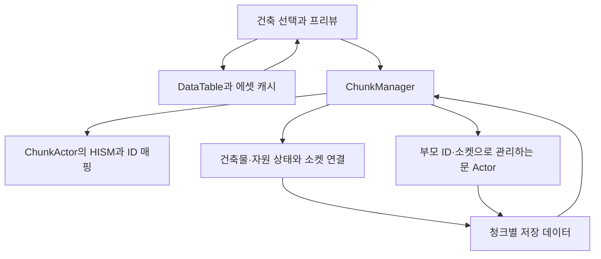

# Survival Game - Unreal Engine C++ 클라이언트 포트폴리오

> Unreal Engine C++ 기반 3D 생존·액션 게임 클라이언트 프로젝트입니다.  
> 대량으로 배치되는 건축물과 자원을 **HISM과 ID로 관리**하고,  
> **연결 관계를 고려한 청크 스트리밍**, **변경된 청크를 반영하는 저장 방식**, **소켓 기반 건축 시스템**을 구현했습니다.

## 시연 영상


- [전체 시연 영상](https://youtu.be/0txWLSwWrPc?si=d2CH1-GF88vsjKtm)

건축과 채집, 저장/로드, 인벤토리·퀘스트 UI, AI 전투를 확인할 수 있는 시연 영상입니다.


***주의 코드업뎃안함!!!
---

<a id="table-of-contents"></a>

## 목차

- [1. 프로젝트 개요](#overview)
- [2. 핵심 기술 요약](#tech-summary)
- [3. 시스템 구조](#system-architecture)
- [4. 핵심 기술 상세](#core-tech)
  - [4.1 HISM 기반 청크 월드 관리](#hism-chunk-world)
  - [공통 배경: 청크 시스템을 사용한 이유](#chunk-systems)
  - [4.2 연결 관계를 고려한 청크 스트리밍](#chunk-streaming)
  - [4.3 Dirty Chunk 기반 저장/로드](#dirty-chunk-save-load)
  - [4.4 소켓 기반 건축 연결과 HISM·Actor 혼합 구조](#socket-building-state)
  - [4.5 데이터 기반 건축 시스템과 에셋 로드](#data-driven-building)
  - [4.6 인벤토리·제작·퀘스트 UI](#inventory-crafting-quest)
  - [4.7 AI 전투 시스템](#ai-combat)
- [5. 코드 구조](#code-structure)
- [6. 공통 측정 환경](#measurement-method)
- [7. 설계상 트레이드오프](#tradeoffs)

---

<a id="overview"></a>

## 1. 프로젝트 개요

| 항목 | 내용 |
|---|---|
| 프로젝트명 | Survival Game |
| 장르 | 3D 생존·액션·제작·건축 |
| 엔진 / 언어 | Unreal Engine 4.26 / C++ |
| 담당 영역 | 클라이언트 시스템 설계 및 구현 |
| 개발 인원 | 1명 |
| 개발 기간 | 3\~4개월 |

### 프로젝트 방향

생존·건축 게임에서 계속 늘어나는 건축물과 자원을 어떻게 관리할지에 초점을 맞췄습니다.

정적 건축물과 자원은 HISM 인스턴스로 묶고, 내구도와 소켓 연결 같은 상태는 ID를 기준으로 따로 관리했습니다. 이를 바탕으로 개별 오브젝트를 배치하고 파괴할 수 있도록 하면서, 필요한 지역만 로드하고 변경 내용을 저장하는 구조로 만들었습니다.

---

<a id="tech-summary"></a>

## 2. 핵심 기술 요약

| 핵심 기술 | 설명 |
|---|---|
| HISM과 ID 기반 상태 관리 | 건축물과 자원을 HISM으로 묶고, 인스턴스 번호와 ID를 연결해 개별 상태를 관리했습니다. 삭제·업그레이드로 번호가 바뀌면 ID에 대응하는 번호도 갱신했습니다. |
| 연결 관계를 고려한 청크 스트리밍 | 월드를 청크 단위로 나눠 플레이어 주변 청크를 로드하고, 멀어진 청크는 언로드했습니다. 다만 소켓으로 연결된 바깥 청크는 함께 로드했습니다. |
| Dirty Chunk 저장 | 월드 데이터를 청크 단위로 나누고, 변경된 청크의 내용만 저장 데이터에 반영했습니다. |
| 소켓 기반 건축과 지지 판정 | 건축물의 연결 지점(소켓)에 맞춰 배치하고 연결 관계를 관리했습니다. 파괴 시 지지 기반을 잃은 건축물은 함께 제거했습니다. |
| 데이터·게임플레이 연동 | 건축물 정보와 에셋 로드를 분리하고, 인벤토리·제작·퀘스트·Behavior Tree 기반 전투를 구현했습니다. |

---

<a id="system-architecture"></a>

## 3. 시스템 구조



`ChunkManager`는 로드된 오브젝트의 상태와 청크 로드·언로드를 관리합니다. 

`ChunkActor`는 각 청크에서 같은 Mesh를 HISM으로 묶고, 충돌 검사로 얻은 인스턴스 번호(InstanceIndex)에 대응하는 ID를 찾습니다.

---

<a id="core-tech"></a>

## 4. 핵심 기술 상세

<a id="hism-chunk-world"></a>

### 4.1 HISM 기반 청크 월드 관리

#### 문제

건축물과 자원을 모두 개별 Actor로 두면, 수량이 늘어날수록 Actor와 Component의 관리 비용도 커집니다. 그래서 같은 Mesh를 반복해서 사용하는 오브젝트를 묶어 관리할 방법이 필요했습니다.

#### 왜 HISM을 선택했나?

| 방법 | 검토한 점 | 현재 프로젝트에서의 판단 |
|---|---|---|
| 개별 Actor 유지 + Tick 비활성화 | 매 프레임 실행되는 처리를 줄일 수 있음 | Actor와 Component 수는 그대로 남음 |
| 거리 기반 숨김 / 충돌 비활성화 | 멀리 있는 오브젝트의 표시·충돌 부담을 줄일 수 있음 | 오브젝트 자체는 월드에 남아 있어 보조 방법으로 검토 |
| Object Pooling | Actor를 재사용해 생성·제거 부담을 줄일 수 있음 | 이미 배치된 Actor 수를 줄이는 목적과는 다름 |
| Mesh 병합 / HLOD | 배경 Mesh를 묶어 표시하는 데 활용 가능 | 개별 배치·파괴·업그레이드가 필요해 현재 건축물 관리 방식으로는 선택하지 않음 |
| ISM | 같은 Mesh를 인스턴스로 묶을 수 있음 | 아래 비교에서 HISM보다 프레임 성능이 낮았음 |
| HISM | 같은 Mesh를 인스턴스로 묶으며, 아래 비교에서 프레임 성능이 좋았음 | 개별 상태를 ID로 관리하는 구조를 추가해 선택 |

#### 구현

HISM을 사용하면서도 개별 오브젝트를 구분할 수 있도록, 각 건축물과 자원에 고유 ID를 발급하고 상태를 별도 Map에 저장했습니다.

| 데이터 | 관리하는 상태 |
|---|---|
| `BuildingMap` | 소속 청크와 인스턴스 번호, 건축물 정보, 내구도, 소켓 연결, 연결된 건축물 ID, 지지 기반 여부 |
| `ResourceMap` | 소속 청크와 인스턴스 번호, 자원 정보, 체력, 자원 타입 |

LineTrace나 Sweep에서 얻은 **HISM Component와 인스턴스 번호로 ID를 찾고**, 해당 Map의 상태를 읽어 파괴·업그레이드·채집을 처리했습니다.

인스턴스를 삭제하면 마지막 인스턴스가 빈자리로 옮겨질 수 있어, 인스턴스 번호 자체를 고유 ID로 사용할 수는 없었습니다. 그래서 삭제 후 옮겨진 인스턴스를 확인하고, **청크의 ‘인스턴스 번호 → ID’ 정보와 상태 Map의 인스턴스 번호를 함께 갱신**했습니다.

업그레이드로 Mesh를 바꿀 때도 ID와 소켓 연결은 유지하고, 인스턴스를 새 Mesh에 다시 등록했습니다.

| 내구도 감소·파괴 | 업그레이드 |
|---|---|
|  |  |

| 자원 채집 | 저장/로드 |
|---|---|
|  |  |

#### 측정 결과

4,500개 오브젝트를 같은 개수·배치 기준으로 비교했습니다. 생성 시간은 Actor 생성 또는 인스턴스 등록을 처리하는 코드 구간에서 측정했습니다.

| 방식 | 생성 시간(ms) | 평균 FPS | Game Thread(ms) | GPU(ms) | Draw Calls | 비고 |
|---|---:|---:|---:|---:|---:|---|
| Actor | 2,155.8 | 68.0 | 14.7 | 14.7 | 4,676 | 개별 Actor 4,500개 Spawn |
| ISM | 15.3 | 81.5 | 8.8 | 12.8 | 1,096 | 단일 ISM Component |
| HISM | 15.6 | 129.0 | 7.0 | 8.2 | 1,254 | 단일 HISM Component |
| Chunk-HISM | 28.8 | 131.0 | 7.1 | 8.2 | 1,614 | 청크/ID/소켓 관리 포함 |

이 측정에서 Chunk-HISM은 단일 HISM보다 생성 시간과 Draw Calls가 늘었지만, FPS와 GPU 시간은 비슷했습니다.

Actor 수를 줄인 대신 인스턴스 번호와 내구도, 소켓 연결, 저장 데이터를 직접 관리해야 했습니다. 관리할 부분은 늘었지만, **개별 Actor 방식보다 생성 시간이 줄고 프레임 성능도 좋아졌기 때문에** 이 비용을 감수하고 Chunk-HISM 구조를 선택했습니다.

<details>
<summary>관련 코드 보기</summary>

```text
PP/Chunk/ChunkActor.h / .cpp
  AddInstance / RemoveInstance / GetMeshID
PP/Chunk/ChunkManager.h / .cpp
  UpgradeBuilding / RemoveOnlyBuilding / DestroyResource
PP/Tools/AInstancingBenchmark.h / .cpp
  RunBenchmark
```

</details>

---

<a id="chunk-systems"></a>

### 공통 배경: 청크 시스템을 사용한 이유

처음에는 월드 좌표를 청크 좌표인 `FChunkCoords`로 바꿔, 해당 구역의 건축물과 자원을 빠르게 찾으려고 했습니다. 하지만 한 청크 안에 여러 오브젝트를 자유롭게 배치할 수 있어, 청크 좌표만으로 특정 오브젝트 하나를 구분할 수는 없었습니다.

그래서 상호작용 대상은 HISM Component와 인스턴스 번호로 찾고, 청크는 **지역별 저장과 로드·언로드를 관리하는 단위**로 활용했습니다.

<a id="chunk-streaming"></a>

### 4.2 연결 관계를 고려한 청크 스트리밍

#### 문제

HISM으로 Actor 수를 줄였지만, 멀리 있는 지역의 인스턴스와 충돌 데이터까지 계속 유지하는 비용은 남았습니다. 그래서 청크 단위로 필요한 지역만 로드하고, 멀어진 지역은 언로드하도록 했습니다.

#### 구현

플레이어 위치로 중심 청크를 계산하고, 설정한 반경 안의 청크를 로드했습니다. 멀어진 청크는 HISM과 문 Actor를 월드에서 제거하고, 해당 오브젝트의 상태 데이터도 정리했습니다.

| 플레이어 위치에 따른 청크 스트리밍 |
|---|
|  |

#### 추가 문제: 언로드 후 이전 상태로 돌아가는 경우

청크를 언로드할 때 변경 내용을 남기지 않으면, 다시 로드할 때 파괴·업그레이드 이전 상태로 돌아갈 수 있었습니다. 

이를 막기 위해 실행 중에는 저장 데이터를 메모리에 보관하는 **저장 캐시**를 유지했습니다. 변경된 청크는 언로드하기 전에 저장 캐시에 반영하고, 다시 로드할 때 이 데이터로 복원했습니다.

| 저장 캐시에 반영한 변경 상태 유지 |
|---|
|  |

내구도를 줄이고 업그레이드한 뒤, 청크를 언로드했다 다시 로드해도 변경 상태가 유지되는 시연입니다.

#### 추가 문제: 경계 밖 연결도 유지

기본 반경만 로드하면 건축물의 연결이 청크 경계에서 끊길 수 있습니다. 예를 들어 현재 청크의 천장이 바깥 청크의 기초 건축물(Foundation)에 연결되어 있다면, 바깥 청크가 언로드되면서 소켓 연결이나 지지 판정이 어긋날 수 있습니다.

이를 보완하기 위해 다음 순서로 최종 로드 범위를 정했습니다.

1. 소켓 연결이 바뀐 청크를 `GraphDirtyChunks`에 표시하고, 저장 캐시에 먼저 반영합니다.
2. 기본 반경의 청크를 확인할 목록에 넣습니다.
3. 저장 캐시의 SocketMap을 읽고, 연결된 건축물이 다른 청크에 있으면 그 청크도 목록에 추가합니다.
4. 추가한 청크의 연결도 같은 방식으로 확인한 뒤, 최종 목록에 맞춰 로드·언로드합니다.

큐에 넣은 청크를 BFS 방식으로 확인하고, 이미 포함한 청크는 다시 추가하지 않았습니다. 저장 캐시에서 연결 정보를 읽으므로 아직 로드하지 않은 청크의 연결도 따라갈 수 있었습니다.

| 연결된 바깥 청크도 함께 로드 |
|---|
|  |

플레이어가 제자리에 있어도 건축물을 붙이거나 파괴하면 연결은 바뀔 수 있습니다. 따라서 다른 청크로 이동했을 때뿐 아니라 **소켓 연결이 바뀌었을 때도 로드할 청크를 다시 계산**해, 새로 필요한 청크를 추가하고 더 이상 필요 없는 청크는 제거했습니다.

#### 측정 결과

전체 월드는 7×7청크입니다. Radius 1은 중심을 포함한 3×3, Radius 2는 5×5를 유지합니다. Connected는 기본 3×3에 연결 청크 1개를 더 로드한 경우입니다.

Clean은 변경 없이 이동한 경우이고, Dirty는 활성 청크마다 건축물 1개를 추가한 뒤 언로드한 경우입니다. 아래 표는 각 조건에서 유지하는 청크·인스턴스·HISM Component 수입니다.

| 케이스 | ActiveChunks | ActiveInstances | ActiveHISMComponents |
|---|---:|---:|---:|
| 전체 로드 | 49 | 2729 | 980 |
| Radius 1, Clean | 9 | 507 | 180 |
| Radius 1, Dirty | 9 | 516 | 180 |
| Radius 2, Clean | 25 | 1385 | 500 |
| Radius 2, Dirty | 25 | 1410 | 500 |
| Radius 1, Connected Clean | 10 | 562 | 200 |
| Radius 1, Connected Dirty | 10 | 572 | 200 |

##### 로드·언로드 비용

`AvgLoad`와 `AvgUnload`는 청크 한 개의 평균 처리 시간입니다. 언로드 중 저장 캐시에 반영한 작업이 있으면 그 시간도 `AvgUnload`에 포함됩니다.

`CacheFlushCount`와 `AvgCacheFlush`는 저장 캐시 반영 횟수와 한 번 반영할 때의 평균 시간입니다. 여기서는 메모리의 저장 캐시를 갱신하는 시간을 측정했습니다.

| 케이스 | AvgLoad(ms) | AvgUnload(ms) | CacheFlushCount | AvgCacheFlush(ms) |
|---|---:|---:|---:|---:|
| 전체 로드 | - | - | - | - |
| Radius 1, Clean | 1.185 | 0.436 | 0 | - |
| Radius 1, Dirty | 1.203 | 0.474 | 9 | 0.117 |
| Radius 2, Clean | 1.205 | 0.436 | 0 | - |
| Radius 2, Dirty | 1.224 | 0.528 | 25 | 0.178 |
| Radius 1, Connected Clean | 1.219 | 0.440 | 0 | - |
| Radius 1, Connected Dirty | 1.254 | 0.494 | 10 | 0.107 |

플레이어 주변과 연결된 청크만 유지하면서 활성 청크와 인스턴스·HISM Component 수를 줄일 수 있었습니다. 

이 테스트에서 청크 한 개의 데이터를 저장 캐시에 반영하는 데 걸린 시간은 평균 0.107\~0.178ms였으며, 여러 청크를 같은 프레임에 처리하면 그만큼 전체 처리 시간도 늘어납니다.

연결 청크를 추가로 로드하면 유지하는 오브젝트도 늘어나지만, 청크 경계에서도 건축물의 연결과 지지 판정이 이어지도록 이 방식을 선택했습니다.

<details>
<summary>관련 코드 보기</summary>

```text
PP/Chunk/ChunkManager.cpp
  UpdateChunkStreamingAroundLocation
  BuildWantChunkSet / BuildConnectedWantedChunkSet
  LoadChunkRuntime / UnloadChunkRuntime
  RebuildChunkDataIndex / AppendChunkStreamingCSV
```

</details>

---

<a id="dirty-chunk-save-load"></a>

### 4.3 Dirty Chunk 기반 저장/로드

#### 문제

게임을 다시 실행한 뒤에도 건축물과 자원의 변경 상태를 복원하려면, 저장 캐시의 내용을 파일에 기록해야 했습니다. 하지만 저장할 때마다 전체 데이터를 다시 만들면, 일부 지역만 바뀌어도 모든 청크를 처리해야 했습니다. 그래서 **청크별로 변경 여부를 표시하고, 바뀐 청크의 데이터만 다시 만들어 기존 저장 데이터에 반영**하도록 했습니다.

#### 구현

배치·파괴·업그레이드·자원 채집으로 상태가 바뀌면 해당 청크를 `DirtyChunks`에 넣었습니다. 이를 기준으로 변경된 청크의 데이터만 다시 만들고, 오브젝트가 모두 없어진 청크 데이터는 제거했습니다.

스트리밍 중 수동 저장할 때는 남은 변경 내용을 저장 캐시에 반영한 뒤 파일에 기록했습니다.

| 저장 대상 | 저장 내용 |
|---|---|
| 건축물 | ID, DataTable 항목 이름, Transform, 내구도, SocketMap |
| 자원 | ID, DataTable 항목 이름, Transform, 체력, 자원 타입 |
| 문 Actor | 부모 건축물 ID, 부모 소켓 이름, DataTable 항목 이름, Transform, 내구도 |

문을 복원하려면 먼저 문이 붙어 있던 부모 건축물이 필요합니다. 그래서 **인스턴스 생성 → 소켓 연결 복원 → 문 Actor 복원** 순서로 처리하고, 연결된 건축물 목록은 저장된 SocketMap에서 다시 만들었습니다. 

이 과정이 새로운 배치로 기록되지 않도록 복원 중에는 변경 표시를 잠시 막았습니다.

#### 측정 결과

스트리밍을 끄고 625개 청크를 로드한 테스트 월드에서 비교했습니다. Full Save는 전체 청크의 저장 데이터를 다시 만들고, Dirty Save는 기존 파일을 읽은 뒤 변경된 청크의 데이터만 다시 만들어 반영했습니다.

| 방식 | 전체 청크 | 변경 청크 | 다시 구성한 청크 | 데이터 구성(ms) | 전체 저장(ms) |
|---|---:|---:|---:|---:|---:|
| Full Save | 625 | - | 625 | 287.965 | 329.165 |
| Dirty Save - 1개 청크 | 625 | 1 | 1 | 0.975 | 93.710 |
| Dirty Save - 5개 청크 | 625 | 5 | 5 | 3.142 | 96.147 |

변경된 청크가 1개 또는 5개일 때, 저장 데이터를 만드는 시간이 약 288ms에서 1\~3ms로 줄었습니다. 이에 따라 전체 저장 시간도 약 329ms에서 94\~96ms로 줄어, 일부 지역만 바뀌는 상황에서 저장 속도를 개선할 수 있었습니다.

<details>
<summary>관련 코드 보기</summary>

```text
PP/Chunk/ChunkSaveGame.h
PP/Chunk/ChunkManager.cpp
  SaveWorld / SaveWorldFull / SaveWorldDirty / LoadWorld
  BuildChunkSaveData / SaveLoadChunkCache / FlushDirtyChunksSaveCache
  LoadChunkRuntime / SpawnAttachBuildableSaveData
```

</details>

---

<a id="socket-building-state"></a>

### 4.4 소켓 기반 건축 연결과 HISM·Actor 혼합 구조

#### 문제

벽·바닥·천장·계단·문틀처럼 서로 맞물려야 하는 건축물은 자유 배치만으로는 부족했습니다. 위치와 회전을 정확히 맞추고, 어떤 건축물의 어느 지점에 붙었는지도 관리해야 했습니다.

충돌 검사로 가까운 건축물을 찾는 것만으로는 연결 가능한 대상인지, 이미 사용 중인 연결 지점인지 구분하기 어려웠습니다. 그래서 Mesh에 미리 정한 연결 지점인 **Static Mesh Socket**을 사용했습니다.

#### 정적 건축물과 문을 나눈 이유

벽·바닥·천장·창문·계단은 배치 후 HISM에 등록했습니다. 반면 문은 열림·닫힘 동작과 상호작용이 필요해 다음 방식을 검토했습니다.

| 방식 | 검토한 점 | 판단 |
|---|---|---|
| 모든 건축물을 HISM으로 관리 | Actor 수를 줄일 수 있지만 문의 동작과 상태도 별도로 처리해야 함 | 현재 범위에서는 구현이 복잡해짐 |
| 상호작용할 때만 HISM을 Actor로 전환 | 평상시 Actor 수를 줄일 수 있지만 위치·충돌·애니메이션·연결·저장 상태를 전환할 때마다 맞춰야 함 | 상호작용 오브젝트가 많아질 경우 검토할 후보 |
| 정적 건축물은 HISM, 문은 Actor로 유지 | 문을 별도로 관리해야 하지만 전환 처리가 필요 없음 | 현재 프로젝트에서는 이 방식 선택 |

#### 구현

허용된 소켓 중 가까운 곳에 프리뷰의 위치와 회전을 맞춘 뒤, **해당 소켓의 사용 여부와 다른 물체와의 충돌을 검사**해 배치 가능 여부를 정했습니다.

정적 건축물을 연결하면 양쪽 건축물의 SocketMap에 소켓 이름과 연결된 건축물 ID를 기록하고, 연결된 건축물 목록인 `ConnectedBuildingIDs`도 함께 갱신했습니다. SocketMap은 저장과 연결 청크 탐색에, ConnectedBuildingIDs는 파괴 후 지지 판정에 사용했습니다.

문은 별도 건축물 ID를 발급하지 않고 **부모 건축물 ID와 소켓 이름**으로 관리했습니다. 저장할 때도 부모 정보와 Transform, 내구도를 기록해 복원할 수 있도록 했으며, 부모 건축물이 파괴되면 붙어 있던 문도 제거했습니다.

| 소켓 기반 건축 |
|---|
|  |

#### 보완한 부분: 충돌 검사에서 연결 관계를 이용한 지지 판정으로 변경

처음에는 파괴된 건축물 주변을 충돌 검사로 찾아 지지 관계를 확인했습니다. 하지만 여러 건축물이 무너질 때 검사가 반복되고, 가까이 있지만 실제로 연결되지 않은 건축물까지 포함될 수 있었습니다.

그래서 배치할 때 기록한 ConnectedBuildingIDs를 바탕으로, 실제 연결된 건축물만 확인하도록 바꿨습니다.

1. 파괴 대상에 연결된 건축물 ID를 따로 남겨두고, 파괴 대상과 소켓 연결을 제거합니다.
2. 남겨둔 ID에서 BFS로 이어진 건축물 그룹을 찾습니다. 이미 방문한 ID는 다시 검사하지 않습니다.
3. 그룹 안에 지지 기반으로 설정한 건축물(`IsAnchor`)이 있으면 유지하고, 없으면 그룹 전체를 제거합니다.

| 지지 기반 파괴 후 연결된 건축물 제거 |
|---|
|  |

<details>
<summary>관련 코드 보기</summary>

```text
PP/Buildable/BuildManagerComponent.cpp
  FindClosestSocket / Building
PP/Buildable/Buildable.cpp
  Build / BuildDestroy / TakeDamage
PP/Buildable/OpenDoorBuildable.cpp
  Build / PlayerOpenDoor
PP/Chunk/ChunkManager.cpp
  AddSocket / AddHISMAttachBuildActor / RemoveHISMAttachBuildActor
  DestroyBuilding / DisconnectBuilding / RemoveOnlyBuilding
```

</details>

---

<a id="data-driven-building"></a>

### 4.5 데이터 기반 건축 시스템과 에셋 로드

건축물마다 클래스·Mesh·내구도·배치 조건을 코드에 직접 넣으면 종류가 늘 때 수정할 곳도 늘어납니다.

그래서 필요한 정보를 `BuildDataTable`의 `FBuildDefinitionInfo`로 모았습니다. 건축 타입과 재질, 연결 가능한 소켓·건축물 종류, 지지 기반 여부, 업그레이드할 건축물 정보도 함께 관리했습니다.

클래스·Static Mesh·Destructible Mesh는 Soft Reference로 두고, 실제 로드는 `BuildAssetSubsystem`에서 담당했습니다. 한 번 불러온 에셋은 **에셋 캐시**에 보관해 재사용했습니다.

| 상황 | 처리 |
|---|---|
| 건축할 종류 선택 | 비동기로 에셋을 불러오고, 준비되면 프리뷰 생성 |
| 이미 불러온 종류를 다시 선택 | 에셋 캐시에서 재사용 |
| 저장 데이터로 청크 복원·건축물 업그레이드 | 에셋 캐시에 없으면 로드가 끝날 때까지 기다린 뒤 생성·등록 |

에셋을 불러오는 사이 다른 건축물을 선택할 수 있으므로, **로드가 끝났을 때도 같은 건축물을 선택 중인지 확인**한 뒤 프리뷰에 반영했습니다.

기존 건축물과 같은 방식으로 배치하고 동작하는 종류는 DataTable에 항목을 추가하고 Mesh와 클래스를 지정해 늘릴 수 있습니다. 다만 새로운 동작이나 배치 규칙이 필요하면 해당 코드도 추가해야 합니다.

<details>
<summary>관련 코드 보기</summary>

```text
PP/GameInfo.h
  FBuildDefinitionInfo
PP/AssetManager/BuildAssetSubsystem.h / .cpp
  RequestAsync / ResolveSync / ResolveLoad
PP/Buildable/BuildManagerComponent.cpp
  SetBuildData / Building
```

</details>

---

<a id="inventory-crafting-quest"></a>

### 4.6 인벤토리·제작·퀘스트 UI

- 인벤토리 20칸과 퀵슬롯 6칸을 구성하고, `DTItemTable`의 아이콘·타입·장비 정보를 사용했습니다.
- 제작 목록은 무기·장비·건축 아이템·음식으로 나눠 볼 수 있도록 하고, 제작 재료와 결과 수량을 표시했습니다.
- `DTQuest`에서 목표와 보상을 읽고, 사냥·제작 시 진행도를 갱신해 완료 보상을 지급했습니다.

| 인벤토리 UI | 퀘스트 UI |
|---|---|
|  |  |

<details>
<summary>관련 코드 보기</summary>

```text
PP/Widget/InventoryTile.cpp / UseInventoryTile.cpp
PP/Widget/Crafting.cpp / SelectedBlueprintInfo.cpp / QuestWidget.cpp
PP/GameInfo.h / PPGameInstance.cpp
```

</details>

---

<a id="ai-combat"></a>

### 4.7 AI 전투 시스템

- 몬스터의 순찰·추적·공격·도주를 Behavior Tree Task로 분리했습니다.
- Service에서 플레이어를 감지하고, Decorator에서 거리와 보스의 전투 단계(Phase)를 확인해 행동 조건을 나눴습니다.
- 보스 Morigesh는 Phase에 따라 보호막·좀비 소환·폭발·메테오·단검 공격 패턴을 사용합니다.

| 몬스터 감지·추적·공격 |
|---|
|  |

<details>
<summary>관련 코드 보기</summary>

```text
PP/AI/BTService_PlayerDetect.cpp
PP/AI/BTDecorator_CheckDistance.cpp / BTDecorator_CheckPhase.cpp
PP/AI/BTTask_Patrol.cpp / BTTask_TargetTrace.cpp
PP/AI/BTTask_NormalAttack.cpp / BTTask_Getaway.cpp
PP/AI/BTTask_MorigeshPhase0.cpp
PP/AI/UBTTask_MorigeshPhase1.cpp / UBTTask_MorigeshPhase2.cpp
PP/Character/Monster/Morigesh.cpp / MorigeshAnim.cpp
```

</details>

---

<a id="code-structure"></a>

## 5. 코드 구조

| 경로 | 주요 역할 |
|---|---|
| `PP/AI` | Behavior Tree Task·Service·Decorator |
| `PP/AssetManager` | 건축 에셋 로드와 에셋 캐시 |
| `PP/Buildable` | 건축 프리뷰·배치·건축물 Actor·문 상호작용 |
| `PP/Character/Player` | 플레이어 이동·전투·건축·인벤토리 연동 |
| `PP/Character/Monster` | 몬스터·보스·AI Controller·애니메이션 |
| `PP/Chunk` | 청크·HISM·상태 관리·저장/로드·스트리밍 |
| `PP/Customizer` | 캐릭터 커스터마이징 |
| `PP/Equipment` | 무기·장비·소비 아이템·화살 |
| `PP/Environments` | 나무·돌 등 채집 자원 |
| `PP/Effect` | 투사체·보스 스킬·보호막·이펙트 |
| `PP/Tools` | 성능 측정·포털·아이템 박스 |
| `PP/Widget` | 인벤토리·제작·퀘스트·HUD |

---

<a id="measurement-method"></a>

## 6. 공통 측정 환경

| 항목 | 값 |
|---|---|
| CPU | Intel Core i9-12900KF |
| GPU | GeForce RTX 3050 |
| RAM | DDR4 32GB |
| OS | Windows 11 |
| Unreal Engine | 4.26 |
| 실행 환경 | Editor PIE - New Editor Window |
| 해상도 | 1280 × 720 |
| 측정 횟수 | 3\~5회 측정한 평균 |

---

<a id="tradeoffs"></a>

## 7. 설계상 트레이드오프

### 연결 청크와 저장 캐시를 유지하는 비용

연결을 따라 청크 전체를 로드하므로, 연결된 건축물 외에 같은 청크의 다른 오브젝트도 함께 로드됩니다. 건축물이 여러 청크에 걸쳐 이어지면 플레이어 주변 반경보다 로드 범위가 넓어질 수 있습니다.

또한 청크를 언로드해도 저장 캐시는 메모리에 남겨두기 때문에, 월드의 저장 데이터가 늘면 캐시가 차지하는 메모리도 늘어납니다.

### 상호작용 오브젝트가 늘어날 때의 비용

현재는 문을 Actor로 유지해 전환 과정 없이 상호작용을 처리합니다. 다만 보관함·제작대·화로처럼 상호작용 오브젝트를 더 추가하면 Actor 수와 별도로 저장해야 할 상태도 늘어날 수 있습니다.

추후 Actor 수가 늘어나 문제가 될 경우, 상호작용할 때만 HISM을 Actor로 전환하는 방식을 검토할 수 있습니다.

### 청크 복원 시 순간적인 끊김

청크를 복원할 때는 필요한 에셋이 에셋 캐시에 없으면 로드가 끝날 때까지 기다리고, 오브젝트 등록도 한 번에 처리합니다. 구현은 단순하지만 복원할 양이 많으면 게임이 잠깐 끊길 수 있습니다.

이를 줄이려면 필요한 에셋을 비동기로 미리 불러오고, 오브젝트 등록도 여러 프레임에 나눠 처리하는 방식을 고려할 수 있습니다.

### 저장 파일 기록 비용

변경된 청크의 데이터만 다시 만들지만, 파일에는 변경 내용을 합친 전체 SaveGame을 기록합니다. 따라서 일부 청크만 바뀌어도 전체 저장 데이터를 파일에 쓰는 비용은 남습니다.

### 청크에 속한 오브젝트를 찾는 비용

현재는 한 청크의 저장 데이터를 만들 때도 로드된 전체 건축물·자원·문 목록을 훑어, 해당 청크에 속한 것을 찾습니다. 오브젝트 목록도 청크별로 관리하면 필요한 청크의 목록만 확인하도록 개선할 수 있습니다.
