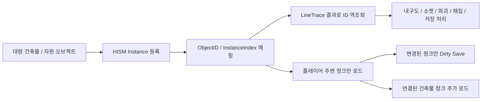
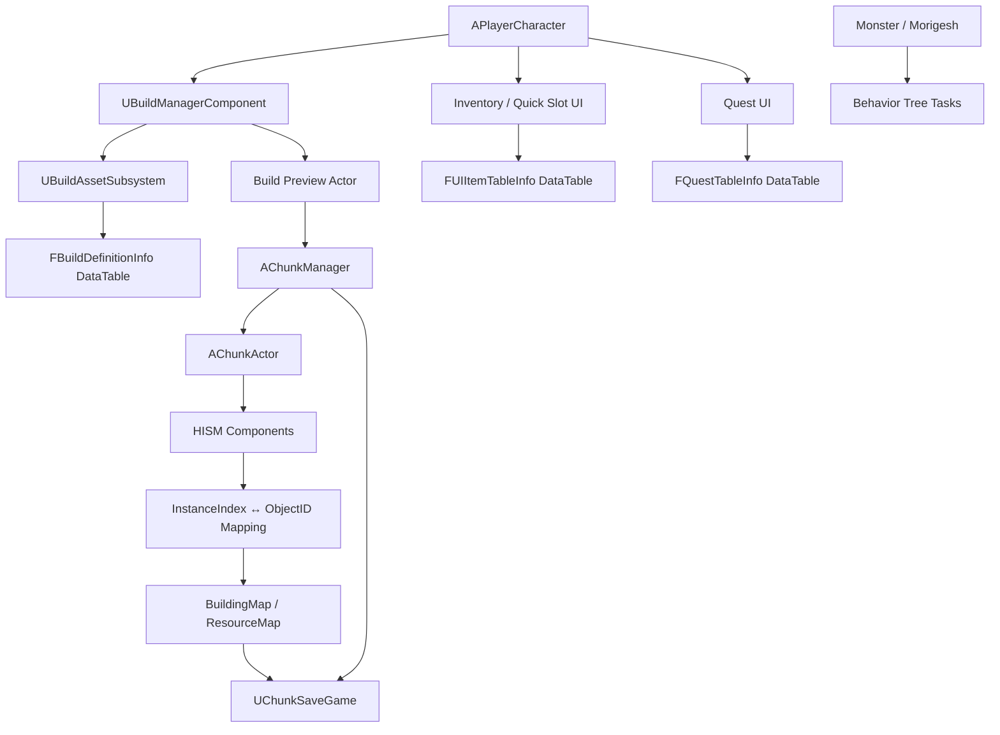

# Survival Game - Unreal Engine C++ 클라이언트 포트폴리오

> Unreal Engine C++ 기반 3D 생존/액션 게임 클라이언트 프로젝트입니다.  
> 대량으로 배치되는 건축물과 자원을 **HISM 기반 청크 시스템**으로 관리하고,  
> **ID / InstanceIndex 매핑**, **청크 스트리밍**, **Dirty Chunk 저장/로드**, **DataTable 기반 콘텐츠 관리**, **AI 전투 시스템**을 구현했습니다.

---

<a id="table-of-contents"></a>
## 목차

- [1. 프로젝트 개요](#overview)
- [2. 핵심 기술 요약](#tech-summary)
- [3. 시스템 구조](#system-architecture)
- [4. 주요 기능 요약](#feature-summary)
- [5. 핵심 기술 상세](#core-tech)
  - [5.1 HISM 기반 청크 월드 관리](#hism-chunk-world)
  - [5.2 플레이어 위치 기반 청크 스트리밍](#chunk-streaming)
  - [5.3 Dirty Chunk 기반 저장/로드](#dirty-chunk-save-load)
  - [5.4 소켓 기반 건축 연결과 HISM ↔ Actor Hybrid](#socket-building-state)
  - [5.5 데이터 기반 건축 시스템과 에셋 로드](#data-driven-building)
  - [5.6 인벤토리 / 제작 / 퀘스트 UI](#inventory-crafting-quest)
  - [5.7 AI 전투 시스템](#ai-combat)
- [6. 코드 구조](#code-structure)
- [7. 공통 측정 환경](#measurement-method)
- [8. 설계상 트레이드오프](#tradeoffs)
- [9. 한 줄 요약](#one-line-summary)

---

<a id="overview"></a>
## 1. 프로젝트 개요

| 항목 | 내용 |
|---|---|
| 프로젝트명 | Survival Game |
| 장르 | 3D 생존 / 액션 / 제작 / 건축 |
| 엔진 | Unreal Engine C++ 4.26 |
| 담당 영역 | 클라이언트 시스템 설계 및 구현 |
| 주요 구현 | 청크 스트리밍, HISM 인스턴싱, 건축 시스템, 저장/로드, 인벤토리, 제작, 퀘스트, AI 전투 |
| 개발 인원 | 1명 |
| 개발 기간 | 3~4개월 |

### 프로젝트 방향

이 프로젝트는 생존/건축 게임에서 오브젝트가 계속 늘어나는 상황을 기준으로, 대량 건축물과 자원을 가볍게 관리하는 데 초점을 뒀습니다. 정적 오브젝트는 HISM 인스턴스로 묶고, HISM이 직접 들고 있지 못하는 상태는 ID 기반 데이터로 따로 관리했습니다. 여기에 청크 스트리밍, Dirty Save, DataTable 기반 콘텐츠 관리를 붙여서 배치부터 저장/로드까지 하나의 흐름으로 이어지게 만들었습니다.

---

<a id="tech-summary"></a>
## 2. 핵심 기술 요약

| 핵심 기술 | 설명 |
|---|---|
| HISM 기반 오브젝트 관리 | 건축물과 자원을 HISM 인스턴스로 등록해 Actor / Component 수 증가를 줄였습니다. |
| ID ↔ InstanceIndex 매핑 | HISM 인스턴스를 개별 오브젝트처럼 다루기 위해 `BuildingID` / `ResourceID`를 Hit된 HISM Component `InstanceIndex`와 매핑했습니다. |
| Chunk Streaming | 플레이어 위치 기준으로 필요한 청크만 로드하고, 범위 밖 청크는 저장 캐시에 반영 후 언로드합니다. |
| Connected Chunk Loading | 청크 밖에 연결된 건축물이 누락되지 않도록 `SocketMap`을 따라 필요한 청크를 추가 로드합니다. |
| Dirty Chunk Save | 전체 월드를 매번 저장하지 않고, 변경된 청크만 SaveData에 반영합니다. |
| DataTable + Soft Reference | 건축물, 아이템, 퀘스트 정보를 DataTable로 분리하고, 건축 프리뷰 에셋은 비동기로 로드해 캐싱합니다. |
| HISM ↔ Actor Hybrid | 정적 건축물은 HISM으로 줄이고, 문처럼 상호작용이 필요한 오브젝트는 Actor로 유지했습니다. |
| Behavior Tree 기반 AI | Task / Service / Decorator로 몬스터 행동과 보스 Phase 패턴을 분리했습니다. |

### 핵심 설계 흐름



단순히 HISM을 사용한 것이 아니라 **HISM 인스턴스에 ID와 상태 데이터를 연결해서, 개별 건축물/자원처럼 조작할 수 있게** 만들었습니다.

청크 스트리밍은 렌더링 컬링과 다르게 멀어진 **청크의 HISM 인스턴스와 충돌 데이터를 실제 월드에서 제거**하고, SaveData 캐시만 남기는 방식으로 동작합니다.

---

<a id="system-architecture"></a>
## 3. 시스템 구조



---

<a id="feature-summary"></a>
## 4. 주요 기능 요약

| 구분 | 주요 구현 내용 |
|---|---|
| 월드 / 청크 시스템 | 플레이어 주변 청크를 로드/언로드하고, HISM Hit 결과를 `BuildingID` / `ResourceID`로 역조회해 채집, 파괴, 업그레이드, 저장/로드에 사용했습니다. |
| 건축 시스템 | 건축 모드, 프리뷰, 충돌 검사, 소켓 스냅, 배치, 내구도, 파괴, 업그레이드, 문 상호작용을 구현했습니다. |
| 저장 / 로드 | 청크별 건축물, 자원, 부착형 Actor, 소켓 연결 정보를 저장하고 다시 복원합니다. |
| 인벤토리 / 제작 / 퀘스트 | UMG 기반 인벤토리와 퀵슬롯, 아이템 스택, 제작 UI, 사냥/제작 등 퀘스트 진행도와 보상 지급을 구현했습니다.|
| 전투 / AI | 장비 타입별 공격, 활 조준/발사, 스태미나 소모, Behavior Tree 기반 몬스터 AI, 보스 Phase 패턴을 구현했습니다. |

---

<a id="core-tech"></a>
## 5. 핵심 기술 상세

<a id="hism-chunk-world"></a>
### 5.1 HISM 기반 청크 월드 관리

#### 문제

건축물, 나무, 돌 같은 월드 오브젝트가 많아질수록 개별 Actor 방식은 부담이 커집니다.  
특히 생존/건축 게임에서는 플레이어가 만든 건축물이 계속 쌓이고, 자원 오브젝트도 월드에 많이 존재합니다.

단순히 Tick을 끄거나 멀리 있는 오브젝트를 숨기는 것만으로는 부족했습니다.  
그래서 여러 최적화 방식을 찾아봤고, 그중 대량 오브젝트 관리에 가장 적합하다고 판단한 HISM을 기반으로 구조를 바꿨습니다.

#### 왜 HISM을 선택했나?

| 방법 | 장점 | 한계 | 판단 |
|---|---|---|---|
| 개별 Actor 유지 + Tick 비활성화 | 기존 로직을 그대로 쓰기 쉬움 | Actor / Component / Collision 비용은 계속 남음 | 대량 오브젝트에는 부족 |
| 거리 기반 숨김 / Collision 비활성화 | 멀리 있는 오브젝트 비용 일부 감소 | Actor는 계속 월드에 남음 | 보조 최적화로만 적합 |
| Object Pooling | Spawn / Destroy 비용 감소 | 이미 배치된 오브젝트는 계속 Actor로 유지해야 함 | 생성 비용 완화용 |
| Merge Actor / HLOD | 고정 배경 오브젝트에 유리 | 자유 배치, 파괴, 업그레이드가 필요한 건축물에는 맞지 않음 | 부적합 |
| ISM | 같은 Mesh를 인스턴스로 관리 가능 | 공간 단위 관리와 컬링 측면에서 HISM보다 아쉬움 | 후보였지만 HISM이 더 적합 |
| HISM | 반복 Mesh를 인스턴스로 관리하고 계층 컬링에 유리 | Actor가 아니므로 상태 관리를 직접 해야 함 | ID 기반 상태 구조를 추가해 채택 |

결국 HISM을 기반으로 하되, HISM 인스턴스를 개별 게임 오브젝트처럼 다루기 위한 **ID 기반 관리 구조**를 직접 만들었습니다.

#### 구현

`AChunkManager`는 전체 청크와 런타임 상태를 관리하고, `AChunkActor`는 청크 내부 HISM 인스턴스를 관리합니다.

- `AChunkManager`
  - 청크 로드/언로드
  - 건축물/자원 ID 발급
  - `BuildingMap`, `ResourceMap` 관리
  - 저장/로드 및 Dirty Chunk 처리

- `AChunkActor`
  - 청크 내부에서 Mesh/오브젝트 타입별 HISM Component 생성/재사용
  - HISM `InstanceIndex`와 ObjectID 매핑
  - HISM Hit 결과로 ID 역조회

```cpp
TMap<FChunkCoords, AChunkActor*> LoadChunks;
TMap<int32, FBuildingNode> BuildingMap;
TMap<int32, FResourceNode> ResourceMap;
```

#### ID 기반 상태 관리

HISM 인스턴스는 Actor가 아니기 때문에 아래 정보를 직접 가질 수 없습니다.

- 고유 ID
- 내구도 / 최대 내구도
- 소켓 점유 상태
- 연결된 건축물 목록
- 파괴 / 업그레이드 상태
- 저장/로드 데이터

그래서 건축물과 자원에 각각 고유 ID를 부여하고, 실제 상태는 `BuildingMap`, `ResourceMap`에서 관리했습니다.

```text
BuildingID
 ├─ OwnerChunk
 ├─ InstanceIndex
 ├─ StaticMesh
 ├─ Durability
 ├─ MaxDurability
 ├─ BuildDefinitionName
 ├─ MaterialType / BuildType
 ├─ SocketMap
 ├─ ConnectedBuildingIDs
 └─ IsAnchor

ResourceID
 ├─ OwnerChunk
 ├─ InstanceIndex
 ├─ StaticMesh
 ├─ Hp
 ├─ ResourceType
 └─ ResourceDefinitionName
```

건축물은 소켓 연결, 업그레이드, 파괴, 지지 구조 판정이 필요해서 `SocketMap`, `ConnectedBuildingIDs`, `IsAnchor`를 추가로 관리했습니다.  
자원은 채집/파괴에 필요한 체력, 자원 타입, 정의 이름 위주로 관리했습니다.

```text
LineTrace Hit
    ↓
HISM Component + InstanceIndex
    ↓
ChunkActor에서 ObjectID 역조회
    ↓
BuildingMap / ResourceMap 접근
    ↓
Damage / Upgrade / Destroy / Harvest / Save 처리
```

#### 측정 결과

| 방식 | 생성 시간(ms) | 평균 FPS | Game Thread(ms) | GPU(ms) | Draw Calls | 비고 |
|---|---:|---:|---:|---:|---:|---|
| Actor | 2,155.8 | 68.0 | 14.7 | 14.7 | 4,676 | 개별 Actor 4,500개 Spawn |
| ISM | 15.3 | 81.5 | 8.8 | 12.8 | 1,096 | 단일 ISM Component |
| HISM | 15.6 | 129.0 | 7.0 | 8.2 | 1,254 | 단일 HISM Component |
| Chunk-HISM | 28.8 | 131.0 | 7.1 | 8.2 | 1,614 | 청크/ID/Socket 관리 포함 |

같은 조건에서 4,500개 오브젝트를 배치해 Actor / ISM / HISM / Chunk-HISM을 비교했습니다.

Actor 방식은 하나씩 Spawn하다 보니 생성 시간이 가장 오래 걸렸고, Draw Calls도 가장 높게 나왔습니다.  
반면 ISM/HISM은 인스턴스로 등록해서 생성 시간이 크게 줄었습니다.

Chunk-HISM은 단일 HISM보다 생성 시간과 Draw Calls는 증가했지만, FPS/GPU 시간은 거의 같은 수준을 유지했습니다.
따라서 순수 렌더링만 보면 단일 HISM이 단순하지만, 이 프로젝트에서는 청크 로드/언로드, ID 매핑, Socket 연결 상태 관리가 필요했기 때문에 Chunk-HISM 구조를 선택했습니다.

#### 이미지/GIF 추천 위치

| 위치 | 추천 자료 |
|---|---|
| HISM 선택 이유 아래 | Actor / ISM / HISM 구조 비교 이미지 |
| ID 기반 상태 관리 아래 | LineTrace → InstanceIndex → ObjectID 역조회 흐름도 |
| 측정 결과 아래 | Actor / ISM / HISM / Chunk-HISM 비교 그래프 |

#### 관련 코드

```text
PP/Chunk/ChunkManager.h
PP/Chunk/ChunkManager.cpp
PP/Chunk/ChunkActor.h
PP/Chunk/ChunkActor.cpp
PP/Tools/AInstancingBenchmark.h
PP/Tools/AInstancingBenchmark.cpp
```

---

<a id="chunk-streaming"></a>
### 5.2 플레이어 위치 기반 청크 스트리밍

#### 문제

청크 시스템은 처음에는 스트리밍용으로 만든 것이 아니었습니다.  
월드 좌표를 `FChunkCoords`로 바꾸고, 그 좌표를 키로 건축물이나 자원을 빠르게 찾기 위한 구조였습니다.

```text
World Location
    ↓
FChunkCoords
    ↓
Chunk Map 조회
    ↓
해당 청크의 오브젝트 접근
```

하지만 이 방식은 포트나이트처럼 정해진 격자에 맞춰 배치하는 시스템에 더 어울렸습니다.  

이 프로젝트는 러스트나 더 포레스트처럼 플레이어가 원하는 위치와 방향으로 자유롭게 배치하는 방식을 목표로 했기 때문에, 청크 좌표만으로 특정 건축물을 식별하기 어려웠습니다.

그래서 상호작용 대상은 `HISM Component + InstanceIndex`로 찾고, 청크 시스템은 **청크 스트리밍**과 **Dirty Chunk 기반 저장/로드**에 활용하는 방향으로 전환했습니다.

#### 설계 전환

```text
초기 목적: 월드 좌표 → 청크 좌표 → 오브젝트 빠른 조회
    ↓
한계 발견: 자유 배치 / 회전 / 소켓 / 경계 걸침 때문에 좌표만으로 식별 어려움
    ↓
역할 전환: 청크를 오브젝트 조회 단위가 아니라 월드 데이터 관리 단위로 사용
    ↓
적용 기능: 청크 스트리밍, Dirty Save
```

#### 구현

플레이어 위치를 기준으로 중심 청크를 계산하고, 반경 안의 청크만 로드했습니다.  
멀어진 청크는 SaveData 캐시에 반영한 뒤 월드에서 제거하고, 다시 가까워지면 SaveData를 기준으로 HISM 인스턴스를 재생성합니다.

```cpp
FChunkCoords CenterCoords = GetChunkCoordsLocation(Location);
TSet<FChunkCoords> WantChunks = BuildWantChunkSet(CenterCoords);
TSet<FChunkCoords> FinalWantChunks = BuildConnectedWantedChunkSet(WantChunks);
```

#### 구현 포인트

- `StreamingRadius` 기준으로 로드 대상 청크를 계산합니다.
- 현재 로드된 청크와 비교해 Load / Unload 목록을 나눕니다.
- 언로드 전 변경된 청크는 SaveData 캐시에 반영합니다.
- 범위 밖 청크의 HISM 인스턴스와 Collision 데이터를 실제 월드에서 제거합니다.
- 청크 경계에 걸친 건축물을 위해 연결된 청크도 추가 로드합니다.
- 연결 그래프가 바뀐 경우에는 `BuildConnectedWantedChunkSet`을 계산하기 전에 `GraphDirtyChunks`에 해당하는 로드 청크를 Runtime SaveData 캐시에 먼저 반영합니다.

#### 트러블 슈팅 : 경계 연결 처리

기본 반경만 로드하면 문제가 생길 수 있습니다.  
예를 들어 현재 청크의 천장이 바깥 청크의 Foundation에 연결되어 있다면, 바깥 청크가 언로드되면서 지지 구조나 소켓 연결 판정이 어긋날 수 있습니다.

이를 줄이기 위해 먼저 플레이어 주변 청크를 기본 로드 대상으로 잡은 뒤 Runtime SaveData의 `SocketMap`을 기준으로 연결된 건축물 ID를 BFS로 순회하고, 연결된 건축물이 다른 청크에 있으면 그 청크도 최종 로드 대상에 추가했습니다.

```text
Player Location → CenterCoords 계산
    ↓
BuildWantChunkSet으로 기본 반경 청크 수집
    ↓
기본 청크들을 Queue에 추가
    ↓
Runtime SaveData에서 CurrentChunk의 Building SaveData 조회
    ↓
Building.SocketMap의 연결 BuildingID 확인
    ↓
ChunkBuildingDataIndexCoords에서 연결 BuildingID의 청크 좌표 조회
    ↓
아직 로드 대상이 아니라면 FinalWantedChunks에 추가 후 Queue에 Enqueue
    ↓
FinalWantedChunks 기준으로 Load / Unload 수행
```

이 방식은 연결된 건축물이 여러 청크에 걸쳐 있더라도 연결 그래프를 따라 필요한 청크를 함께 로드할 수 있다는 장점이 있습니다. 대신 하나의 대형 구조물이 많은 청크를 가로지르면 활성 청크 수가 증가할 수 있으므로, 연결 안정성과 메모리 사용량 사이의 트레이드오프가 있습니다.

#### 측정 결과

Clean은 변경 없이 이동하며 순수 청크 로드/언로드 비용을 측정한 경우이고, Dirty Unload는 활성 청크마다 건축물 1개를 추가한 뒤 언로드 비용을 측정한 경우입니다.

`AvgCacheFlush`는 디스크 저장 시간이 아니라, 언로드 전 Dirty Chunk를 Runtime SaveData 캐시에 반영하는 평균 시간(ms)입니다.

| 방식 | ActiveChunks | ActiveInstances | ActiveHISMComp | AvgLoad | AvgUnload | DirtyFlushCount | AvgCacheFlush |
|---|---:|---:|---:|---:|---:|---:|---:|
| 전체 로드 |  49 | 2729 | 980 | - | - | - | - |
| Radius 1, Clean |  9 |  507 | 180 | 1.185 | 0.436 | 0 | - |
| Radius 1, Dirty Unload |  9 |  516 | 180 | 1.203 | 0.474 | 9 | 0.117 |
| Radius 2, Clean | 25 |  1385 | 500 | 1.205 | 0.436 | 0 | - | 중심 청크 포함 5x5 유지, 변경 없이 이동 |
| Radius 2, Dirty Unload |  25 |  1410 | 500 | 1.224 | 0.528 | 25 | 0.178 |
| Radius 1, 연결 청크 로드, Clean |  10 | 562 | 200 | 1.219 | 0.440 | 0 | - |
| Radius 1, 연결 청크 로드, Dirty Unload | 10 | 572 | 200 | 1.254 | 0.494 | 10 | 0.107 |

측정 결과, 전체 월드를 계속 유지하지 않고 플레이어 주변 청크만 남기는 방식으로 월드에 남아 있는 HISM 인스턴스와 Component 수를 크게 줄일 수 있었습니다.

Dirty Unload 상황에서도 Runtime SaveData 캐시 반영 비용은 0.1ms대로 유지되어, 변경된 청크를 언로드하기 전에 캐시에 반영하는 비용은 크지 않다고 봤습니다.

연결 청크 로드는 기본 반경 밖의 청크를 일부 더 로드하지만, 건축물의 소켓 연결과 지지 구조를 유지하기 위해 감수할 만한 비용이라고 판단했습니다.

그래서 현재 구조에서는 청크 스트리밍이 월드 유지 비용을 줄이면서도, 건축물 연결과 저장 동기화를 안정적으로 처리하는 데 적합하다고 봤습니다.

#### 이미지/GIF 추천 위치

| 위치 | 추천 자료 |
|---|---|
| 설계 전환 아래 | 자유 배치 건축물과 청크 격자가 어긋나는 예시 |
| 구현 아래 | 플레이어 이동에 따라 청크가 로드/언로드되는 GIF |
| 경계 연결 처리 아래 | 기본 로드 청크와 추가 로드 청크를 색으로 구분한 다이어그램 |
| 측정 항목 아래 | 전체 로드 vs 청크 스트리밍 ActiveChunks 비교 그래프 |

#### 관련 코드

```text
AChunkManager::UpdateChunkStreamingAroundLocation
AChunkManager::LoadChunkRuntime
AChunkManager::UnloadChunkRuntime
AChunkManager::BuildWantChunkSet
AChunkManager::BuildConnectedWantedChunkSet
```

---

<a id="dirty-chunk-save-load"></a>
### 5.3 Dirty Chunk 기반 저장/로드

#### 문제

청크 좌표는 자유 배치된 건축물을 직접 찾는 용도로는 한계가 있었지만 저장/로드 단위로는 잘 맞았습니다.

월드 전체를 매번 저장하면 건축물과 자원이 많아질수록 저장 대상이 계속 커지고, 플레이어가 일부 지역만 수정했더라도 전체 데이터를 다시 구성해야 합니다

그래서 청크를 **변경된 월드 데이터를 묶어서 저장하고 복원하는 단위**로 사용했습니다.

#### 구현

건축물 배치, 파괴, 업그레이드, 자원 채집처럼 월드 상태가 바뀌면 해당 위치의 청크만 Dirty로 표시했습니다.  
저장 시에는 Dirty Chunk만 SaveGame 데이터에 반영합니다.

```cpp
TSet<FChunkCoords> DirtyChunks;
TSet<FChunkCoords> GraphDirtyChunks;
```

- `DirtyChunks`: 일반적인 건축물/자원 변경
- `GraphDirtyChunks`: 소켓 연결 변경처럼, 다음 스트리밍 계산 전에 Runtime SaveData 캐시를 먼저 최신화해야 하는 그래프 변경

스트리밍 중에는 Runtime SaveData 캐시를 유지하고, 청크 언로드 또는 수동 저장 시 변경된 청크만 캐시에 반영했습니다.

#### 저장 데이터 구조

```cpp
USTRUCT(BlueprintType)
struct FBuildingSaveData
{
    GENERATED_BODY()

    UPROPERTY(SaveGame)
    int32 ID = INDEX_NONE;

    UPROPERTY(SaveGame)
    FString BuildDefinitionName;

    UPROPERTY(SaveGame)
    FTransform Transform;

    UPROPERTY(SaveGame)
    int32 Durability = 0;

    UPROPERTY(SaveGame)
    TMap<FName, int32> SocketMap;
};

USTRUCT(BlueprintType)
struct FResourceSaveData
{
    GENERATED_BODY()

    UPROPERTY(SaveGame)
    int32 ID = INDEX_NONE;

    UPROPERTY(SaveGame)
    FTransform Transform;

    UPROPERTY(SaveGame)
    int32 Hp = 0;

    UPROPERTY(SaveGame)
    EnvironmentsType ResourceType = EnvironmentsType::Wood;

    UPROPERTY(SaveGame)
    FString ResourceDefinitionName;
};
```

#### 구현 포인트

- 건축물/자원 변경 시 위치 기반으로 Dirty Chunk 등록
- 연결 관계 변경 시 Graph Dirty Chunk 등록
- `SaveWorldFull`과 `SaveWorldDirty` 분리
- 청크 언로드 전 Dirty 상태를 SaveData 캐시에 반영
- 문처럼 HISM에 직접 포함되지 않는 부착형 Actor는 별도 SaveData로 저장

#### 트러블 슈팅 : 스트리밍과 저장 캐시 동기화

청크를 언로드하기 전에 변경 내용을 캐시에 반영하지 않으면, 다시 로드했을 때 이전 상태로 돌아갈 수 있습니다.  
예를 들어 파괴한 건축물이 다시 생기거나, 업그레이드 전 상태로 복원될 수 있습니다.

그래서 언로드 전 Dirty Chunk를 캐시에 반영하고, 수동 저장 시에도 Dirty Chunk만 SaveGame 데이터에 갱신하도록 분리했습니다.  
또한 연결 구조가 바뀐 경우에는 연결 정보가 포함된 청크도 함께 Dirty 처리했습니다.

#### 측정 결과

Dirty Save 측정은 625개 청크가 로드된 테스트 월드에서 진행했습니다.  
Full Save는 전체 청크를 다시 저장 데이터로 만들고, Dirty Save는 변경된 청크만 다시 저장 데이터로 구성하도록 측정했습니다.

| 방식 | 전체 청크 수 | 변경 청크 수 | 저장 데이터 재구성 청크 수 | 저장 데이터 재구성 시간(ms) | 전체 저장 처리 시간(ms) | 비고 |
|---|---:|---:|---:|---:|---:|---|
| Full Save | 625 | - | 625 | 287.965 | 329.165 | 전체 청크 데이터 재구성 |
| Dirty Save - 1개 청크 수정 | 625 | 1 | 1 | 0.975 | 93.710 | 변경 청크만 재구성, 기존 SaveData 로드/병합 포함 |
| Dirty Save - 5개 청크 수정 | 625 | 5 | 5 | 3.142 | 96.147 | 변경 청크만 재구성, 기존 SaveData 로드/병합 포함 |

측정 결과, Full Save는 625개 청크 전체를 다시 저장 데이터로 만들기 때문에 재구성 시간이 크게 증가했습니다.

반면 Dirty Save는 실제로 변경된 1개 또는 5개 청크만 다시 구성해서, 저장 데이터 재구성 시간이 287.965ms에서 0.975ms / 3.142ms로 줄었습니다.

전체 저장 처리 시간도 Full Save의 329.165ms에서 93.710ms / 96.147ms로 줄어, 월드 규모가 커지고 일부 청크만 변경되는 상황에서는 Dirty Chunk 방식이 불필요한 저장 데이터 재구성 비용을 줄이는 데 효과적이라고 판단했습니다.

#### 이미지/GIF 추천 위치

| 위치 | 추천 자료 |
|---|---|
| 구현 아래 | 전체 저장과 Dirty Save 차이 다이어그램 |
| 저장 데이터 구조 아래 | BuildingSaveData / ResourceSaveData 관계도 |
| 캐시 동기화 아래 | Unload 전 SaveData 캐시에 반영되는 흐름도 |
| 측정 항목 아래 | Full Save / Dirty Save 저장 시간 비교 그래프 |

#### 관련 코드

```text
PP/Chunk/ChunkSaveGame.h
AChunkManager::SaveWorld
AChunkManager::SaveWorldFull
AChunkManager::SaveWorldDirty
AChunkManager::LoadWorld
AChunkManager::BuildChunkSaveData
AChunkManager::FlushDirtyChunksSaveCache
```

---

<a id="socket-building-state"></a>
### 5.4 소켓 기반 건축 연결과 HISM ↔ Actor Hybrid

#### 문제

건축 시스템은 완전 자유 배치만으로는 부족했습니다.  
벽, 바닥, 천장, 계단, 문틀처럼 서로 맞물려야 하는 건축물은 위치와 회전이 정확해야 하고, 어떤 건축물의 어느 지점에 붙었는지도 계속 관리해야 했습니다.

단순히 충돌 검사만으로 가까운 건축물을 찾는 방식도 애매했는데 연결이 불가능한 건축물이거나, 이미 사용 중인 연결 지점에 다른 건축물이 또 붙는 문제도 생길 수 있기 때문입니다.

그래서 건축물 연결은 **Static Mesh Socket**을 기준으로 처리했습니다.  
소켓은 각 건축물 Mesh에 미리 정의된 연결 지점이기 때문에, 벽은 벽에 맞는 위치로, 천장은 천장에 맞는 위치로, 계단은 계단에 맞는 위치로 자연스럽게 붙일 수 있었습니다.

#### HISM ↔ Actor Hybrid를 같이 사용한 이유

벽, 바닥, 천장, 창문, 계단처럼 배치 후 거의 움직이지 않는 건축물은 HISM으로 관리했습니다.  
많이 배치될 수 있는 오브젝트라 Actor로 하나씩 유지하기엔 부담이 컸기 때문입니다.

하지만 문짝처럼 열림/닫힘, 애니메이션, 충돌 변경이 필요한 오브젝트는 HISM만으로 처리하기 어려웠습니다.  
그래서 정적 건축물은 HISM으로 줄이고, 문짝처럼 직접 상호작용이 필요한 오브젝트는 Actor로 유지했습니다.

정적 HISM 건축물은 `BuildingID` 기준으로 관리하고, 문짝 같은 부착형 Actor는 `ParentBuildingID + ParentSocketName`을 키로 `HISMAttachBuildActors`에 등록했습니다. 덕분에 정적 건축물의 소켓 연결/내구도/파괴/업그레이드는 `BuildingMap` 흐름을 사용하고, 부착형 Actor는 부모 건축물의 소켓에 붙은 별도 저장 데이터로 복원할 수 있었습니다.

#### 검토한 방식

| 방식 | 장점 | 한계 | 판단 |
|---|---|---|---|
| 모든 건축물을 Actor로 유지 | 문 상호작용, 애니메이션, 충돌 변경 구현이 쉬움 | 벽, 바닥, 천장처럼 대량 배치되는 정적 건축물까지 Actor 수가 증가 | 성능 측면에서 불리 |
| 모든 건축물을 HISM으로 관리 | 대량 건축물 관리에 가장 유리 | 문처럼 상태 변화와 상호작용이 필요한 오브젝트 구현이 복잡 | 기능 구현 비용이 큼 |
| HISM으로 두고 상호작용 시에만 임시 Actor 생성 | 평상시 Actor 수를 최소화할 수 있고, 상호작용 오브젝트가 많아질수록 장기적으로 유리 | HISM ↔ Actor 전환 시 Transform, Collision, Animation, 저장 데이터, 소켓 연결 상태를 모두 동기화해야 함 | 장기 개선 후보 |
| 정적 건축물은 HISM, 상호작용 Actor만 유지 | 현재 프로젝트처럼 상호작용 Actor 개수가 적은 구조에서는 구현이 단순하고 안정적 | 상호작용 Actor가 많아지면 Actor 수와 별도 저장 데이터가 증가 | 현재 프로젝트 범위에서 최종 채택 |

현재 프로젝트에서는 상호작용 오브젝트가 문짝 중심이라 전체 정적 건축물에 비해 수가 적다고 봤습니다. 그래서 **정적 건축물은 HISM으로 관리하고, 문짝 같은 부착형 상호작용 오브젝트만 Actor로 유지하는 방식**으로 구현했습니다.

다만 보관함, 제작대, 화로, 함정처럼 상태를 가진 상호작용 오브젝트가 많아진다면, 평상시에는 HISM으로 두고 상호작용 시점에만 Actor로 전환하는 구조가 더 적합할 수 있습니다.

#### 구현

정적 건축물은 HISM 인스턴스로 전환하고, 문짝처럼 상호작용이 필요한 오브젝트는 별도 Actor로 유지했습니다.
이렇게 하면 많이 배치되는 벽, 바닥, 천장, 창문, 계단은 HISM으로 부담을 줄이고, 문짝은 Actor의 충돌, 함수 호출, Timeline/애니메이션, 상태 저장 구조를 활용할 수 있습니다.

건축물 연결은 Static Mesh Socket을 사용했습니다.
배치 시 가장 가까운 유효 소켓을 찾아 프리뷰 위치와 회전을 보정하고, 배치 완료 후 SocketMap과 ConnectedBuildingIDs를 갱신했습니다.

```text
Build Preview
    ↓
라인트레이스로 연결 대상 건축물 탐색
    ↓
AllowedTargetTypes / AllowedTargetSockets로 프리뷰 소켓 필터링
    ↓
가장 가까운 유효 Socket 찾기
    ↓
Preview Transform을 Socket 기준으로 보정
    ↓
충돌 검사 및 배치 가능 여부 확인
    ↓
배치 확정
    ↓
정적 건축물: HISM Instance 등록
부착형 상호작용 오브젝트: Actor 유지
    ↓
SocketMap / ConnectedBuildingIDs 또는 HISMAttachBuildActors 갱신
```

```cpp
bool AChunkManager::AddSocket(
    int32 ID,
    int32 ConnectID,
    FName SocketName,
    FName ConnectSocketName
);

TMap<FName, int32> SocketMap;
TArray<int32> ConnectedBuildingIDs;

struct FAttachBuildKey
{
    int32 ParentBuildingID;
    FName ParentSocketName;
};

TMap<FAttachBuildKey, ABuildable*> HISMAttachBuildActors;
```

`SocketMap`은 정적 HISM 건축물끼리 연결된 소켓을 관리합니다. 이미 사용 중인 소켓에는 다시 정적 건축물이 붙지 않도록 `CheckSocket`으로 막았습니다.

`ConnectedBuildingIDs`는 이 건축물이 어떤 정적 건축물과 연결되어 있는지 저장합니다. 이 정보는 배치뿐 아니라 저장/로드, 청크 경계 로드, 파괴 후 지지 구조 판정에도 사용했습니다.

문짝 같은 부착형 Actor는 자기만의 `BuildingID`를 새로 발급하지 않고, `ParentBuildingID + ParentSocketName` 조합으로 `HISMAttachBuildActors`에 등록했습니다. 저장 시에는 `FAttachBuildableSaveData`로 부모 ID, 부모 소켓, Transform, 내구도를 따로 기록합니다.

#### 구현 포인트

- 프리뷰 단계에서는 `AllowedTargetTypes`, `AllowedTargetSockets`로 배치 가능한 대상 타입과 소켓을 제한했습니다.
- 가장 가까운 유효 소켓을 찾아 프리뷰 위치와 회전을 보정했습니다.
- 정적 건축물끼리의 중복 배치는 `SocketMap`과 `CheckSocket`으로 막았습니다.
- 부착형 Actor의 중복 배치는 `HISMAttachBuildActors` 키(`ParentBuildingID + ParentSocketName`)로 막았습니다.
- 배치 완료 시 정적 건축물은 양쪽 `SocketMap` / `ConnectedBuildingIDs`를 서로 등록했습니다.
- 정적 건축물은 배치 후 HISM 인스턴스로 전환했습니다.
- 문짝 Actor는 부모 건축물 ID와 소켓 이름을 기준으로 부착 관리했습니다.
- 정적 소켓 연결 정보는 저장/로드, 청크 경계 연결, 파괴 후 지지 구조 판정에도 사용했습니다.

#### 트러블 슈팅 : 충돌 검사 기반 판정에서 연결 그래프 기반 지지 판정으로 변경

처음에는 건축물이 파괴될 때 주변 충돌 검사를 통해 인접한 건축물을 찾았습니다.  
하지만 여러 건축물이 한 번에 무너지는 상황에서는 각 건축물마다 충돌 검사가 반복되어 비용이 커졌습니다.

또 충돌 검사만으로는 “가까이 있는 건축물”과 “실제로 소켓으로 연결된 건축물”을 구분하기 어려웠습니다.
서로 연결되지 않았는데 가까이 있다는 이유로 연결된 것처럼 판정될 수 있었고, 어떤 건축물이 지지 구조인지 판단하는 코드도 복잡해졌습니다.

그래서 배치 시점에 저장해 둔 `ConnectedBuildingIDs`를 연결 그래프처럼 사용했습니다.  
건축물을 파괴할 때는 파괴 대상과 연결되어 있던 건축물들을 시작점으로 BFS를 돌고, 탐색된 연결 컴포넌트 안에 `IsAnchor`가 있는지 확인했습니다.

```text
DestroyBuilding(ID)
    ↓
파괴 대상의 ConnectedBuildingIDs를 StartNodes로 저장
    ↓
파괴 대상을 SocketMap / ConnectedBuildingIDs에서 Disconnect
    ↓
파괴 대상 HISM Instance 제거
    ↓
각 StartNode에서 ConnectedBuildingIDs 기반 BFS 탐색
    ↓
연결 컴포넌트 내부에 IsAnchor가 있는지 확인
    ↓
Anchor가 없으면 해당 연결 컴포넌트의 건축물들을 함께 제거
```

이 방식은 매번 주변 충돌 검사를 반복하지 않고, 실제 배치 과정에서 확정된 연결 정보만 사용합니다.
그래서 가까이 있지만 연결되지 않은 건축물이 잘못 포함되는 문제를 줄이고, 대량 파괴 상황도 연결 그래프 단위로 처리할 수 있습니다.

#### 추천 이미지/GIF 위치

| 위치 | 추천 자료 |
|---|---|
| `왜 소켓 기반으로 연결했는가?` 아래 | 자유 배치와 소켓 스냅의 차이를 보여주는 다이어그램 |
| `소켓 기반 배치 흐름` 아래 | 프리뷰가 가장 가까운 소켓에 스냅되는 GIF |
| `구현 포인트` 아래 | SocketMap으로 중복 배치를 막는 다이어그램 |
| `연결 그래프 기반 지지 판정` 아래 | Anchor 기준 BFS 탐색 후 공중 구조물이 제거되는 GIF |
| `HISM ↔ Actor Hybrid` 아래 | HISM 건축물과 문 Actor가 함께 저장/로드되는 흐름도 |

#### 관련 코드

```text
AChunkManager::AddSocket
AChunkManager::CheckSocket
AChunkManager::AddHISMAttachBuildActor
AChunkManager::RemoveHISMAttachBuildActor
AChunkManager::DamageBuilding
AChunkManager::DestroyBuilding
AChunkManager::DisconnectBuilding
AChunkManager::RemoveOnlyBuilding
AChunkManager::UpgradeBuilding
AChunkManager::UpgradeBuildingDefinitionName
UBuildManagerComponent::FindClosestSocket
ABuildable::Build
ABuildable::BuildDestroy
PP/Buildable/DoorBuildable.cpp
PP/Buildable/OpenDoorBuildable.cpp
PP/Buildable/DestructibleBuildable.cpp
```
---

<a id="data-driven-building"></a>
### 5.5 데이터 기반 건축 시스템과 에셋 로드

#### 문제

건축물 종류가 늘어날수록 클래스, 메시, 내구도, 재질, 배치 조건, 업그레이드 정보를 코드에 직접 연결하기 어렵습니다.  
또 건축물 선택 시 필요한 에셋을 동기 로드하면 순간적인 끊김이 생길 수 있습니다.

#### 구현

`FBuildDefinitionInfo`를 DataTable Row로 정의해 건축물 정보를 데이터화했습니다.  
건축물 클래스, Static Mesh, Destructible Mesh는 Soft Reference로 관리했습니다. 프리뷰 생성처럼 플레이어 입력 중 발생하는 경로는 `UBuildAssetSubsystem::RequestAsync`로 비동기 로드하고 캐싱했으며, 저장/로드 복원이나 청크 런타임 재생성처럼 즉시 데이터가 필요한 경로는 `ResolveSync`로 캐시 또는 동기 로드를 사용했습니다.

```cpp
USTRUCT(BlueprintType)
struct FBuildDefinitionInfo : public FTableRowBase
{
    GENERATED_BODY()

    UPROPERTY(EditAnywhere, BlueprintReadWrite)
    EBuildType BuildType = EBuildType::None;

    UPROPERTY(EditAnywhere, BlueprintReadWrite)
    EnvironmentsType MaterialType = EnvironmentsType::Wood;

    UPROPERTY(EditAnywhere, BlueprintReadWrite)
    TSoftClassPtr<ABuildable> BuildableClass;

    UPROPERTY(EditAnywhere, BlueprintReadWrite)
    TSoftObjectPtr<UStaticMesh> StaticMesh;

    UPROPERTY(EditAnywhere, BlueprintReadWrite)
    TSoftObjectPtr<UDestructibleMesh> DestructibleMesh;

    UPROPERTY(EditAnywhere, BlueprintReadWrite)
    int32 Durability = 1000;

    UPROPERTY(EditAnywhere, BlueprintReadWrite)
    int32 MaxDurability = 1000;

    UPROPERTY(EditAnywhere, BlueprintReadWrite)
    bool GroundBuild = false;

    UPROPERTY(EditAnywhere, BlueprintReadWrite)
    bool GroundOnly = false;

    UPROPERTY(EditAnywhere, BlueprintReadWrite)
    bool Anchor = false;

    UPROPERTY(EditAnywhere, BlueprintReadWrite)
    TArray<EBuildType> AllowedTargetTypes;

    UPROPERTY(EditAnywhere, BlueprintReadWrite)
    TArray<FName> AllowedTargetSockets;

    UPROPERTY(EditAnywhere, BlueprintReadWrite)
    FString UpgradeName;
};
```
#### 구현 포인트

- 건축물 클래스와 메시를 Soft Reference로 관리합니다.
- `UBuildAssetSubsystem`은 로드된 에셋을 `Cache`에 저장해 재사용합니다.
- `UBuildManagerComponent::SetBuildData`는 선택된 건축물의 DataTable 정보를 찾고, `RequestAsync` 완료 후 프리뷰 Actor를 생성할 수 있게 준비합니다.
- 배치 가능 여부에 따라 성공/실패 머티리얼을 적용합니다.
- 배치 확정 시 정적 건축물은 Actor를 유지하지 않고 Chunk HISM 인스턴스로 전환합니다.

#### 적용 방식

| 항목 | 적용 방식 |
|---|---|
| 건축물 정의 | `FBuildDefinitionInfo` DataTable |
| 에셋 참조 | `TSoftClassPtr`, `TSoftObjectPtr` |
| 로드 방식 | 프리뷰 선택 시 `RequestAsync`, 저장/로드 복원 시 `ResolveSync` |
| 재사용 방식 | `UBuildAssetSubsystem` 캐시 |
| 확장 방식 | DataTable Row 추가로 건축물 정의 확장 |

#### 건축물 선택 및 배치 흐름

```text
Build UI에서 건축물 선택
    ↓
DataTable Row 조회
    ↓
Soft Reference 에셋 비동기 로드(RequestAsync)
    ↓
로드 완료 후 캐시에 저장
    ↓
Preview Actor 생성
    ↓
배치 가능 여부 검사
    ↓
배치 확정
    ↓
정적 건축물은 Chunk HISM Instance로 등록
```

#### 이미지/GIF 추천 위치

| 위치 | 추천 자료 |
|---|---|
| 구현 아래 | DataTable Row → Build Preview → HISM 등록 흐름도 |
| 구현 포인트 아래 | 건축 프리뷰 생성 및 머티리얼 변경 GIF |
| 측정 항목 아래 | 최초 로드 / 캐시 재사용 시간 비교 그래프 |

#### 관련 코드

```text
PP/GameInfo.h
PP/AssetManager/BuildAssetSubsystem.h
PP/AssetManager/BuildAssetSubsystem.cpp
PP/Buildable/BuildManagerComponent.h
PP/Buildable/BuildManagerComponent.cpp
PP/Buildable/Buildable.h
PP/Buildable/Buildable.cpp
```

---

<a id="inventory-crafting-quest"></a>
### 5.6 인벤토리 / 제작 / 퀘스트 UI

#### 구현 내용

- 인벤토리는 20칸, 퀵슬롯은 6칸 구조로 구현했습니다.
- 아이템 정보는 `FUIItemTableInfo` DataTable에서 읽어옵니다.
- 동일 아이템은 최대 수량까지 스택하고, 초과 수량은 빈 슬롯에 나눠 넣습니다.
- 제작 UI는 무기, 장비, 건축 아이템, 음식 카테고리로 필터링합니다.
- 퀘스트 UI는 사냥/제작 진행도를 갱신하고, 완료 시 보상을 인벤토리에 지급합니다.

#### 측정 결과

| 항목 | 값 | 설명 |
|---|---|---|
| 인벤토리 슬롯 수 | 20 | 기본 인벤토리 슬롯 |
| 퀵슬롯 수 | 6 | 단축 슬롯 |
| 아이템 DataTable Row 수 | 에셋 기준 확인 필요 | 코드 zip에는 DataTable 에셋이 포함되지 않아 산출 불가 |
| 제작 가능 아이템 수 | 에셋 기준 확인 필요 | Crafting UI에 노출되는 제작 항목 수 |
| 퀘스트 타입 수 | 3 | `Collection`, `Hunt`, `Craft` |

#### 이미지/GIF 추천 위치

| 위치 | 추천 자료 |
|---|---|
| 구현 내용 아래 | 인벤토리, 퀵슬롯, 제작 UI 캡처 |
| 측정 항목 아래 | 아이템 획득 → 스택 → 제작 → 퀘스트 보상 흐름 GIF |

#### 관련 코드

```text
PP/Widget/InventoryTile.cpp
PP/Widget/UseInventoryTile.cpp
PP/Widget/Crafting.cpp
PP/Widget/QuestWidget.cpp
PP/GameInfo.h
PP/PPGameInstance.cpp
```

---

<a id="ai-combat"></a>
### 5.7 AI 전투 시스템

#### 구현 내용

- 몬스터의 순찰, 추적, 공격, 도주를 Behavior Tree Task로 분리했습니다.
- Player Detect Service에서 거리와 각도를 기준으로 타겟을 감지합니다.
- Decorator로 거리 조건과 보스 Phase 조건을 판단합니다.
- 보스 Morigesh는 Phase에 따라 보호막, 좀비 소환, 폭발, 메테오, 단검 공격 패턴을 사용합니다.

#### 이미지/GIF 추천 위치

| 위치 | 추천 자료 |
|---|---|
| 구현 내용 아래 | 일반 몬스터 탐지 → 추적 → 공격 GIF |
| 측정 항목 아래 | Morigesh Phase 전환 및 보스 스킬 사용 GIF |

#### 관련 코드

```text
PP/AI/BTService_PlayerDetect.cpp
PP/AI/BTDecorator_CheckDistance.cpp
PP/AI/BTDecorator_CheckPhase.cpp
PP/AI/BTTask_Patrol.cpp
PP/AI/BTTask_TargetTrace.cpp
PP/AI/BTTask_NormalAttack.cpp
PP/AI/BTTask_Getaway.cpp
PP/AI/BTTask_MorigeshPhase0.cpp
PP/AI/UBTTask_MorigeshPhase1.cpp
PP/AI/UBTTask_MorigeshPhase2.cpp
PP/Character/Monster/Morigesh.cpp
```

---

<a id="code-structure"></a>
## 6. 코드 구조

```text
PP/
├── AI/                  # Behavior Tree Task, Service, Decorator
├── AssetManager/        # 건축 에셋 비동기 로드 및 캐싱
├── Buildable/           # 건축물 Actor, 건축 매니저, 문/벽/창문/천장/계단 등
├── Character/
│   ├── Player/          # 플레이어 이동, 전투, 건축, 인벤토리 연동
│   └── Monster/         # 몬스터, 보스, AI Controller, Anim
├── Chunk/               # 청크, HISM 인스턴싱, 저장/로드, 스트리밍
├── Customizer/          # 캐릭터 커스터마이징
├── Equipment/           # 무기, 장비, 소비 아이템, 화살 등
├── Environments/        # 나무/돌 등 채집 자원
├── Effect/              # 투사체, 보스 스킬, 실드, 이펙트
├── Tools/               # 벤치마크, 포털, 아이템 박스
└── Widget/              # 인벤토리, 제작, 퀘스트, HUD
```

---

<a id="measurement-method"></a>
## 7. 공통 측정 환경

| 항목 | 값 |
|---|---|
| CPU | Intel i9 12900kf |
| GPU | GeForce RTX 3050 |
| RAM | DDR4 32GB |
| OS | 윈도우 11 |
| Unreal Engine Version | 4.26|
| Build Type | Editor PIE - New Editor Window |
| Resolution | 1280*720 |
| 측정 횟수 | 평균 3~5회 |


<a id="tradeoffs"></a>
## 8. 설계상 트레이드오프

### HISM 선택으로 인한 상태 관리 비용

HISM은 대량 오브젝트를 표현하기 좋지만, Actor처럼 각 인스턴스가 자체 상태를 가질 수는 없습니다.  
그래서 건축물과 자원은 `BuildingID`, `ResourceID`를 기준으로 나누고, `BuildingMap`, `ResourceMap`에서 상태를 따로 관리했습니다.

Actor 수와 Component 수를 줄이는 데는 유리했지만, `FBuildingNode`, `FResourceNode` 같은 상태 데이터를 계속 들고 있어야 합니다.  
즉, 렌더링과 Actor 관리 비용은 줄인 대신, 개별 오브젝트 상태를 직접 관리하는 비용이 생겼습니다.

### 연결 청크 로드로 인한 활성 청크 증가

연결 구조가 끊기지 않도록 기본 스트리밍 반경 밖에 있는 연결 청크도 추가 로드했습니다.  
이 방식은 안정적이지만, 하나의 대형 구조물이 여러 청크에 걸쳐 연결되어 있을 경우 활성 청크 수가 증가할 수 있습니다.

### SaveData 기준 연결 탐색

연결 청크 로드는 Runtime SaveData 캐시를 기준으로 수행합니다.  
그래서 연결 구조가 바뀐 청크는 스트리밍 계산 전에 SaveData 캐시에 반영되도록 처리했습니다.

이 방식은 언로드된 청크의 연결 정보도 탐색할 수 있습니다.  
대신 SaveData 캐시와 런타임 상태가 어긋나지 않게 Dirty Chunk 반영 타이밍을 신경 써야 합니다.

### HISM ↔ Actor Hybrid 구조

정적 건축물은 HISM으로 관리하고, 문처럼 상호작용이 필요한 오브젝트만 Actor로 유지했습니다.  
현재 프로젝트에서는 상호작용 오브젝트가 문 중심이라 Actor 수 증가가 크지 않았고, 구현도 더 안정적이었습니다.

다만 보관함, 제작대, 화로, 함정처럼 상태를 가진 오브젝트가 많아지면 Actor 수와 저장 데이터가 함께 늘어날 수 있습니다.  
추후에는 평상시에는 HISM으로 두고, 상호작용 시점에만 Actor로 전환하는 구조로 확장할 수 있습니다.

### 청크 복원 경로의 동기 로드

건축 프리뷰 에셋은 `RequestAsync`로 비동기 로드하지만, SaveData에서 청크를 복원하는 `AddBuildingInstanceDefinitionName` / `SpawnAttachBuildableSaveData` 경로는 `ResolveSync`를 사용합니다.  
구현은 단순하고 즉시 복원이 쉽지만, 청크 크기와 오브젝트 수가 커지면 순간적인 비용이 생길 수 있습니다.  
추후에는 청크 복원도 비동기 에셋 준비 단계와 실제 HISM 등록 단계를 분리하는 방식으로 확장할 수 있습니다.

---

<a id="one-line-summary"></a>
## 9. 한 줄 요약

> 대규모 건축/자원 오브젝트를 HISM과 청크 스트리밍으로 관리하고, ID 기반 상태 관리와 DataTable 기반 건축·아이템·퀘스트 시스템을 결합한 Unreal Engine C++ 클라이언트 포트폴리오입니다.
