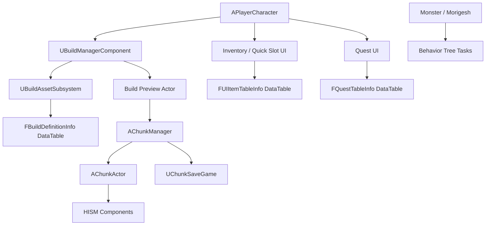

[README_tech_intro_metrics_toc.md](https://github.com/user-attachments/files/27746114/README_tech_intro_metrics_toc.md)
# [프로젝트명] - Unreal Engine C++ 클라이언트 포트폴리오

> Unreal Engine C++ 기반의 3D 생존/액션 게임 클라이언트 프로젝트입니다.  
> 대규모 건축물/자원 오브젝트를 HISM 기반 청크 단위로 Chunk Streaming + Dirty Save를 사용해 관리하고, 건축·제작·인벤토리·퀘스트를 데이터 기반으로 구성 AI 및 전투 시스템을 구현하였습니다.

//문장 좀 추가 했는데 어떤지
> **작성 팁**  
> 이 README는 기능 소개보다 **어떤 문제를 어떤 방식으로 해결했는지**를 보여주는 기술소개서 형식입니다.  
> 실제 GitHub에 올릴 때는 `[ ]` 영역을 본인 프로젝트 정보로 교체하고, 측정 완료 후 `성능 측정 요약`과 각 기술 섹션의 벤치마크 표에 실제 수치를 넣으면 좋습니다.

---

<a id="table-of-contents"></a>
## 목차

- [1. 프로젝트 개요](#overview)
  - [1.1 핵심 성능 지표 요약](#performance-summary)
- [2. 기술 스택](#tech-stack)
- [3. 주요 기능 요약](#feature-summary)
- [4. 시스템 구조](#system-architecture)
- [5. 핵심 기술 상세](#core-tech)
  - [5.1 HISM 기반 청크 월드 관리](#hism-chunk-world)
  - [5.2 플레이어 위치 기반 청크 스트리밍](#chunk-streaming)
  - [5.3 Dirty Chunk 기반 저장/로드](#dirty-chunk-save-load)
  - [5.4 데이터 기반 건축 시스템](#data-driven-building)
  - [5.5 소켓 기반 건축물 연결](#socket-building)
  - [5.6 건축물 내구도, 파괴, 업그레이드](#building-durability-destroy-upgrade)
  - [5.7 인벤토리 / 제작 / 퀘스트 UI](#inventory-crafting-quest)
  - [5.8 AI 전투 시스템](#ai-combat)
- [6. 코드 구조](#code-structure)
- [7. 트러블슈팅 / 개선 경험](#troubleshooting)
- [8. 측정 방법 / 재현 조건](#measurement-method)
- [9. 향후 개선 사항](#future-work)
- [10. README에 추가하면 좋은 이미지/GIF](#media)
- [11. 한 줄 요약](#one-line-summary)

---

<a id="overview"></a>
## 1. 프로젝트 개요

| 항목 | 내용 |
|---|---|
| 프로젝트명 | Survival Game |
| 장르 | 3D 생존 / 액션 / 제작 / 건축 |
| 엔진 | Unreal Engine C++ 4.26 |
| 담당 영역 | 클라이언트 시스템 설계 및 구현 |
| 주요 구현 | 청크 스트리밍, HISM 인스턴싱, 건축 시스템, 저장/로드, 인벤토리, 제작, 퀘스트, AI 전투 |
| 개발 인원 | 1 |
| 개발 기간 | 3~4개월 |

### 핵심 목표

- 다수의 건축물과 자원을 일반 Actor가 아닌 **HISM(Hierarchical Instanced Static Mesh)** 기반으로 관리하여 월드 오브젝트 처리 비용을 줄이는 구조 구현
- 플레이어 위치 기준으로 필요한 청크만 로드하고, 변경된 청크만 저장하는 **청크 스트리밍 + Dirty Save** 구조 구현
- 건축물 배치, 연결, 내구도, 업그레이드, 파괴, 저장/복원을 하나의 시스템으로 관리
- 아이템/건축물/자원/퀘스트 데이터를 DataTable 기반으로 관리하여 콘텐츠 확장성을 확보

//더적을게 있나?

---

<a id="performance-summary"></a>
### 1.1 핵심 성능 지표 요약

> 아래 표는 README 상단에 배치하는 **정량 지표 요약 영역**입니다.  
> 아직 측정 전이라면 `[측정 예정]`으로 두고, 실제 GitHub 공개 전에는 반드시 직접 측정한 값으로 교체하세요.

| 비교 항목 | 측정 조건 | 주요 지표 | 결과 요약 |
|---|---|---|---|
| Actor vs ISM vs HISM vs Chunk-HISM | 동일 Mesh `4,500개` 배치 | 생성 시간, 평균 FPS, Game/Render/GPU ms, Draw Call, Actor/Component 수 | [측정 후 작성] |
| 전체 로드 vs 청크 스트리밍 | 동일 SaveData 기준, StreamingRadius `[1 또는 2]` | ActiveChunks, ActiveInstances, ActiveHISMComponents, AvgLoad/Unload ms | [측정 후 작성] |
| 전체 저장 vs Dirty Chunk 저장 | 전체 청크 저장 / 일부 청크만 수정 후 저장 | Save Time, DirtyChunkCount, Save Slot Size | [측정 후 작성] |
| Soft Reference 비동기 로드 / 캐싱 | 건축물 최초 선택 / 재선택 | First Load ms, Cached Load ms | [선택 측정] |

//지표 요약을 굳이 해야되나? 기술 상세에만 나오면 되는거 아닌가? 중복되는 느낌?
#### README에 넣기 좋은 최종 요약 문장 예시

```text
4,500개의 동일 건축물을 배치한 벤치마크에서 Actor, ISM, HISM, Chunk-HISM 방식을 비교했습니다.
또한 동일한 저장 데이터를 기준으로 전체 로드 방식과 플레이어 위치 기반 청크 스트리밍 방식의 활성 청크 수,
활성 인스턴스 수, 평균 청크 로드/언로드 시간을 비교했습니다.
```

---

<a id="tech-stack"></a>
## 2. 핵심 기술 요약

| 항목 | 설명 |
|---|---|
| HISM 기반 오브젝트 관리 | 건축물/자원을 개별 Actor가 아닌 HISM 인스턴스로 관리 |
| ID ↔ InstanceIndex 매핑 | HISM 인스턴스를 개별 오브젝트처럼 다루기 위해 고유 ID와 InstanceIndex를 매핑 |
| Chunk Streaming | 플레이어 위치 기준으로 필요한 청크만 로드하고, 범위 밖 청크는 저장 후 언로드 |
| Dirty Chunk Save | 변경된 청크만 SaveData 캐시에 반영 |
| Connected Chunk Expansion | 연결된 건축물 일부만 로드되는 문제를 줄이기 위해 연결 청크까지 로드 대상에 포함 |
| HISM ↔ Actor Hybrid | 정적 오브젝트는 HISM, 상호작용이 필요한 일부 오브젝트는 Actor로 관리 |

//핵심 기술 요약으로 바꿨는데 어떤가? 괜찮은가? 그리고 괜찮으면 더 추가할게 있으면 넣어달라

---

<a id="feature-summary"></a>
## 3. 주요 기능 요약

### 월드 / 청크 시스템

- 월드 좌표를 `FChunkCoords`로 변환하여 청크 단위로 오브젝트 관리
- 건축물과 자원을 각각 `BuildingMap`, `ResourceMap`으로 관리
- 건축물 ID와 자원 ID를 분리하여 충돌 없는 식별 체계 구성
- 플레이어 위치 기준으로 필요한 청크만 로드/언로드
- 청크별 건축물, 자원, 부착형 건축물을 저장
- 변경된 청크만 Dirty 처리하여 저장 비용 절감

### 건축 시스템

- `UBuildManagerComponent`에서 건축 모드, 미리보기, 배치 요청 처리
- `FBuildDefinitionInfo` DataTable을 통해 건축물 클래스, 메시, 내구도, 재질, 업그레이드 정보를 데이터화
- `UBuildAssetSubsystem`에서 건축 프리뷰에 필요한 클래스/메시를 비동기로 로드하고 캐싱
- 소켓 기반으로 벽, 바닥, 천장, 문, 창문, 계단, 램프 등을 연결
- 충돌 검사와 배치 가능 여부에 따라 프리뷰 머티리얼 변경
- 건축물 내구도, 파괴, 업그레이드 처리

### 인벤토리 / 제작 / 퀘스트

- UMG `TileView`, `ListView` 기반 인벤토리와 단축 슬롯 구성
- 아이템 DataTable 기반으로 무기, 장비, 건축 아이템, 음식, 재료 관리
- 제작 재료 정보를 기준으로 제작 가능한 아이템 목록 표시
- 사냥, 제작, 수집형 퀘스트 진행도를 갱신하고 완료 시 보상 지급

### 전투 / AI

- 근접 무기, 활, 도끼, 곡괭이 등 장비 타입별 동작 처리
- 활 조준, 크로스헤어, 화살 발사, 스태미나 소모 처리
- 몬스터 AI는 Behavior Tree Task/Service/Decorator로 순찰, 추적, 공격, 도주, 감지 처리
- 보스 몬스터 Morigesh는 Phase 기반 스킬 패턴, 보호막, 소환, 폭발, 메테오 공격 구현

---

<a id="system-architecture"></a>
## 4. 시스템 구조



---

<a id="core-tech"></a>
## 5. 핵심 기술 상세

<a id="hism-chunk-world"></a>
## 5.1 HISM 기반 청크 월드 관리

### 문제

건축물, 나무, 돌 같은 월드 오브젝트를 모두 Actor로 유지하면 오브젝트 수가 증가할수록 Tick, Collision, Transform 관리 비용이 커집니다. 특히 생존/건축 게임에서는 플레이어가 배치하는 건축물이 계속 누적되므로 일반 Actor 방식만으로는 확장성이 떨어질 수 있습니다.

### 해결

`AChunkManager`와 `AChunkActor`를 분리하여 월드 오브젝트를 청크 단위로 관리했습니다.

- `AChunkManager`
  - 전체 청크 로드/언로드 관리
  - 건축물/자원 ID 발급
  - 저장/로드 및 Dirty Chunk 관리
  - 스트리밍 통계 관리

- `AChunkActor`
  - 청크 내부의 실제 인스턴스 관리
  - `UHierarchicalInstancedStaticMeshComponent`를 메시별로 생성/재사용
  - 인스턴스 인덱스와 게임 오브젝트 ID를 매핑

```cpp
TMap<FChunkCoords, AChunkActor*> LoadChunks;
TMap<int32, FBuildingNode> BuildingMap;
TMap<int32, FResourceNode> ResourceMap;
```

### 정량 지표를 넣기 좋은 위치

이 섹션에는 **Actor / ISM / HISM / Chunk-HISM 비교 결과**를 넣는 것이 가장 좋습니다.  
현재 프로젝트에는 `AAInstancingBenchmark`가 있고, 기본 배치 수가 `30 x 30 x 5 = 4,500`개이므로 이 수치를 기준으로 비교하면 설득력이 좋습니다.

#### 벤치마크 조건

| 항목 | 값 |
|---|---|
| 배치 수 | `GridSizeX 30 * GridSizeY 30 * GridSizeZ 5 = 4,500개` |
| Mesh | `[예: WoodWall]` |
| 간격 | `Spacing 300.f` |
| 측정 방식 | 동일 위치에서 `AAInstancingBenchmark::RunBenchmark()` 실행 후 3회 평균 |
| 측정 환경 | `[CPU / GPU / RAM / 해상도 / 빌드 타입]` |

#### 측정 결과

| 방식 | 생성 시간(ms) | 평균 FPS | Game Thread(ms) | Render Thread(ms) | GPU(ms) | Draw Calls | Actor 수 | Component 수 | 비고 |
|---|---:|---:|---:|---:|---:|---:|---:|---:|---|
| Actor | [ ] | [ ] | [ ] | [ ] | [ ] | [ ] | 4,500 | [ ] | 개별 Actor Spawn |
| ISM | [ ] | [ ] | [ ] | [ ] | [ ] | [ ] | 1 | [ ] | 단일 ISM Component |
| HISM | [ ] | [ ] | [ ] | [ ] | [ ] | [ ] | 1 | [ ] | 단일 HISM Component |
| Chunk-HISM | [ ] | [ ] | [ ] | [ ] | [ ] | [ ] | `[청크 수]` | `[HISM 수]` | 청크 + ID/Socket 관리 포함 |

#### README에 넣을 수 있는 해석 문장

```text
동일한 4,500개 건축물 배치 조건에서 Actor, ISM, HISM, Chunk-HISM 방식을 비교했습니다.
Actor 방식은 개별 오브젝트 관리에는 유리하지만 오브젝트 수가 증가할수록 Actor 수가 직접 증가합니다.
반면 HISM/Chunk-HISM 방식은 인스턴스 단위로 오브젝트를 관리하여 다수의 반복 Mesh를 더 적은 Component로 표현할 수 있었습니다.
```

### 구현 포인트

- 건축물 ID는 `0`부터, 자원 ID는 `1000000`부터 시작하여 충돌을 방지했습니다.
- HISM의 `InstanceIndex`와 게임 로직용 ID를 별도로 매핑했습니다.
- HISM 인스턴스가 삭제될 때 이동된 마지막 인스턴스의 ID를 갱신하여 인덱스 불일치를 방지했습니다.
- Actor / ISM / HISM / Chunk 방식을 비교할 수 있는 벤치마크용 Actor를 구현했습니다.

### 관련 코드

```text
PP/Chunk/ChunkManager.h
PP/Chunk/ChunkManager.cpp
PP/Chunk/ChunkActor.h
PP/Chunk/ChunkActor.cpp
PP/Tools/AInstancingBenchmark.h
PP/Tools/AInstancingBenchmark.cpp
```

---

<a id="chunk-streaming"></a>
## 5.2 플레이어 위치 기반 청크 스트리밍

### 문제

월드 전체의 건축물과 자원을 항상 메모리에 유지하면 불필요한 HISM 컴포넌트와 인스턴스가 계속 남게 됩니다. 저장 데이터가 커질수록 로드 시간도 증가합니다.

### 해결

플레이어 위치를 기준으로 중심 청크를 계산하고, 반경 내 청크만 활성화하는 스트리밍 구조를 구현했습니다.

```cpp
FChunkCoords CenterCoords = GetChunkCoordsLocation(Location);
TSet<FChunkCoords> WantChunks = BuildWantChunkSet(CenterCoords);
TSet<FChunkCoords> FinalWantChunks = BuildConnectedWantedChunkSet(WantChunks);
```

### 정량 지표를 넣기 좋은 위치

이 섹션에는 **전체 로드 방식과 청크 스트리밍 방식의 차이**를 넣는 것이 좋습니다.  
프로젝트에 이미 `FChunkStreamingStats`와 `ChunkStreamingStats.csv` 출력 기능이 있으므로 아래 항목은 직접 측정하기 좋습니다.

#### 스트리밍 측정 결과

| 방식 | TotalKnownChunks | ActiveChunks | UnloadedChunks | ActiveTotalInstances | ActiveHISMComponents | AvgLoad(ms) | AvgUnload(ms) | AvgSave(ms) | 비고 |
|---|---:|---:|---:|---:|---:|---:|---:|---:|---|
| 전체 로드 | [ ] | [ ] | [ ] | [ ] | [ ] | - | - | - | `bEnableChunkStreaming = false` |
| StreamingRadius = 1 | [ ] | [ ] | [ ] | [ ] | [ ] | [ ] | [ ] | [ ] | 중심 청크 주변만 로드 |
| StreamingRadius = 2 | [ ] | [ ] | [ ] | [ ] | [ ] | [ ] | [ ] | [ ] | 반경 확장 비교 |

#### CSV로 이미 남길 수 있는 항목

```text
Reason,
TotalKnownChunks,
ActiveChunks,
UnloadedChunks,
DirtyChunks,
ActiveBuildingInstances,
ActiveResourceInstances,
ActiveTotalInstances,
ActiveHISMComponents,
ChunkLoadCount,
ChunkUnloadCount,
ChunkSaveCount,
AvgLoadMs,
AvgUnloadMs,
AvgSaveMs
```

#### README에 넣을 수 있는 해석 문장

```text
동일한 SaveData를 기준으로 전체 로드 방식과 플레이어 위치 기반 청크 스트리밍 방식을 비교했습니다.
청크 스트리밍 적용 시 전체 청크 중 플레이어 주변 청크만 활성화되며,
README 표에는 ActiveChunks, ActiveTotalInstances, ActiveHISMComponents, 평균 청크 로드/언로드 시간을 기록했습니다.
```

### 구현 포인트

- `StreamingRadius` 기준으로 로드해야 할 청크 집합을 계산합니다.
- 현재 로드된 청크와 비교하여 `Load`, `Unload` 목록을 분리합니다.
- 건축물이 청크 경계를 넘어 연결되어 있을 수 있으므로, 연결된 건축물의 청크까지 추가 로드하는 `BuildConnectedWantedChunkSet`을 구현했습니다.
- 언로드 전 변경된 청크는 Save Cache에 반영합니다.
- 로드/언로드/저장 평균 시간을 `FChunkStreamingStats`로 관리하고 CSV로 기록합니다.

### 관련 코드

```text
AChunkManager::UpdateChunkStreamingAroundLocation
AChunkManager::LoadChunkRuntime
AChunkManager::UnloadChunkRuntime
AChunkManager::BuildWantChunkSet
AChunkManager::BuildConnectedWantedChunkSet
AChunkManager::AppendChunkStreamingCSV
```

---

<a id="dirty-chunk-save-load"></a>
## 5.3 Dirty Chunk 기반 저장/로드

### 문제

월드 전체를 매번 저장하면 데이터가 많아질수록 저장 비용이 증가합니다. 실제로는 플레이어가 수정한 일부 청크만 저장하면 됩니다.

### 해결

건축물 배치, 파괴, 업그레이드, 자원 채집 등 월드 변경이 발생한 위치의 청크만 Dirty로 표시하고, 저장 시 Dirty Chunk만 SaveGame에 반영하도록 구성했습니다.

```cpp
TSet<FChunkCoords> DirtyChunks;
TSet<FChunkCoords> GraphDirtyChunks;
```

### 정량 지표를 넣기 좋은 위치

이 섹션에는 **전체 저장과 Dirty 저장의 차이**를 넣으면 좋습니다.  
다만 현재 코드는 `SaveLoadChunkCache`의 평균 저장 시간은 스트리밍 통계에 반영하지만, `SaveWorldFull()`과 `SaveWorldDirty()` 전체 호출 시간을 별도 표로 비교하려면 함수 시작/끝에 간단한 타이머 로그를 추가하는 것이 좋습니다.

#### 저장 방식 비교 결과

| 방식 | 전체 청크 수 | Dirty 청크 수 | 저장 대상 청크 수 | Save Time(ms) | Save Slot Size(KB/MB) | 비고 |
|---|---:|---:|---:|---:|---:|---|
| Full Save | [ ] | - | [ ] | [ ] | [ ] | 전체 청크 저장 |
| Dirty Save - 1개 청크 수정 | [ ] | 1 | 1 | [ ] | [ ] | 일부 청크만 갱신 |
| Dirty Save - 5개 청크 수정 | [ ] | 5 | 5 | [ ] | [ ] | 다중 청크 갱신 |

#### README에 넣을 수 있는 해석 문장

```text
전체 저장과 Dirty Chunk 저장을 비교하기 위해 동일한 월드 데이터에서 일부 청크만 수정한 뒤 저장 시간을 측정했습니다.
Dirty Save는 변경된 청크만 SaveGame 데이터에 반영하므로, 월드 전체를 매번 재구성하지 않고도 저장 데이터를 갱신할 수 있습니다.
```

### 구현 포인트

- 건축물/자원 변경 시 위치 기반으로 Dirty Chunk 등록
- 건축물 연결 관계 변경 시 Graph Dirty Chunk 등록
- `SaveWorldFull`과 `SaveWorldDirty`를 분리
- 스트리밍 중에는 Runtime Save Cache를 유지하고, 언로드/수동 저장 시 캐시에 반영
- 저장 데이터에는 건축물 ID, 건축물 정의 이름, Transform, 내구도, 소켓 연결 정보가 포함됩니다.

```cpp
USTRUCT(BlueprintType)
struct FBuildingSaveData
{
    GENERATED_BODY()

    UPROPERTY(SaveGame)
    int32 ID = INDEX_NONE;

    UPROPERTY(SaveGame)
    FString BuildDefinitionName;

    UPROPERTY(SaveGame)
    FTransform Transform;

    UPROPERTY(SaveGame)
    int32 Durability = 0;

    UPROPERTY(SaveGame)
    TMap<FName, int32> SocketMap;
};
```

### 관련 코드

```text
PP/Chunk/ChunkSaveGame.h
AChunkManager::SaveWorld
AChunkManager::SaveWorldFull
AChunkManager::SaveWorldDirty
AChunkManager::LoadWorld
AChunkManager::BuildChunkSaveData
AChunkManager::FlushDirtyChunksSaveCache
```

---

<a id="data-driven-building"></a>
## 5.4 데이터 기반 건축 시스템

### 문제

건축물 종류가 늘어날수록 클래스, 메시, 내구도, 재질, 배치 조건, 업그레이드 정보를 코드에 직접 연결하면 유지보수가 어려워집니다.

### 해결

`FBuildDefinitionInfo`를 DataTable Row로 정의하여 건축물 정보를 데이터화했습니다.

```cpp
USTRUCT(BlueprintType)
struct FBuildDefinitionInfo : public FTableRowBase
{
    GENERATED_BODY()

    UPROPERTY(EditAnywhere, BlueprintReadWrite)
    EBuildType BuildType = EBuildType::None;

    UPROPERTY(EditAnywhere, BlueprintReadWrite)
    EnvironmentsType MaterialType = EnvironmentsType::Wood;

    UPROPERTY(EditAnywhere, BlueprintReadWrite)
    TSoftClassPtr<ABuildable> BuildableClass;

    UPROPERTY(EditAnywhere, BlueprintReadWrite)
    TSoftObjectPtr<UStaticMesh> StaticMesh;

    UPROPERTY(EditAnywhere, BlueprintReadWrite)
    TSoftObjectPtr<UDestructibleMesh> DestructibleMesh;

    UPROPERTY(EditAnywhere, BlueprintReadWrite)
    FString UpgradeName;
};
```

### 선택적으로 넣을 수 있는 정량 지표

이 섹션은 성능보다 **확장성** 중심이라서 정량 지표가 필수는 아닙니다.  
다만 넣는다면 아래 정도가 적당합니다.

| 항목 | 측정/기록 값 | 설명 |
|---|---:|---|
| Build DataTable Row 수 | [ ] | 등록된 건축물 정의 개수 |
| Soft Reference 최초 로드 시간(ms) | [ ] | 건축물 첫 선택 시 비동기 로드 시간 |
| 캐시 재사용 로드 시간(ms) | [ ] | 같은 건축물을 다시 선택했을 때 걸린 시간 |
| 코드 수정 없이 추가 가능한 건축물 수 | [ ] | DataTable Row 추가만으로 확장 가능한 항목 |

### 구현 포인트

- 건축물 클래스와 메시를 Soft Reference로 관리합니다.
- `UBuildAssetSubsystem`에서 필요한 에셋을 비동기 로드하고 캐싱합니다.
- `UBuildManagerComponent`는 현재 선택된 건축물의 DataTable 정보를 기준으로 프리뷰 Actor를 생성합니다.
- 배치 가능 여부에 따라 성공/실패 머티리얼을 적용합니다.
- 배치 확정 시 Actor를 유지하지 않고 Chunk HISM 인스턴스로 전환합니다.

### 관련 코드

```text
PP/GameInfo.h
PP/AssetManager/BuildAssetSubsystem.h
PP/AssetManager/BuildAssetSubsystem.cpp
PP/Buildable/BuildManagerComponent.h
PP/Buildable/BuildManagerComponent.cpp
PP/Buildable/Buildable.h
PP/Buildable/Buildable.cpp
```

---

<a id="socket-building"></a>
## 5.5 소켓 기반 건축물 연결

### 문제

벽, 바닥, 천장, 문, 창문 등은 자유 배치가 아니라 서로 정해진 위치와 방향으로 연결되어야 합니다. 또한 연결 상태는 저장/로드와 파괴 처리에도 영향을 줍니다.

### 해결

Static Mesh Socket을 이용하여 건축물 간 연결 가능한 위치를 정의하고, 배치 시 가장 가까운 유효 소켓을 찾아 프리뷰 위치와 회전을 보정했습니다.

### 선택적으로 넣을 수 있는 정량 지표

이 섹션은 정량 지표보다 GIF가 더 효과적입니다. 그래도 수치를 넣는다면 아래 정도만 추천합니다.

| 항목 | 값 | 설명 |
|---|---:|---|
| 지원 건축물 타입 수 | [ ] | Foundation, Wall, Ceiling, Door, Window, Stairs 등 |
| Socket 기반 연결 테스트 수 | [ ] | 수동 테스트 또는 자동 테스트 기준 |
| 중복 배치 방지 케이스 수 | [ ] | 이미 사용 중인 SocketMap 검증 케이스 |

### 구현 포인트

- `AllowedTargetTypes`, `AllowedTargetSockets`로 배치 가능한 대상 타입과 소켓을 제한합니다.
- 이미 사용 중인 소켓은 `SocketMap`으로 막아 중복 배치를 방지합니다.
- 배치 완료 시 양쪽 건축물의 연결 정보를 서로 등록합니다.
- 문/창문처럼 HISM으로 표현하기 어려운 인터랙션형 건축물은 별도 Actor로 부착 관리합니다.

```cpp
bool AChunkManager::AddSocket(int32 ID, int32 ConnectID, FName SocketName, FName ConnectSocketName);
TMap<FName, int32> SocketMap;
TArray<int32> ConnectedBuildingIDs;
```

### 관련 코드

```text
AChunkManager::AddSocket
AChunkManager::CheckSocket
AChunkManager::AddHISMAttachBuildActor
UBuildManagerComponent::FindClosestSocket
ABuildable::Build
```

---

<a id="building-durability-destroy-upgrade"></a>
## 5.6 건축물 내구도, 파괴, 업그레이드

### 문제

건축물은 단순 배치로 끝나는 것이 아니라 공격을 받으면 내구도가 감소하고, 파괴되거나 상위 재질로 업그레이드될 수 있어야 합니다.

### 해결

각 건축물 인스턴스의 상태를 `FBuildingNode`에 저장하고, Damage/Upgrade 요청이 들어오면 HISM 인스턴스와 저장 데이터를 함께 갱신하도록 구성했습니다.

### 선택적으로 넣을 수 있는 정량 지표

| 항목 | 값 | 설명 |
|---|---:|---|
| 업그레이드 단계 수 | [ ] | Wood → Stone → Metal 등 |
| 내구도 단계 | [ ] | 재질별 Durability 값 |
| 파괴/업그레이드 처리 평균 시간(ms) | [ ] | 다수 건축물 대상으로 측정 시 사용 |

### 구현 포인트

- `FBuildingNode`에 내구도, 최대 내구도, 재질 타입, 건축물 타입, 연결 정보 저장
- `DamageBuilding`에서 내구도 감소 후 0 이하가 되면 파괴 처리
- `UpgradeBuildingDefinitionName`에서 DataTable의 상위 건축물 정의를 찾아 메시와 내구도 교체
- 파괴 시 Destructible Mesh 기반 파괴 Actor 연출 가능

### 관련 코드

```text
AChunkManager::DamageBuilding
AChunkManager::DestroyBuilding
AChunkManager::UpgradeBuilding
AChunkManager::UpgradeBuildingDefinitionName
ABuildable::BuildDestroy
PP/Buildable/DestructibleBuildable.cpp
```

---

<a id="inventory-crafting-quest"></a>
## 5.7 인벤토리 / 제작 / 퀘스트 UI

### 구현 내용

- 인벤토리는 20칸, 퀵슬롯은 6칸 구조로 구현했습니다.
- 아이템은 `FUIItemTableInfo` DataTable에서 이름, 아이콘, 메시, 타입, 옵션, 제작 재료를 읽어옵니다.
- 동일 아이템은 최대 수량까지 스택하고, 초과 수량은 빈 슬롯에 분배합니다.
- 제작 UI는 아이템 타입별로 무기, 장비, 건축 아이템, 음식 카테고리를 필터링합니다.
- 퀘스트 UI는 사냥/제작/수집 진행도를 갱신하고 완료 시 보상을 인벤토리에 지급합니다.

### 선택적으로 넣을 수 있는 정량 지표

| 항목 | 값 | 설명 |
|---|---:|---|
| 인벤토리 슬롯 수 | 20 | 기본 인벤토리 슬롯 |
| 퀵슬롯 수 | 6 | 단축 슬롯 |
| 아이템 DataTable Row 수 | [ ] | 등록된 아이템 수 |
| 제작 가능 아이템 수 | [ ] | Crafting UI에 노출되는 제작 항목 수 |
| 퀘스트 타입 수 | [ ] | 사냥 / 제작 / 수집 등 |

### 관련 코드

```text
PP/Widget/InventoryTile.cpp
PP/Widget/UseInventoryTile.cpp
PP/Widget/Crafting.cpp
PP/Widget/QuestWidget.cpp
PP/GameInfo.h
PP/PPGameInstance.cpp
```

---

<a id="ai-combat"></a>
## 5.8 AI 전투 시스템

### 구현 내용

- 몬스터의 순찰, 추적, 공격, 도주를 Behavior Tree Task로 분리했습니다.
- Player Detect Service에서 탐지 거리와 각도를 기준으로 타겟을 감지합니다.
- Decorator로 거리 조건과 보스 Phase 조건을 판단합니다.
- 보스 Morigesh는 Phase에 따라 보호막, 좀비 소환, 폭발, 메테오, 단검 공격 패턴을 수행합니다.

### 선택적으로 넣을 수 있는 정량 지표

AI 섹션은 영상/GIF가 더 효과적입니다. 그래도 수치를 넣는다면 아래 정도가 적당합니다.

| 항목 | 값 | 설명 |
|---|---:|---|
| Behavior Tree Task 수 | [ ] | Patrol, Trace, Attack, Getaway, Boss Phase 등 |
| Service / Decorator 수 | [ ] | 감지, 거리 체크, Phase 체크 등 |
| 보스 Phase 수 | [ ] | Morigesh Phase 패턴 수 |
| 보스 스킬 수 | [ ] | 보호막, 소환, 폭발, 메테오 등 |

### 관련 코드

```text
PP/AI/BTService_PlayerDetect.cpp
PP/AI/BTDecorator_CheckDistance.cpp
PP/AI/BTDecorator_CheckPhase.cpp
PP/AI/BTTask_Patrol.cpp
PP/AI/BTTask_TargetTrace.cpp
PP/AI/BTTask_NormalAttack.cpp
PP/AI/BTTask_Getaway.cpp
PP/AI/BTTask_MorigeshPhase0.cpp
PP/AI/UBTTask_MorigeshPhase1.cpp
PP/AI/UBTTask_MorigeshPhase2.cpp
PP/Character/Monster/Morigesh.cpp
```

---


/*HISM 기반 건축물 / 자원 관리
건축물과 자원은 월드에 대량으로 배치될 수 있으므로, 개별 Actor 대신 HISM 인스턴스로 등록했습니다.

하지만 HISM 인스턴스는 Actor가 아니기 때문에 다음 정보를 직접 가질 수 없습니다.

내구도
고유 ID
소켓 점유 상태
연결된 건축물 목록
파괴 상태
저장/로드 데이터
이를 해결하기 위해 각 오브젝트에 고유 ID를 부여하고, 런타임에서는 별도 맵으로 관리했습니다.

BuildingID
 ├─ OwnerChunk
 ├─ InstanceIndex
 ├─ StaticMesh
 ├─ Durability
 ├─ SocketMap
 ├─ ConnectedBuildingIDs
 └─ IsAnchor
라인트레이스 결과에서 HISM Component와 InstanceIndex를 얻고, 이를 다시 BuildingID로 변환하여 건축물 파괴, 내구도 처리, 소켓 연결, 저장/로드에 사용했습니다.

InstanceIndex 재매핑
HISM 인스턴스는 삭제 시 내부 인스턴스 배열이 재정렬될 수 있습니다.
따라서 인스턴스 삭제 후 이동된 인스턴스의 ID를 다시 찾아 를 갱신하도록 처리했습니다.InstanceIndex

RemoveInstance(BuildingID)
    ↓
HISM 내부 InstanceIndex 변경 가능
    ↓
이동된 인스턴스의 ID 조회
    ↓
BuildingMap[MovedID].InstanceIndex 갱신*/
//이거에 관련된 내용도 있었으면 좋겠다 5.5랑 5.6이 비슷한내용이니 저기에 있는 내용이랑 합쳐서 그리고 3. 주요 기능 요약에도 추가해달라

<a id="code-structure"></a>
## 6. 코드 구조

```text
PP/
├── AI/                  # Behavior Tree Task, Service, Decorator
├── AssetManager/        # 건축 에셋 비동기 로드 및 캐싱
├── Buildable/           # 건축물 Actor, 건축 매니저, 문/창문/벽/천장/계단 등
├── Character/
│   ├── Player/          # 플레이어 이동, 전투, 건축, 인벤토리 연동
│   └── Monster/         # 몬스터, 보스, AI Controller, Anim
├── Chunk/               # 청크, HISM 인스턴싱, 저장/로드, 스트리밍
├── Equipment/           # 무기, 장비, 소비 아이템, 화살 등
├── Environments/        # 나무/돌 등 채집 자원
├── Effect/              # 투사체, 보스 스킬, 실드, 이펙트
├── Tools/               # 벤치마크, 포털, 아이템 박스
└── Widget/              # 인벤토리, 제작, 퀘스트, HUD
```

---

<a id="troubleshooting"></a>
## 7. 트러블슈팅 / 개선 경험

### 7.1 HISM 인스턴스 삭제 시 ID 매핑 문제

**문제**  
HISM에서 인스턴스를 삭제하면 내부 인덱스가 재정렬될 수 있어 게임 로직의 건축물 ID와 인스턴스 인덱스가 어긋날 수 있습니다.

**해결**  
`AChunkActor`에서 인스턴스 인덱스와 오브젝트 ID를 매핑하고, 삭제 후 이동된 인스턴스의 ID를 반환받아 `BuildingMap` 또는 `ResourceMap`의 `InstanceIndex`를 갱신했습니다.

**관련 정량 지표**  
이 항목은 성능 지표보다 안정성 지표가 어울립니다. 예를 들어 `연속 삭제 테스트 100회`, `삭제 후 ID 매핑 오류 0건`처럼 테스트 결과를 넣을 수 있습니다.

---

### 7.2 청크 경계에 걸친 건축물 연결 문제

**문제**  
플레이어 위치 기준 반경 밖 청크를 언로드하면, 현재 청크의 건축물이 외부 청크의 건축물과 연결되어 있는 경우 연결 정보가 끊기거나 잘못 처리될 수 있습니다.

**해결**  
기본 반경 내 청크뿐 아니라 저장 캐시의 SocketMap을 기준으로 연결된 건축물이 위치한 청크까지 추가로 로드하는 `BuildConnectedWantedChunkSet`을 구현했습니다.

**관련 정량 지표**  
`경계 연결 케이스 수`, `추가 로드된 연결 청크 수`, `언로드/로드 반복 후 연결 유지 성공률` 같은 지표를 넣을 수 있습니다.

---

### 7.3 건축 프리뷰 에셋 로딩 지연 문제

**문제**  
건축물 선택 시 클래스와 메시를 동기 로드하면 순간적인 프레임 드랍이 발생할 수 있습니다.

**해결**  
`UBuildAssetSubsystem`에서 Soft Reference 기반으로 에셋 로드 목록을 만들고 `RequestAsyncLoad`로 비동기 로드했습니다. 로드된 에셋은 캐싱하여 같은 건축물을 다시 선택할 때 재사용합니다.

**관련 정량 지표**  
최초 선택 로드 시간과 캐시 재사용 시 선택 시간을 비교할 수 있습니다.

---
//트러블 슈팅은 5번란에 그냥 몇 기술 상세 한 부분에 추가로 적고싶다. 없애고 5번란에 넣을수있는 디자인만


<a id="measurement-method"></a>
## 8. 측정 방법 / 재현 조건

README에 성능 수치를 넣을 때는 수치만 적기보다 **측정 조건**을 함께 적는 것이 중요합니다. 같은 코드라도 PC 사양, 해상도, 빌드 타입, 맵 상태에 따라 결과가 달라질 수 있기 때문입니다.

### 공통 측정 환경

| 항목 | 값 |
|---|---|
| CPU | [ ] |
| GPU | [ ] |
| RAM | [ ] |
| OS | [ ] |
| Unreal Engine Version | [ ] |
| Build Type | Editor / Development / Shipping 중 선택 |
| Resolution | [예: 1920x1080] |
| 측정 횟수 | [예: 3회 평균] |

### 추천 측정 항목

| 구분 | 추천 지표 | README 반영 위치 |
|---|---|---|
| Actor / ISM / HISM 비교 | 생성 시간, FPS, Game/Render/GPU ms, Draw Calls, Actor 수 | `5.1 HISM 기반 청크 월드 관리` |
| 청크 스트리밍 | ActiveChunks, ActiveInstances, ActiveHISMComponents, AvgLoad/Unload/Save ms | `5.2 플레이어 위치 기반 청크 스트리밍` |
| Dirty Save | Save Time, DirtyChunkCount, Save Slot Size | `5.3 Dirty Chunk 기반 저장/로드` |
| 에셋 비동기 로드 | 최초 로드 시간, 캐시 재사용 시간 | `5.4 데이터 기반 건축 시스템` |
| 소켓 연결 안정성 | 경계 연결 테스트 수, 연결 유지 성공률 | `7.2 청크 경계에 걸친 건축물 연결 문제` |

### 간단한 측정 로그 코드 예시

`SaveWorldFull()` 또는 `SaveWorldDirty()` 전체 호출 시간을 비교하고 싶다면 아래처럼 함수 시작/끝에 시간을 찍으면 됩니다.

```cpp
double StartSeconds = FPlatformTime::Seconds();

// 측정할 로직 실행

float ElapsedMs = static_cast<float>((FPlatformTime::Seconds() - StartSeconds) * 1000.0);
UE_LOG(LogTemp, Log, TEXT("[Benchmark] SaveWorldDirty elapsed: %.3f ms"), ElapsedMs);
```

`AAInstancingBenchmark::RunBenchmark()`도 동일한 방식으로 전체 생성 시간을 측정할 수 있습니다.

```cpp
double StartSeconds = FPlatformTime::Seconds();

// Actor / ISM / HISM / Chunk 생성 루프

float ElapsedMs = static_cast<float>((FPlatformTime::Seconds() - StartSeconds) * 1000.0);
UE_LOG(LogTemp, Log, TEXT("[Benchmark] Mode:%d Count:%d Elapsed:%.3f ms"),
    static_cast<int32>(CurrentMode),
    GridSizeX * GridSizeY * GridSizeZ,
    ElapsedMs);
```

### 측정 시 주의사항

- README에는 직접 측정하지 않은 수치를 넣지 않습니다.
- Editor 환경 측정값과 패키징 빌드 측정값은 구분해서 작성합니다.
- 평균값을 사용할 경우 `3회 평균`, `5회 평균`처럼 기준을 함께 적습니다.
- 한 번에 너무 많은 지표를 넣기보다, 핵심 비교표 2~3개만 넣는 것이 포트폴리오 가독성에 좋습니다.

---

<a id="future-work"></a>
## 9. 향후 개선 사항

- 청크 저장 데이터 버전 관리 강화
- 스트리밍 통계 CSV 기반 실제 성능 그래프 추가
- 건축물 파괴 시 연결 그래프 안정성 검증 로직 강화
- 인벤토리/퀘스트 데이터 저장 구조 확장
- 멀티플레이 대응 시 건축물 ID 발급과 청크 동기화 구조 재설계

//이거랑


/*
## 설계상 트레이드오프

### 연결 청크 확장으로 인한 활성 청크 증가

연결 구조의 일관성을 유지하기 위해, 기본 스트리밍 반경 밖에 있더라도 연결된 건축물이 있는 청크는 추가 로드 대상으로 포함했습니다.

이 방식은 연결 구조 일부만 로드되는 문제를 줄일 수 있지만, 하나의 대형 구조물이 여러 청크에 걸쳐 연결되어 있을 경우 활성 청크 수가 증가할 수 있습니다.

### SaveData 기준 연결 탐색

연결 청크 확장은 `RuntimeSaveGame`의 SaveData를 기준으로 수행합니다. 따라서 연결 구조가 변경된 청크는 스트리밍 계산 전에 SaveData 캐시에 반영되도록 처리했습니다.

### HISM 인스턴스의 한계

HISM은 개별 Actor가 아니기 때문에, 각 건축물의 내구도, 연결 관계, 소켓 점유, 저장 데이터는 별도 자료구조로 관리했습니다.

### 동기 로드/언로드

현재 스트리밍은 동기 방식으로 청크를 로드/언로드합니다. 추후 비동기 에셋 로딩 및 청크 로딩으로 확장할 수 있습니다.
*/


//이 거 둘중에 밑에가 더나은거 같은데 트레이드 오프로 바꾸는건 어떻게 생각하나?

---

<a id="media"></a>
## 10. README에 추가하면 좋은 이미지/GIF

| 위치 | 추천 자료 |
|---|---|
| 프로젝트 개요 아래 | 10~20초 플레이 영상 GIF |
| 성능 측정 요약 아래 | Actor / HISM / Chunk 비교 그래프 또는 CSV 캡처 |
| 건축 시스템 섹션 | 건축 프리뷰 → 배치 → 업그레이드 GIF |
| 청크 시스템 섹션 | 청크 스트리밍 로그 또는 CSV 캡처 |
| AI 섹션 | 보스 Phase 전환/스킬 사용 영상 |
| UI 섹션 | 인벤토리, 제작, 퀘스트 UI 캡처 |

// 5번에 이미지 넣을만한 구간 디자인 해달라


---

<a id="one-line-summary"></a>
## 11. 한 줄 요약

> 대규모 건축/자원 오브젝트를 HISM과 청크 스트리밍으로 관리하고, DataTable 기반 건축·아이템·퀘스트 시스템을 결합한 Unreal Engine C++ 클라이언트 포트폴리오입니다.


//전체적으로 CSV 관련된 부분은 다빼줘라 

/*
핵심 정리
이 프로젝트의 핵심은 단순히 HISM을 사용한 것이 아니라, HISM 인스턴스를 개별 건축물처럼 다루기 위해 ID 기반 데이터 구조를 설계한 점입니다.

또한 청크 스트리밍은 렌더링 컬링과 다르게, 멀어진 청크의 HISM 인스턴스와 충돌 데이터를 실제 월드에서 제거하고 SaveData 캐시만 유지하는 방식입니다.

대량 건축물과 자원을 HISM으로 관리
    ↓
ID / InstanceIndex 매핑으로 개별 오브젝트 상태 관리
    ↓
플레이어 주변 청크만 실제 월드에 로드
    ↓
Dirty Chunk만 SaveData 캐시에 반영
    ↓
연결된 건축물 청크까지 확장하여 지지 구조 판정 안정화
*/

//핵심 정리는 솔직히 좀 애매한데 이거 관련된 내용도 넣고 싶긴하다 어떻게 넣을지 추천좀 해달라
