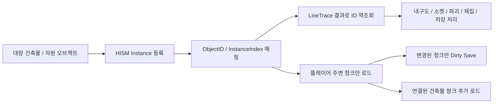
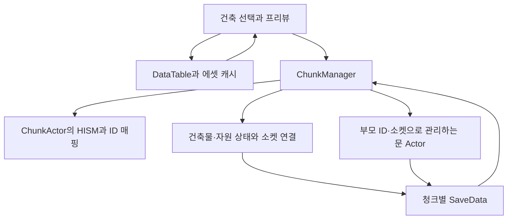

# Survival Game - Unreal Engine C++ 클라이언트 포트폴리오

> Unreal Engine C++ 기반 3D 생존/액션 게임 클라이언트 프로젝트입니다.  
> 대량으로 배치되는 건축물과 자원을 **HISM 기반 청크 시스템**으로 관리하고,  
> **ID / InstanceIndex 매핑**, **청크 스트리밍**, **Dirty Chunk 저장/로드**, **DataTable 기반 콘텐츠 관리**, **AI 전투 시스템**을 구현했습니다.

파일코드 업뎃안함!!!!!!!!주의!!!!!

## 영상


- [영상 링크](https://youtu.be/0txWLSwWrPc?si=d2CH1-GF88vsjKtm)
  
건축 시스템, HISM 기반 오브젝트 관리, 청크 스트리밍, Dirty Save, 인벤토리/퀘스트 UI, AI 전투와 보스 Phase 패턴을 보여주는 시연 영상입니다.

---

<a id="table-of-contents"></a>
## 목차

- [1. 프로젝트 개요](#overview)
- [2. 핵심 기술 요약](#tech-summary)
- [3. 시스템 구조](#system-architecture)
- [4. 핵심 기술 상세](#core-tech)
  - [4.1 HISM 기반 청크 월드 관리](#hism-chunk-world)
  - [공통 배경: Chunk System를 사용한 이유](#chunk-systems)
  - [4.2 Dirty Chunk 기반 저장/로드](#dirty-chunk-save-load)
  - [4.3 플레이어 위치 기반 청크 스트리밍](#chunk-streaming)
  - [4.4 소켓 기반 건축 연결과 HISM·Actor 혼합 구조](#socket-building-state)
  - [4.5 데이터 기반 건축 시스템과 에셋 로드](#data-driven-building)
  - [4.6 인벤토리 / 제작 / 퀘스트 UI](#inventory-crafting-quest)
  - [4.7 AI 전투 시스템](#ai-combat)
- [5. 코드 구조](#code-structure)
- [6. 공통 측정 환경](#measurement-method)
- [7. 설계상 트레이드오프](#tradeoffs)
- 
---

<a id="overview"></a>
## 1. 프로젝트 개요

| 항목 | 내용 |
|---|---|
| 프로젝트명 | Survival Game |
| 장르 | 3D 생존 / 액션 / 제작 / 건축 |
| 엔진 | Unreal Engine C++ 4.26 |
| 담당 영역 | 클라이언트 시스템 설계 및 구현 |
| 주요 구현 | 청크 스트리밍, HISM 인스턴싱, 건축 시스템, 저장/로드, 인벤토리, 제작, 퀘스트, AI 전투 |
| 개발 인원 | 1명 |
| 개발 기간 | 3~4개월 |

### 프로젝트 방향

생존·건축 게임에서 계속 늘어나는 건축물과 자원을 어떻게 관리할지에 초점을 맞췄습니다.

정적 건축물과 자원은 HISM 인스턴스로 묶고, 내구도와 소켓 연결 같은 상태는 ID를 기준으로 따로 관리했습니다. 각 오브젝트를 배치하고 파괴할 수 있도록 하면서, 필요한 지역만 로드하고 변경 내용을 저장하는 구조로 만들었습니다.


---


<a id="tech-summary"></a>
## 2. 핵심 기술 요약

| 핵심 기술 | 설명 |
|---|---|
| HISM과 ID 기반 상태 관리 | 건축물과 자원을 HISM으로 묶고, 인스턴스 번호와 ID를 연결해 개별 상태를 관리했습니다. 삭제·업그레이드로 인스턴스 번호가 바뀌면 연결 정보도 갱신했습니다. |
| 연결 관계를 고려한 청크 스트리밍 | 월드를 청크 단위로 나눠 플레이어 주변 청크를 로드하고, 멀어진 청크는 언로드했습니다. 다만 소켓으로 연결된 바깥 청크는 함께 로드했습니다. |
| Dirty Chunk 저장 | 월드 데이터를 청크 단위로 나누고, 변경된 청크의 내용만 저장 데이터에 반영했습니다. |
| 소켓 연결과 지지 판정 | 소켓 사용 여부를 관리하고, 파괴 후 연결된 건축물에 지지 기반이 남아 있는지 검사했습니다. 정적 건축물은 HISM, 문은 Actor로 관리했습니다. |
| 데이터·게임플레이 연동 | 건축물 정보와 에셋 로드를 분리하고, 인벤토리·제작·퀘스트·Behavior Tree 기반 전투를 구현했습니다. |


### 핵심 설계 흐름



HISM는 ID 기반 상태 데이터와 연결해 개별 건축물/자원처럼 다룰 수 있게 만들었습니다. 

청크 스트리밍은 멀어진 HISM 인스턴스와 충돌 데이터를 월드에서 제거하고, Runtime SaveData 캐시만 남기는 방식으로 구현했습니다.

---

<a id="system-architecture"></a>
## 3. 시스템 구조



ChunkManager는 로드된 오브젝트의 상태와 청크 로드·언로드를 관리합니다. 

ChunkActor는 청크 내부에서 같은 Mesh를 HISM으로 묶고, Hit 결과의 InstanceIndex를 ID로 바꿔줍니다. 


---

<a id="core-tech"></a>
## 4. 핵심 기술 상세

<a id="hism-chunk-world"></a>
### 4.1 HISM 기반 청크 월드 관리

#### 문제

건축물과 자원을 모두 개별 Actor로 두면, 수량이 늘어날수록 Actor와 Component의 관리 비용도 커집니다. 

그래서 같은 Mesh를 반복해서 사용하는 오브젝트를 묶어 관리할 방법이 필요했습니다.

#### 왜 HISM을 선택했나?

| 방법 | 검토한 점 | 현재 프로젝트에서의 판단 |
|---|---|---|
| 개별 Actor 유지 + Tick 비활성화 | 매 프레임 실행되는 처리를 줄일 수 있음 | Actor와 Component 수는 그대로 남음 |
| 거리 기반 숨김 / 충돌 비활성화 | 멀리 있는 오브젝트의 표시·충돌 부담을 줄일 수 있음 | 오브젝트 자체는 월드에 남아 있어 보조 방법으로 검토 |
| Object Pooling | Actor를 재사용해 생성·제거 부담을 줄일 수 있음 | 이미 배치된 Actor 수를 줄이는 목적과는 다름 |
| Mesh 병합 / HLOD | 배경 Mesh를 묶어 표시하는 데 활용 가능 | 개별 배치·파괴·업그레이드가 필요해 현재 건축물 관리 방식으로는 선택하지 않음 |
| ISM | 같은 Mesh를 인스턴스로 묶을 수 있음 | 아래 비교에서 HISM보다 프레임 성능이 낮았음 |
| HISM | 같은 Mesh를 인스턴스로 묶으며, 아래 비교에서 프레임 성능이 좋았음 | 개별 상태를 ID로 관리하는 구조를 추가해 선택 |

결국 HISM을 쓰되, HISM 인스턴스를 개별 게임 오브젝트처럼 다루기 위한 **ID 기반 관리 구조**로 만들었습니다.

#### 구현

각 건축물과 자원에 고유 ID를 발급하고, 상태를 별도 Map에 저장했습니다.

| 데이터 | 관리하는 상태 |
|---|---|
| `BuildingMap` | 소속 청크와 인스턴스 번호, 건축물 정보, 내구도, 소켓 연결, 연결된 건축물 ID, 지지 기반 여부 |
| `ResourceMap` | 소속 청크와 인스턴스 번호, 자원 정보, 체력, 자원 타입 |

LineTrace나 Sweep에서 얻은 **HISM Component와 InstanceIndex로 ID를 찾고**, 해당 Map의 상태를 읽어 파괴·업그레이드·채집을 처리했습니다.

인스턴스를 삭제하면 마지막 인스턴스가 빈 자리로 옮겨질 수 있어, 이 번호를 고유 ID로 사용할 수 없었습니다. 

그래서 삭제 후 옮겨진 인스턴스를 확인하고, **청크에 기록한 ‘인스턴스 번호→ID’와 상태 Map의 InstanceIndex를 함께 바꿨습니다.**

```text
LineTrace Hit
    ↓
HISM Component + InstanceIndex
    ↓
ChunkActor에서 ObjectID 역조회
    ↓
BuildingMap / ResourceMap 접근
    ↓
Damage / Destroy / Upgrade / Harvest / Save 처리
```

| Damage & Destroy | Upgrade |
|---|---|
|  |  |

 Harvest | Save & load |
|---|---|
|  |  |


#### 측정 결과

4,500개 오브젝트를 같은 개수·배치 기준으로 비교했습니다.

| 방식 | 생성 시간(ms) | 평균 FPS | Game Thread(ms) | GPU(ms) | Draw Calls | 비고 |
|---|---:|---:|---:|---:|---:|---|
| Actor | 2,155.8 | 68.0 | 14.7 | 14.7 | 4,676 | 개별 Actor 4,500개 Spawn |
| ISM | 15.3 | 81.5 | 8.8 | 12.8 | 1,096 | 단일 ISM Component |
| HISM | 15.6 | 129.0 | 7.0 | 8.2 | 1,254 | 단일 HISM Component |
| Chunk-HISM | 28.8 | 131.0 | 7.1 | 8.2 | 1,614 | 청크/ID/소켓 관리 포함 |

Chunk-HISM은 단일 HISM보다 생성 시간과 Draw Calls는 늘었지만, FPS/GPU 시간은 비슷했습니다.

결국 Actor 수를 줄인 대신 **인스턴스 삭제, 내구도, 소켓 연결, 저장 상태를 직접 맞춰야 하는 관리 비용**이 생겼지만, 청크별 로드·언로드와 상태 관리가 필요했기 때문에 Chunk-HISM 구조를 선택했습니다.


#### 관련 코드
<details>
<summary>관련 코드 보기</summary>

```text
PP/Chunk/ChunkActor.h / .cpp
  AddInstance / RemoveInstance / GetMeshID
PP/Chunk/ChunkManager.h / .cpp
  UpgradeBuilding / RemoveOnlyBuilding / DestroyResource
```

</details>

---

<a id="chunk-systems"></a>
### 청크 시스템을 사용한 이유

청크 시스템은 처음에는 스트리밍용으로 만든 것이 아니었습니다.  

월드 좌표를 `FChunkCoords`로 바꾸고, 그 좌표를 키로 건축물이나 자원을 빠르게 찾기 위한 구조였습니다.

하지만 이 방식은 포트나이트처럼 정해진 격자에 맞춰 배치하는 시스템에 더 어울렸습니다.

이 프로젝트는 러스트나 더 포레스트처럼 플레이어가 원하는 위치와 방향으로 자유롭게 배치하는 방식을 목표로 했기 때문에, 청크 좌표만으로 특정 건축물을 식별하기 어려웠습니다.

그래서 상호작용 대상은 `HISM Component + InstanceIndex`로 찾고, 청크 시스템은 **청크 스트리밍**과 **Dirty Chunk 기반 저장/로드**에 활용하는 방향으로 전환했습니다.


<a id="dirty-chunk-save-load"></a>
### 4.2 Dirty Chunk 기반 저장/로드

#### 문제

청크 좌표는 자유 배치된 건축물을 직접 찾는 용도로는 한계가 있었지만 저장/로드 단위로는 잘 맞았습니다.

월드 전체를 매번 저장하면 건축물과 자원이 많아질수록 저장 대상이 계속 커지고, 플레이어가 일부 지역만 수정했더라도 전체 데이터를 다시 만들어야 합니다.

그래서 **청크별로 변경 여부를 표시하고, 바뀐 청크만 다시 구성**하도록 했습니다.

#### 구현

배치·파괴·업그레이드·자원 채집으로 상태가 바뀌면 해당 청크를 `DirtyChunks`에 넣었습니다. 저장할 때 이 청크의 데이터만 다시 만들어 기존 저장 데이터에 반영하고, 오브젝트가 모두 없어진 청크 데이터는 제거했습니다.

| 저장 대상 | 저장 내용 |
|---|---|
| 건축물 | ID, 정의 이름, Transform, 내구도, SocketMap |
| 자원 | ID, 정의 이름, Transform, 체력, 자원 타입 |
| 문 Actor | 부모 건축물 ID, 부모 소켓 이름, 정의 이름, Transform, 내구도 |

복원은 문같은 경우 붙어 있을 부모 건축물이 먼저 필요하기 때문에 **인스턴스 생성 → 소켓 연결 복원 → 문 Actor 복원** 순서로 처리했습니다. 

연결된 건축물 목록은 저장된 SocketMap에서 다시 만들었습니다. 복원한 오브젝트를 새로 배치한 것으로 처리하지 않도록, 복원 중에는 변경 표시를 잠시 막았습니다.

#### 추가 문제: 언로드 후 이전 상태로 돌아가는 경우

스트리밍으로 청크를 제거할 때 변경 내용을 남기지 않으면, 다시 로드할 때 파괴·업그레이드 이전 상태로 돌아갈 수 있었습니다.

그래서 실행 중 메모리에 저장 데이터를 보관하는 **저장 캐시(Runtime SaveData 캐시)를** 유지했습니다.

변경된 청크는 언로드하기 전에 캐시에 반영하고, 다시 로드할 때 이 데이터를 사용했습니다. 수동 저장 시에는 아직 남아 있는 변경도 반영한 뒤 파일에 기록했습니다.

| 청크 저장 캐시 동기화 | 
|---|
|  |

내구도를 줄이고 업그레이드한 뒤, 청크를 언로드했다 다시 로드해도 변경 상태가 유지되는 시연입니다.

#### 측정 결과

스트리밍을 끄고 625개 청크를 로드한 테스트 월드에서 비교했습니다. 

Full Save는 전체 청크의 저장 데이터를 다시 만들고, Dirty Save는 기존 파일을 읽은 뒤 변경된 청크만 다시 만들어 반영했습니다.

| 방식 | 전체 청크 | 변경 청크 | 재구성 청크 | 재구성(ms) | 전체 저장(ms) |
|---|---:|---:|---:|---:|---:|
| Full Save | 625 | - | 625 | 287.965 | 329.165 |
| Dirty Save - 1개 청크 | 625 | 1 | 1 | 0.975 | 93.710 |
| Dirty Save - 5개 청크 | 625 | 5 | 5 | 3.142 | 96.147 |

전체 625개 청크 대신 변경된 청크의 데이터만 다시 만들도록 했습니다. 

그 결과 전체 저장 시간이 약 329ms에서 94~96ms로 줄어, 일부 지역만 바뀌는 상황에서 저장 속도를 개선할 수 있었습니다.

#### 관련 코드
<details>
<summary>관련 코드 보기</summary>

```text
PP/Chunk/ChunkSaveGame.h
PP/Chunk/ChunkManager.cpp
  SaveWorld / SaveWorldFull / SaveWorldDirty / LoadWorld
  BuildChunkSaveData / SaveLoadChunkCache / FlushDirtyChunksSaveCache
  LoadChunkRuntime / SpawnAttachBuildableSaveData
```

</details>

---

<a id="chunk-streaming"></a>
### 4.3 플레이어 위치 기반 청크 스트리밍

#### 문제

Dirty Save로 저장 비용을 줄여도, 모든 지역의 HISM과 충돌 데이터를 계속 월드에 두면 런타임 관리 비용은 남습니다.

그래서 청크를 저장 단위뿐 아니라 로드/언로드 단위로도 사용했습니다. 

#### 구현

플레이어 위치를 기준으로 중심 청크를 계산하고, 반경 안의 청크만 로드했습니다.  

멀어진 청크는 필요한 변경 내용을 저장 캐시에 반영한 뒤 HISM과 문 Actor, 사용 중인 상태 데이터를 월드에서 제거했습니다. 다시 가까워지면 캐시를 읽어 복원했습니다.

| 청크 스트리밍 | 
|---|
|  |


#### 추가 문제와 개선: 경계 밖 연결도 유지

기본 반경만 로드하면 문제가 생길 수 있습니다.  
예를 들어 현재 청크의 천장이 바깥 청크의 기초 건축물(Foundation)에 연결되어 있다면, 바깥 청크가 언로드되면서 지지 구조나 소켓 연결 판정이 어긋날 수 있습니다.

이를 보완하기 위해 다음 순서로 최종 로드 범위를 정했습니다.

1. 소켓 연결이 바뀐 청크를 `GraphDirtyChunks`에 표시하고, 저장 캐시에 먼저 반영합니다.
2. 기본 반경의 청크를 확인할 목록에 넣습니다.
3. 청크의 저장된 SocketMap을 읽고, 연결된 건축물이 다른 청크에 있으면 그 청크도 목록에 추가합니다.
4. 추가한 청크의 연결도 같은 방식으로 확인한 뒤, 최종 목록에 맞춰 로드·언로드합니다.

이 탐색에는 BFS를 사용하여 큐에 청크를 넣어 순서대로 확인하고, 이미 포함한 청크는 다시 추가하지 않았습니다.


| 청크 연결 스트리밍 | 
|---|
|  | 

이동할 때만 로드 목록을 갱신하면 새로 필요한 청크를 놓치거나, 더 이상 필요 없는 청크를 계속 남길 수 있습니다. 그래서 플레이어가 다른 청크로 이동했을 때뿐 아니라, 소켓 연결이 바뀌었을 때도 로드할 청크를 다시 계산했습니다.

#### 측정 결과

전체 월드는 7×7청크입니다. Radius 1은 중심을 포함한 3×3, Radius 2는 5×5를 유지합니다. Connected는 기본 3×3에 연결 청크 1개를 더 로드한 경우입니다.

Clean은 변경 없이 이동하고, Dirty는 활성 청크마다 건축물 1개를 추가한 뒤 언로드했습니다.

| 케이스 | ActiveChunks | ActiveInstances | ActiveHISMComponents |
|---|---:|---:|---:|
| 전체 로드 | 49 | 2729 | 980 |
| Radius 1, Clean | 9 | 507 | 180 |
| Radius 1, Dirty | 9 | 516 | 180 |
| Radius 2, Clean | 25 | 1385 | 500 |
| Radius 2, Dirty | 25 | 1410 | 500 |
| Radius 1, Connected Clean | 10 | 562 | 200 |
| Radius 1, Connected Dirty | 10 | 572 | 200 |

##### 로드 / 언로드 비용

`AvgLoad`·`AvgUnload`는 청크 한 개의 평균 처리 시간입니다.

`CacheFlushCount`와 `AvgCacheFlush`는 측정 구간의 캐시 반영 횟수와 평균 시간으로, 디스크 저장 비용은 아닙니다. 

| 케이스 | AvgLoad(ms) | AvgUnload(ms) | CacheFlushCount | AvgCacheFlush(ms) |
|---|---:|---:|---:|---:|
| 전체 로드 | - | - | - | - |
| Radius 1, Clean | 1.185 | 0.436 | 0 | - |
| Radius 1, Dirty | 1.203 | 0.474 | 9 | 0.117 |
| Radius 2, Clean | 1.205 | 0.436 | 0 | - |
| Radius 2, Dirty | 1.224 | 0.528 | 25 | 0.178 |
| Radius 1, Connected Clean | 1.219 | 0.440 | 0 | - |
| Radius 1, Connected Dirty | 1.254 | 0.494 | 10 | 0.107 |


이번 테스트에서 청크 한 개의 데이터를 저장 캐시에 반영하는 데 걸린 시간은 평균 0.107~0.178ms였습니다. 다만 여러 청크를 같은 프레임에 처리하면 전체 처리 시간은 더 늘어날 수 있습니다.

연결 청크를 더 로드하면 유지하는 오브젝트도 늘어납니다. 이 비용은 청크 경계에서도 건축물의 연결과 지지 판정이 이어지도록 하기 위해 받아들였습니다.

#### 관련 코드
<details>
<summary>관련 코드 보기</summary>

```text
PP/Chunk/ChunkManager.cpp
  UpdateChunkStreamingAroundLocation
  BuildWantChunkSet / BuildConnectedWantedChunkSet
  LoadChunkRuntime / UnloadChunkRuntime
  RebuildChunkDataIndex / AppendChunkStreamingCSV
```

</details>

---

<a id="socket-building-state"></a>
### 4.4 소켓 기반 건축 연결과 HISM·Actor 혼합 구조

#### 문제

건축 시스템은 완전 자유 배치만으로는 부족했습니다.  
벽, 바닥, 천장, 계단, 문틀처럼 서로 맞물려야 하는 건축물은 위치와 회전이 정확해야 하고, 어떤 건축물의 어느 지점에 붙었는지도 계속 관리해야 했습니다.

단순히 충돌 검사만으로 가까운 건축물을 찾는 방식도 애매했는데 연결이 불가능한 건축물이거나, 이미 사용 중인 연결 지점에 다른 건축물이 또 붙는 문제도 생길 수 있기 때문입니다.

#### 정적 건축물과 문을 나눈 이유

벽·바닥·천장·창문·계단은 배치 후 HISM에 등록했습니다. 문은 열림·닫힘 동작과 상호작용이 필요해 Actor로 유지했습니다.

#### 검토한 방식

| 방식 | 검토한 점 | 판단 |
|---|---|---|
| 모든 건축물을 HISM으로 관리 | Actor 수를 줄일 수 있지만 문의 동작과 상태도 별도로 처리해야 함 | 현재 범위에서는 구현이 복잡해짐 |
| 상호작용할 때만 HISM을 Actor로 전환 | 평상시 Actor 수를 줄일 수 있지만 위치·충돌·애니메이션·연결·저장 상태를 전환할 때마다 맞춰야 함 | 상호작용 오브젝트가 많아질 경우 검토할 후보 |
| 정적 건축물은 HISM, 문은 Actor로 유지 | 문을 별도로 관리해야 하지만 전환 처리가 필요 없음 | 현재 프로젝트에서는 이 방식 선택 |

#### 구현

건축물 연결은 Mesh에 미리 정한 연결 지점인 **Static Mesh Socket**을 사용한뒤, 허용된 소켓 중 가까운 곳에 프리뷰를 맞추고, 그 소켓을 이미 사용 중인지와 다른 물체와의 충돌을 확인했습니다.

배치가 끝나면 양쪽 건축물의 SocketMap에 소켓 이름과 연결된 건축물 ID를 기록하고, 연결된 건축물 목록인 `ConnectedBuildingIDs`도 함께 갱신했습니다.

SocketMap은 저장과 연결 청크 탐색에 사용하고, ConnectedBuildingIDs는 파괴 후 지지 판정에 사용했습니다. 저장 파일을 읽을 때는 SocketMap으로 이 목록을 다시 만들었습니다.

문에는 새 BuildingID를 발급하지 않고 **부모 건축물 ID와 소켓 이름**으로 관리하고, 저장할 때도 부모 정보·Transform·내구도를 기록해 복원했고, 부모가 파괴되면 문도 제거했습니다. 

```text
Build Preview
    ↓
라인트레이스로 연결 대상 건축물 탐색
    ↓
배치 가능한 타입 / 소켓인지 확인
    ↓
가장 가까운 유효 소켓 찾기
    ↓
Preview Transform을 소켓 기준으로 보정
    ↓
충돌 검사 및 배치 가능 여부 확인
    ↓
배치 확정
    ↓
정적 건축물은 HISM Instance로 등록
문 같은 부착형 오브젝트는 Actor로 유지
    ↓
소켓 점유 정보와 연결된 건축물 목록 갱신
```

| 소켓 기반 건축 | 
|---|
|  |


#### 보완한 부분: 충돌 검사에서 연결 그래프 기반 지지 판정으로 변경

처음에는 파괴된 건축물 주변을 충돌 검사로 찾아 지지 관계를 확인했습니다. 여러 건축물이 무너질 때 검사가 반복되고, 가까이 있지만 실제로 연결되지 않은 건축물까지 포함될 수 있었습니다.

그래서 배치할 때 확정한 `ConnectedBuildingIDs`를 사용했습니다.

1. 파괴 대상의 연결 이웃을 저장하고, 대상과 소켓 연결을 제거합니다.
2. 남은 이웃에서 BFS로 연결 그룹을 찾습니다. 방문한 ID는 다시 검사하지 않습니다.
3. 그룹 안에 `IsAnchor`인 건축물이 있으면 유지하고, 없으면 그룹 전체를 제거합니다.

| 기반 파괴 | 
|---|
|  |


#### 관련 코드
<details>
<summary>관련 코드 보기</summary>

```text
PP/Buildable/BuildManagerComponent.cpp
  FindClosestSocket / Building
PP/Buildable/Buildable.cpp
  Build / BuildDestroy / TakeDamage
PP/Buildable/OpenDoorBuildable.cpp
  Build / PlayerOpenDoor
PP/Chunk/ChunkManager.cpp
  AddSocket / AddHISMAttachBuildActor / RemoveHISMAttachBuildActor
  DestroyBuilding / DisconnectBuilding / RemoveOnlyBuilding
```

</details>

---

<a id="data-driven-building"></a>
### 4.5 데이터 기반 건축 시스템과 에셋 로드

건축물마다 클래스·Mesh·내구도·배치 조건을 코드에 직접 넣으면 종류가 늘 때 수정할 곳도 늘어납니다. 그래서 필요한 정보를 `BuildDataTable`의 `FBuildDefinitionInfo`로 모았습니다. 건축 타입과 재질, 연결 가능한 소켓·건축물 종류, 지지 기반 여부, 업그레이드할 건축물 정보도 함께 관리했습니다.

클래스·Static Mesh·Destructible Mesh는 에셋 경로를 참조하는 Soft Reference로 두었습니다. 실제 로드와, 한 번 읽은 에셋을 보관해 재사용하는 처리는 BuildAssetSubsystem에서 담당했습니다.

| 상황 | 처리 |
|---|---|
| 건축할 종류 선택 | 비동기로 에셋을 불러오고, 준비되면 프리뷰 생성 |
| 이미 불러온 종류를 다시 선택 | 보관한 에셋 재사용 |
| 저장 데이터로 청크 복원 / 건축물 업그레이드 | 에셋이 없으면 로드가 끝날 때까지 기다린 뒤 생성·등록 |

에셋을 불러오는 사이 다른 건축물을 선택할 수 있어, **로드가 끝났을 때도 같은 건축물을 선택 중인지 확인**한 뒤 프리뷰에 반영했습니다.

기존 건축물과 같은 방식으로 배치하고 동작하는 종류라면, DataTable에 항목을 추가하고 사용할 Mesh와 클래스를 지정해 늘릴 수 있습니다. 새로운 동작이나 배치 규칙이 필요하면 그 부분은 코드도 추가해야 합니다.

#### 관련 코드
<details>
<summary>관련 코드 보기</summary>

```text
PP/GameInfo.h
  FBuildDefinitionInfo
PP/AssetManager/BuildAssetSubsystem.h / .cpp
  RequestAsync / ResolveSync / ResolveLoad
PP/Buildable/BuildManagerComponent.cpp
  SetBuildData / Building
```

</details>

---

<a id="inventory-crafting-quest"></a>
### 4.6 인벤토리 / 제작 / 퀘스트 UI

#### 구현

- 인벤토리 20칸과 퀵슬롯 6칸을 구성하고, `DTItemTable`의 아이콘·타입·장비 정보를 사용했습니다.
- 제작 목록은 무기·장비·건축 아이템·음식으로 필터링하고, 제작 재료와 결과 수량을 표시했습니다.
- `DTQuest`에서 목표와 보상을 읽고, 사냥·제작 시 진행도를 갱신해 완료 보상을 지급했습니다.

| 인벤토리 UI | 퀘스트 UI |
|---|---|
|  |  | 


#### 관련 코드
<details>
<summary>관련 코드 보기</summary>

```text
PP/Widget/InventoryTile.cpp / UseInventoryTile.cpp
PP/Widget/Crafting.cpp / SelectedBlueprintInfo.cpp / QuestWidget.cpp
PP/GameInfo.h / PPGameInstance.cpp
```

</details>

---

<a id="ai-combat"></a>
### 4.7 AI 전투 시스템

#### 구현 내용

- 몬스터의 순찰, 추적, 공격, 도주를 Behavior Tree Task로 분리했습니다.
- Player Detect Service와 Decorator로 타겟 감지, 거리 조건, 보스 Phase 조건을 나눠 처리했습니다.
- 보스 Morigesh는 Phase에 따라 보호막, 좀비 소환, 폭발, 메테오, 단검 공격 패턴을 사용합니다.


| 몬스터 탐지 및 추척, 공격 | 
|---|
|  |


#### 관련 코드
<details>
<summary>관련 코드 보기</summary>

```text
PP/AI/BTService_PlayerDetect.cpp
PP/AI/BTDecorator_CheckDistance.cpp / BTDecorator_CheckPhase.cpp
PP/AI/BTTask_Patrol.cpp / BTTask_TargetTrace.cpp
PP/AI/BTTask_NormalAttack.cpp / BTTask_Getaway.cpp
PP/AI/BTTask_MorigeshPhase0.cpp
PP/AI/UBTTask_MorigeshPhase1.cpp / UBTTask_MorigeshPhase2.cpp
PP/Character/Monster/Morigesh.cpp / MorigeshAnim.cpp
```

</details>

---


<a id="code-structure"></a>
## 5. 코드 구조

```text
PP/
├── AI/                  # Behavior Tree Task, Service, Decorator
├── AssetManager/        # 건축 에셋 비동기 로드 및 캐싱
├── Buildable/           # 건축물 Actor, 건축 매니저, 문/벽/창문/천장/계단 등
├── Character/
│   ├── Player/          # 플레이어 이동, 전투, 건축, 인벤토리 연동
│   └── Monster/         # 몬스터, 보스, AI Controller, Anim
├── Chunk/               # 청크, HISM 인스턴싱, 저장/로드, 스트리밍
├── Customizer/          # 캐릭터 커스터마이징
├── Equipment/           # 무기, 장비, 소비 아이템, 화살 등
├── Environments/        # 나무/돌 등 채집 자원
├── Effect/              # 투사체, 보스 스킬, 실드, 이펙트
├── Tools/               # 벤치마크, 포털, 아이템 박스
└── Widget/              # 인벤토리, 제작, 퀘스트, HUD
```

---

<a id="measurement-method"></a>
## 6. 공통 측정 환경

| 항목 | 값 |
|---|---|
| CPU | Intel i9 12900kf |
| GPU | GeForce RTX 3050 |
| RAM | DDR4 32GB |
| OS | 윈도우 11 |
| Unreal Engine Version | 4.26 |
| Build Type | Editor PIE - New Editor Window |
| Resolution | 1280 x 720 |
| 측정 횟수 | 평균 3~5회 |


<a id="tradeoffs"></a>
## 7. 설계상 트레이드오프

### HISM 선택으로 인한 상태 관리 비용

HISM으로 건축물과 자원을 관리하면서 Actor / Component 수는 줄일 수 있었습니다.  
대신 HISM 인스턴스는 Actor처럼 자체 상태를 가질 수 없기 때문에, `BuildingID`, `ResourceID`를 기준으로 `BuildingMap`, `ResourceMap`에서 상태를 따로 관리했습니다.

즉, 렌더링과 Actor 관리 비용은 줄인 대신, 내구도, 소켓 연결, 파괴 상태 같은 개별 오브젝트 데이터를 직접 관리해야 하는 비용이 생겼습니다.

### 연결 청크 로드와 SaveData 캐시

청크 밖에 연결된 건축물이 누락되지 않도록 `SocketMap`을 따라 기본 반경 밖의 청크도 추가 로드했습니다.  
이 방식은 소켓 연결과 지지 구조를 안정적으로 유지할 수 있지만, 큰 건축물이 여러 청크에 걸쳐 있으면 활성 청크 수가 늘어날 수 있습니다.

또 연결 청크 계산은 Runtime SaveData 캐시를 기준으로 하기 때문에, 연결 구조가 바뀐 청크는 스트리밍 계산 전에 캐시에 먼저 반영되도록 처리했습니다.  
덕분에 언로드된 청크의 연결 정보도 탐색할 수 있었지만, 런타임 상태와 SaveData 캐시가 어긋나지 않게 Dirty Chunk 반영 타이밍을 신경 써야 했습니다.

### HISM ↔ Actor Hybrid 구조

벽, 바닥, 천장처럼 많이 배치되는 정적 건축물은 HISM으로 관리하고, 문처럼 상호작용이 필요한 오브젝트는 Actor로 유지했습니다.  
현재 프로젝트에서는 상호작용 오브젝트가 문 중심이라 Actor 수 증가가 많지 않았고, 구현도 더 안정적이었습니다.

다만 보관함, 제작대, 화로, 함정처럼 상태를 가진 상호작용 오브젝트가 많아지면 Actor 수와 별도 저장 데이터가 함께 늘어날 수 있습니다.

추후에는 평상시에는 HISM으로 두고, 상호작용 시점에만 Actor로 전환하는 구조로 확장할 수 있습니다.

### 청크 복원 경로의 동기 로드

건축 프리뷰 에셋은 `RequestAsync`로 비동기 로드하지만, SaveData를 기준으로 청크를 복원하는 `AddBuildingInstanceDefinitionName` / `SpawnAttachBuildableSaveData` 경로는 `ResolveSync`를 사용했습니다.

이 방식은 구현이 단순하고 즉시 복원이 쉽지만, 청크 크기와 오브젝트 수가 커지면 순간적인 비용이 생길 수 있습니다.

추후에는 청크 복원도 비동기 에셋 준비 단계와 실제 HISM 등록 단계를 분리하는 방식으로 확장할 수 있습니다.

### 청크 복원 시 순간적인 끊김

청크를 복원할 때는 필요한 에셋을 불러오고 오브젝트를 등록하는 작업을 한 번에 처리합니다. 구현은 단순하지만, 복원할 양이 많으면 게임이 잠깐 끊길 수 있습니다.

이를 줄이려면 에셋을 미리 불러오고, 오브젝트 등록도 여러 프레임에 걸쳐 조금씩 나눠 처리하는 방식을 고려할 수 있습니다.

### 저장 파일 기록 비용

변경된 청크의 데이터만 다시 만들지만, 파일에는 전체 저장 데이터를 기록합니다. 그래서 변경된 청크가 적어도 전체 데이터를 파일에 쓰는 비용은 남습니다.

### 청크에 속한 오브젝트를 찾는 비용

현재는 한 청크의 저장 데이터를 만들 때도 로드된 전체 오브젝트 목록을 확인해, 해당 청크에 속한 것을 찾습니다.

이후에는 오브젝트 목록도 청크별로 나눠 관리하면, 필요한 청크의 목록만 확인하도록 개선할 수 있습니다.


